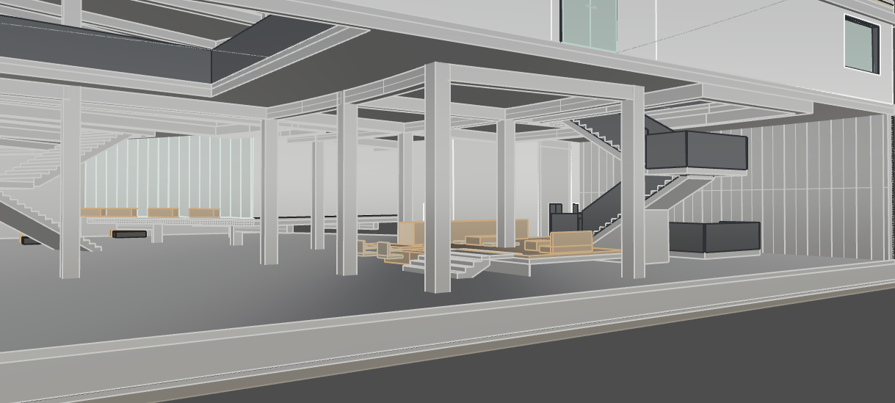
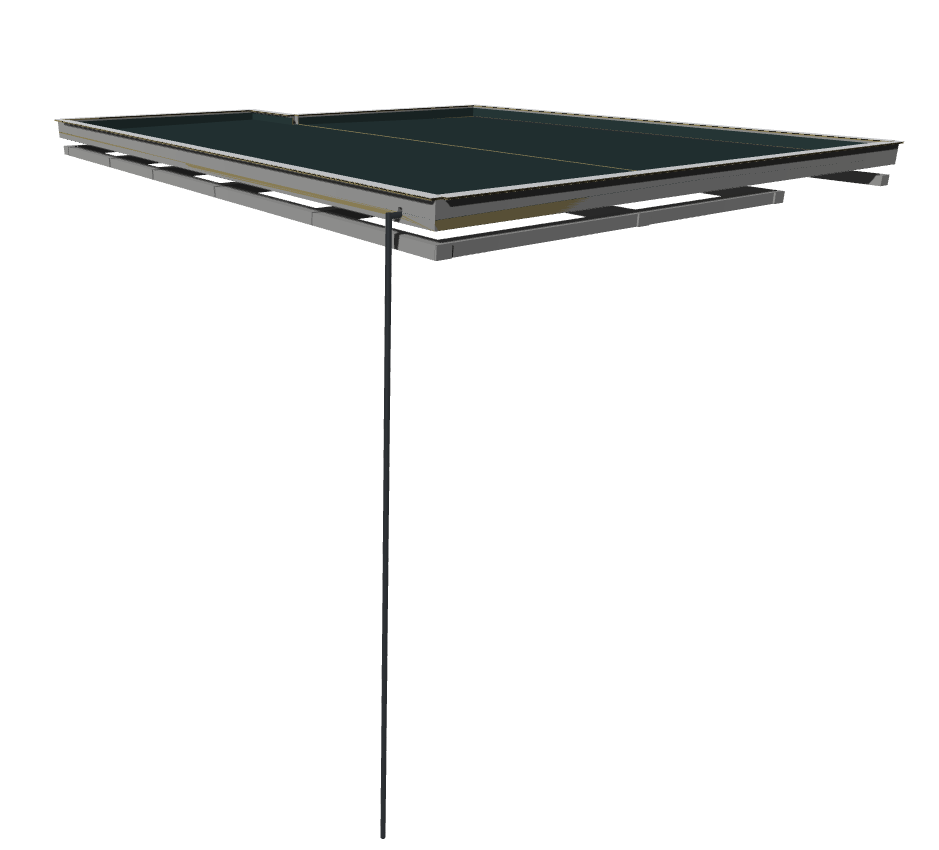

# 공간과 구축을 읽는 설계 판단

## 공간의 의미

건축 요소를 종류나 재료·거리만으로 구분하지 않고, 요소들이 함께 무엇을 가능하게 하는지와 사용·행태·구조적 역할의 관계를 읽는다. 하나의 요소가 여러 공간과 역할에 걸쳐 작용할 수 있고, 물리적으로 떨어진 요소도 하나의 사용이나 역할을 함께 이룰 수 있다.

공간의 의미는 실의 이름이나 도면 기호만으로 결정되지 않는다. 공간의 크기와 형태, 연결과 전이, 경계와 개방, 빛과 시선, 주변 관계를 함께 살피며 그곳에서 가능한 행태를 구상한다. 같은 공간도 이용자와 상황에 따라 다르게 쓰일 수 있다. 설계가 어떤 경험과 선택을 가능하게 하고 무엇을 어렵게 하는지 판단한다.

과업의 규모와 목적에 따라 개인의 생활에서 공동체, 거리와 도시, 주변 환경과 사회적 가치까지 연결해 생각한다. 공간적 구성의 영향과 도면만으로 확정할 수 없는 운영·사회적 효과는 구분하며, 후자는 해석이나 제안으로 다룬다.

### 공간과 의미를 읽기;`Scene`과 `ontological-holon` 활용 예시

Scene은 의미 단위들이 모여 이루는 장면이자 구현할 프로그램이다. Ontological-holon은 그 장면을 이루는 의미 단위다. Rhino Group ID 하나가 이러한 의미 단위에 대응할 수 있고, ontological-holon과 객체는 Scene에 등록할 수 있다. 객체의 물리적 구성뿐 아니라 그것이 가능하게 하는 사용과 역할의 관계를 함께 해석한다.

1. 마루와 계단참

작은 계단참과 마루에서 사람들이 머물고 교류하는 행태가 Scene이다. 그 Scene을 이루는 ontological-holon는 다음처럼 **실물 구성과 그것이 가능하게 하는 것**을 함께 갖는다.

| ontological-holon | 함께 구성하는 요소와 의미 |
|---|---|
| 마루 위 공간을 지지하는 구조 | 기둥·보 여러 개가 함께 위에서 오는 하중을 지지한다. 기둥마다 따로 등록하지 않는다. |
| 사람들이 걸터앉는 마루·계단참 | 지지 콘크리트와 마루 마감이 함께 단차와 앉을 자리를 만든다. 마루라는 실물이면서 걸터앉을 수 있게 하는 장치다. 공유 바닥슬래브 전체를 포함할 필요는 없다. |
| 마루에서 바둑 두는 가구 묶음 | 방석·낮은 탁자·바둑판·바둑알과 통·시계 등이 함께 앉아서 바둑 두는 행위를 가능하게 하고 유도한다. 가구 하나씩 나누지 않고, 그 행위와 사용 관계로 묶는다. |

2. 지붕과 우수관

지붕의 의미에는 덮는 역할과 함께 집수·배수가 이어진다. 우수관이 여러 층을 지나거나 기둥 속 콘크리트에 매립돼 있어도 그 역할이 이어지므로 지붕 ontological-holon에 포함한다. 지붕 안의 구축 시스템과 우수관 element들은 일반 group으로 나눠 관리할 수 있다. **물리적으로 떨어져 있어도 하나의 역할을 이루면 같은 ontological-holon가 될 수 있다.** 두 사례의 [사용자 설명 원문과 사진](component-feedback.md)은 별도로 보존한다.

## 물질적 구성과 공간을 함께 생각하기

Rhino 객체는 건축을 표현하는 편집 단위다. 하나의 실물 부재가 여러 객체로 나뉘거나, 하나의 객체가 복합 구성을 단순화할 수 있다. 따라서 객체 경계와 실물의 이음, 모델의 빈틈과 의도한 공간을 구별하고 표현이 어느 정도까지 구체화되어 있는지 확인한다.

건축 모델링은 공간을 이루는 물질적 구성을 설계하고 구체화하는 일이다. 부재와 재료가 차지하는 부분뿐 아니라 그 사이의 공간, 공간을 연결하거나 나누는 경계를 함께 읽는다. 형상의 크기·두께·방향·배치가 사람의 움직임과 머무름, 빛·시선·환경에 어떤 조건을 만드는지 살핀다.

### 텍토닉: 재료와 구성, 접합

텍토닉은 재료의 성질과 부재의 구성·결합이 건축의 공간과 표현을 성립시키는 방식이다. 재료의 물성과 가공 방식, 부재를 만들고 조립하는 순서는 가능한 형상·치수·접합을 제약한다. 요소를 이해할 때는 이 조건 속에서 부재가 무엇을 받치거나 감싸며, 힘과 기능이 다른 요소로 어떻게 이어지는지 읽는다. 실제 역할과 만드는 방식이 부재의 구분과 연결을 판단하는 근거다.

접합부에는 요소 사이의 의존 관계가 드러난다. 연속돼야 할 부분, 힘이나 기능을 넘겨받는 부분, 서로 움직이거나 교체할 수 있도록 분리할 부분은 서로 다른 구성을 요구한다. 맞닿음·겹침·틈은 이 관계를 표현하는 기하 상태이므로, 각각이 재료·시공·사용 조건에 맞는지 판단한다. 모델에서 면이 맞거나 솔리드가 닫혔다는 사실과, 실제로 조립되고 역할을 수행할 수 있다는 판단은 별도의 근거를 갖는다.

공간과 구축은 함께 발전한다. 부재의 위치와 깊이, 재료의 두께, 접합과 지지 방식은 공간의 여유·개방감·경계의 성질을 바꾸고, 원하는 공간은 다시 구성 방식의 선택에 영향을 준다. 현재 설계 단계에서 판단하려는 내용에 맞춰 형상을 구체화한다. 단순화한 표현으로 남긴 구성과 실제 상세를 결정한 부분을 구별하고, 상세를 추가할 때는 전체 구성과의 관계를 이어 간다.

## 건축 설계란
구상한 프로그램과 사용 행위가 현재 평·단면과 모델, 제안한 구축 방식에서 실제로 성립하는지 검토하고, 충돌이 있으면 프로그램이나 구축 방식을 조정해가며 의도한 사용과 실제 구축이 함께 성립하도록 발전시킨다.
