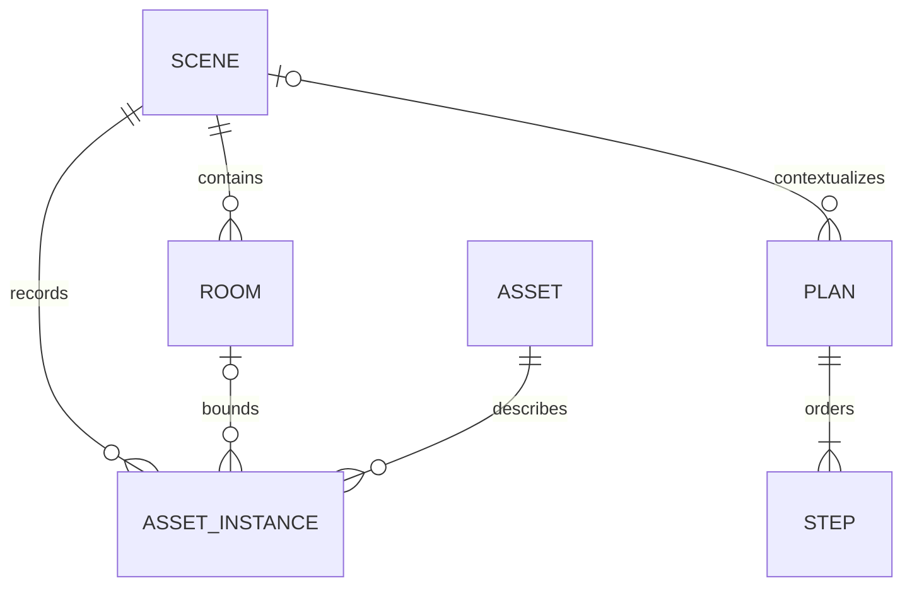
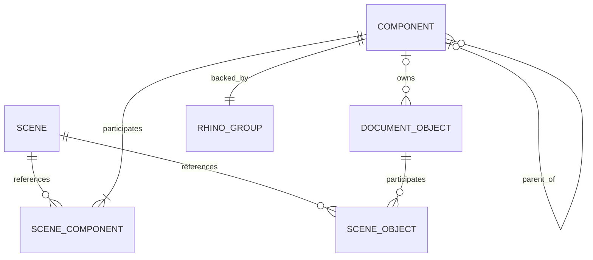
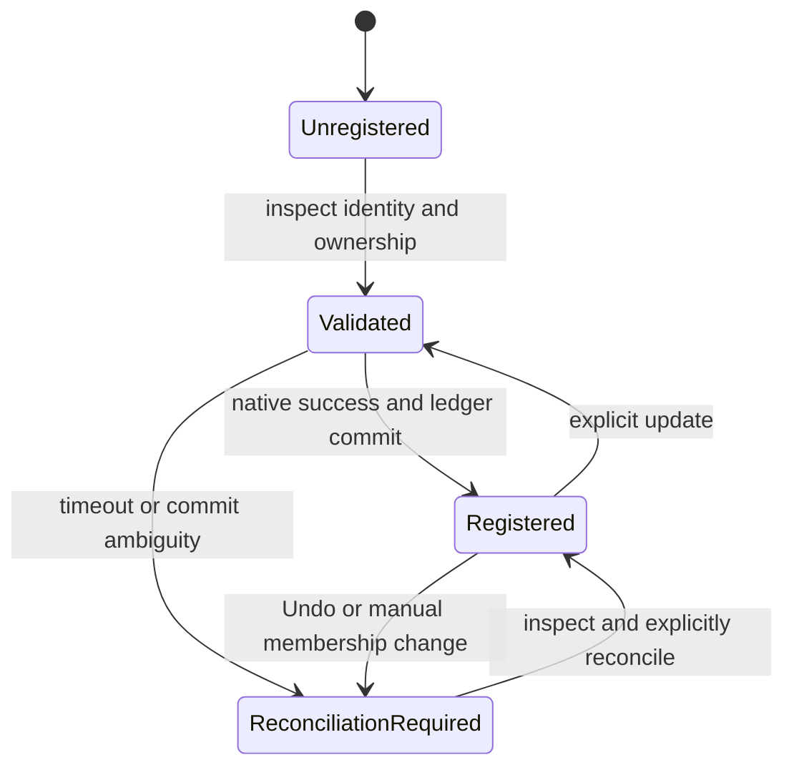
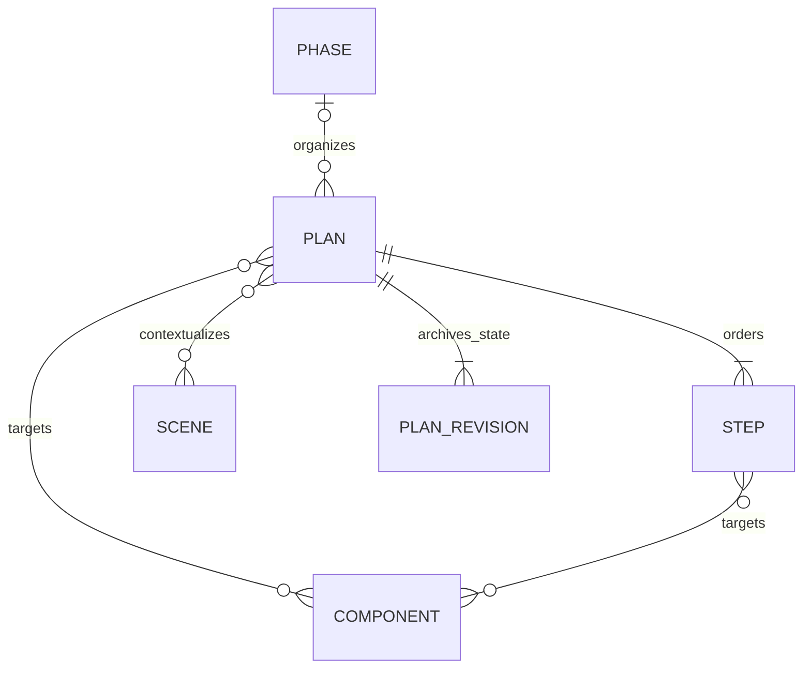
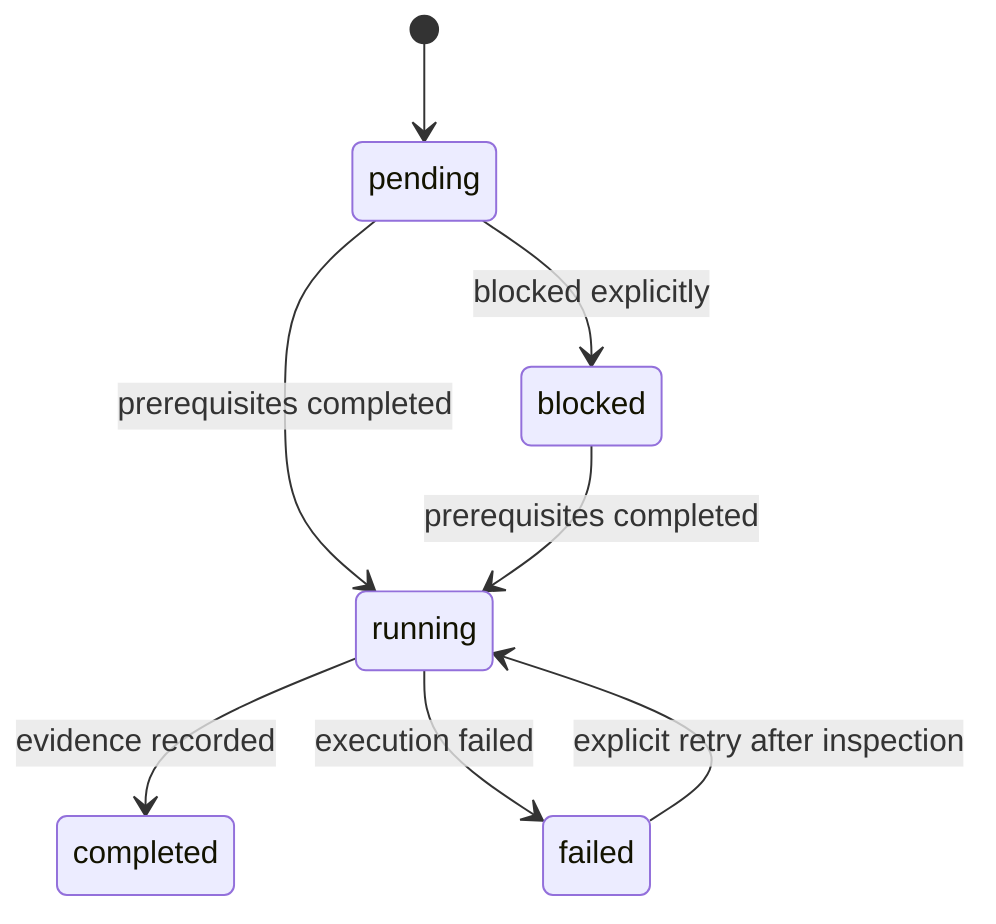
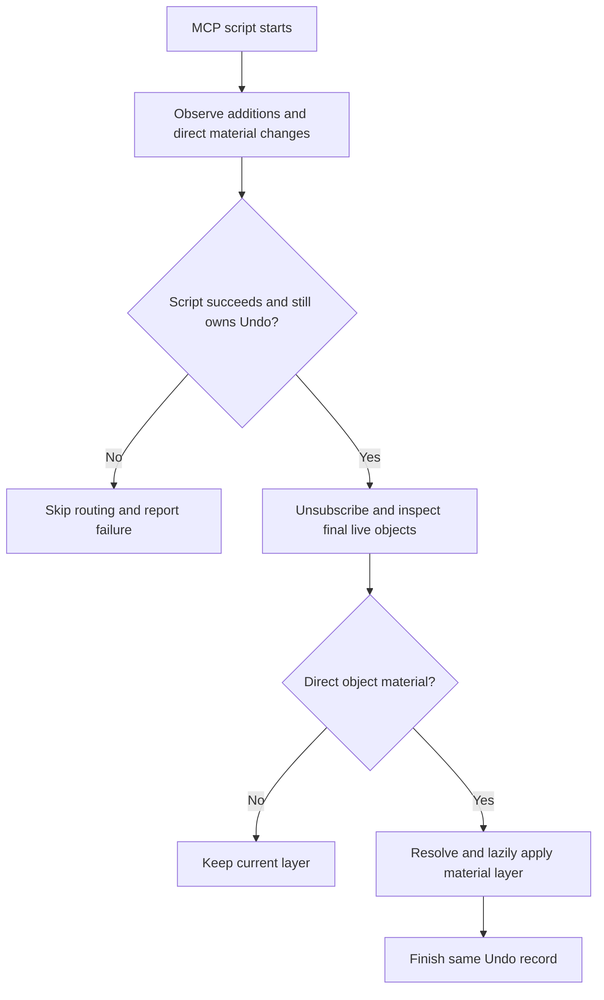

# Scene, Component, planning and material layers

## Scope and baseline

This change starts from `8558e6f` (main, PR #7). The implementation review covered
`server.py`, `retrieval_store.py`, Engine's `shared_store.py` and native request
binding, the COS schema builder/runtime, Bridge execution/observation, material
and construction manifests, asset placement/export consumers, and every helper
in `skills/rhino-almond/scripts`.

The existing scene ledger is independent of Rhino geometry. Rooms are rectangular
space envelopes; instances are asset placements used by collision checks,
room containment, asset retention and structural loads. A recorded Rhino GUID
does not verify that an object exists. Existing plans are manual dependency
ledgers, not executors. Their four templates and status vocabulary are retained.

Existing `scenes.revision` counts recorded ledger mutations. `scene_revisions`
contains operation patches, not complete model snapshots. Some patches omit
metadata and GUIDs, and there is no public replay/rollback mechanism. It must
not be presented as an archive of previous plans or Rhino geometry.

## Physical ownership and spatial context

### Delivery alignment

The delivery gate is one usable workflow: choose a material, model with ordinary
RhinoCommon calls, organize nested Components, read notes in the selected group,
resolve Plan/Step targets, then reuse the assembly in drawings and the asset library.
Individual Python tests or an unwired native helper are not proof of this workflow.

Nested Component ownership and group notes have priority over adding new APIs.
Direct ownership stays exclusive; parent groups select the union of their descendants.
Existing `outline` annotation observations supply TextDot text, so there is no
separate annotation service. Phase and Plan remain records rather than a scheduler.
Sheets associate a model-space drawing region with a real Rhino Layout. New 3DM
drawing assets keep their dimensions and derived DXF/SVG under the same asset ID.
No physical-contact key/value graph, new structural solver, mass asset conversion,
or unrelated UI refactor is included. Curved Room and structural integration work
must distinguish current support from proposed follow-up work.

Native checks use one isolated actual Rhino process with disposable documents.
Headless SDK limitations are not expanded into production fallbacks or extra hosts.
Shared native/Python response contracts are agreed before parallel implementation.
The final catalog and ready-to-load runtimes are generated only after those paths
are connected and checked.

A Component is an explicitly registered Rhino group of top-level objects. A
block occurrence may be a group member, including a nested block assembly;
shared block-definition objects are not independently assigned by occurrence.
Ordinary Rhino groups do not become Components automatically.

An object has zero or one Component owner. A Component belongs to at least one Scene and can serve many Scenes,
because a facade, core or slab can participate in several spatial intentions.
Scenes may also reference ordinary objects directly. Direct membership and
Component-derived membership are combined as a set, never duplicate objects.

Object identity is `(canonical model_path, Rhino GUID)`, because the folder's
SQLite database is shared by multiple documents and copied documents can retain
GUIDs. The group uses its persistent GUID, never its index or name as identity.
Object names remain unrestricted. Component names describe assemblies; material
layers describe substance, and neither substitutes for the other.

Rhino 8 native tests showed that Group user strings do not participate in Undo,
even after a table rename. Registration therefore stores an internal
`almond:component_record` map on existing members, changed through
`ModifyAttributes`. Each entry is keyed by the persistent group GUID and carries
its Component name, Scene references and direct child IDs. An existing descendant
can host both its own and an ancestor's record, so a parent needs no artificial
direct member. Every physical object still has at most one
`almond:component_id` direct owner. Records move when their host leaves the
subtree; native attribute Undo/Redo preserves registration.

Room envelopes and asset instances remain available for their existing checks
and consumers. No existing room, instance or user group is automatically
converted. Ordinary modeled geometry requires neither a fictional asset nor an
instance registration. Component membership is not a claim that two separate
Rhino objects cannot geometrically overlap: duplicate geometry still requires
geometric checking.

### Native and ledger consistency

Registration validates scene IDs, document identity and exclusive ownership in
an immediate SQLite transaction before invoking one bounded native operation.
The native operation rechecks live objects and registered groups on the UI
thread, uses the existing Undo discipline, and returns a complete member
snapshot with millimetre bounds. Only an acknowledged, matching snapshot is
committed. The existing Engine StoreGate and native completion guards remain.

Rhino Undo, manual edits and a process failure after native success can diverge
from SQLite. Cached reads say `live_verified=false`; explicit inspection compares
group identity, group scene references, member IDs and ownership stamps. A
mismatch requires reconciliation. It never licenses replay of an uncertain
mutation, deletion of geometry, or adoption of a group by its name.

Registration snapshots and AABBs are observations, not live geometric constraints.
Layout reports distinguish legacy asset broad-phase tests from registered raw
objects and report their coverage. AABB candidates are not Brep intersections
or certified construction clearances.

### Curved Room and Component structural targets — review boundary

**Current Room contract.** `retrieval_store.upsert_room` accepts only six finite
`bounds_mm` values; the `rooms` table has no curve/Brep identity. An assigned
`instance` uses `room.min_z` as its default floor elevation. The
`validate_scene_layout` query runs R-tree instance-AABB collision preflight and
compares each assigned instance AABB with the Room AABB, reporting
`passed_scope=legacy_asset_instances`,
`registered_object_collisions_checked=false` and `live_verified=false`.
An enclosing box or a curved Room reference stored only in metadata does not
support exact curved-boundary containment.

**Smallest feasible future Room extension (not implemented).** Preserve six
bounds and existing `room_id`/instance consumers for broadphase and legacy
behavior. An optional `(model_path, rhino_guid)` could bind one verified closed
planar footprint and explicit finite Z range; after AABB pruning a native
shape check would return `shape_verified`, unknown/truncated coverage and
touch/penetration distinctions. That extrusion still cannot represent
lofted/curved 3D room volumes or sloped ceilings: those require an explicitly
validated closed volumetric boundary. Never promote AABB-only `passed` to exact
containment.

**Current structural analysis contract.** `validate_structure(guids, ...)`
and `visualize_structure(guids, ...)` take explicit Rhino GUIDs, not Component
IDs. `StructureModelExport.Handle` runs `ModelConditioner.Condition`: Points
become support anchors, Curves become member axes, slender Extrusions and
prismatic Breps can heuristically become members, and Mesh/surface/plate-like
geometry becomes shells; other solids can be skipped with warnings. The
native frame solver requires line members and rejects shells. The Karamba
fallback is not automatically equivalent EN 1990 / Eurocode verification.
Passing all architectural Component geometry directly as structural members
would overstate both coverage and analysis validity.

**Smallest feasible future Component bridge (not implemented).** Inspect
`effective_object_ids` live and report supported structural axes/support
points and candidate member solids separately from skipped, unsupported,
ambiguous or pending geometry; require real section, support and load intent.
Then forward only explicitly selected GUIDs to existing
`validate_structure`/`visualize_structure` with their existing EN 1990 and
Eurocode inputs. Preserve `StructureModelExport`, `ModelConditioner`,
`native_structure`, `design_codes` and `code_profiles/eurocode.json`.
No additional solver is justified by Component registration alone.

Generated-asset gravity loads are **loads**, not automatically members.
Preserve `AssetPlacementExport.Handle` (including old/new asset-ID tags),
`retrieval_store.scene_instances`, `asset_loads.placements_from_scene`,
`LoadTable.lookup`, `asset_loads.apply`, `structure_study.asset_catalogue`,
`server._structural_loads_path`, `_asset_load_spec`,
`get_generated_asset_passport`, `structural-loads.json`, and generated manifest
`category`, `spatial.support_plane`, `nominal_dimensions_mm`, and stable asset
IDs. This existing path assigns estimated G/Q product/occupancy loads to
frame members while reporting skipped ground-only, wall-mounted and
structural elements. `test_asset_load_tools.py` and `test_asset_loads.py`
cover these consumers. Asset conversion must not drop those identities/loads.

## Phase, Plan and Step

Phase is an organizational parent. A Plan can reference Scenes and Components;
a Step can explicitly reference Components. This does not impose a permanent
rule that Scene belongs only at Phase or Component only at Plan. Explicit
component references need not be restricted to the Plan's contextual Scenes.

The legacy `scene_id` remains compatible with the first entry of `scene_ids`.
The existing scope templates remain; a minimal Component scope supports
inspection, design, modeling and validation without requiring a furniture loop.
There is no new automatic scheduler or arbitrary DAG editor.

Omitted reference arguments preserve prior values; an explicit empty list clears
them. A Step's explicit empty component selection must not silently expand to
the Plan or every object in a Scene. Target resolution is registration context,
not authorization to edit all returned geometry.

Each committed Plan mutation creates an immutable full Plan-state snapshot.
Revision numbers identify these saved states, not design attempts. Existing
Plans receive a clearly labeled migration baseline; earlier history is not
invented. `expected_revision` permits stale-client rejection. These snapshots
archive plan metadata, dependencies, statuses and handles, not Rhino geometry.

A completed prerequisite cannot regress while a dependent remains running or
completed. The caller must explicitly invalidate dependent work first. Updates,
dependency checks, revision checks and archival snapshots share one transaction.

## Drawing Sheets

A Sheet is one named record bound to one real Rhino Layout and a registered
detail viewport. Its drawing remains authored geometry in a world-XY region of
model space. `model_bounds_mm` records six bounds, `paper_mm` records physical
paper width/height and `scale_denominator` records the paper ratio (100 means
1:100). The native path uses a parallel Top detail with a 10 mm inset and checks
that the region fits at the requested scale, including when model and page units
differ. A section/elevation/axonometric `drawing_type` is a label for the authored
region; registration itself does not project 3D geometry.

Scene, Component and Plan references support `list_drawing_sheets` at Plan
wrapup. Listing is read-only; `remove_drawing_sheet` releases registration while
preserving the Layout, detail and model geometry. Uncertain native completion
requires `sync_drawing_sheet` to inspect the existing Layout, not a second create.
Layout view changes do not reliably participate in Rhino Undo; responses expose
`layout_undo_supported=false`, and failed updates attempt explicit compensation.

## Prepared drawing assets

The canonical new asset is a reviewed, prepared 3DM. Cleanup, orientation and
visual review stay with the external Almond Asset Converter. Registration verifies
millimeters, Z-up coordinates and a bottom-center origin; it does not rotate the
source, claim that a front direction is visually correct, or alter the user's file.
The native extractor reads a copied File3dm, resolves nested block transforms,
meshes supported geometry, and acknowledges source/artifact hashes and measured
bounds. Unsupported geometry or an incomplete extraction prevents publication.

`register_drawing_asset` stages the copied model, plan/front/right DXF and SVG,
and `dimensions.json` under one stable asset ID. It uses the existing GLB drafting
projection code with verified native triangles, preserving the custom GLB path.
An OS lock serializes library writes; all files are checked before an atomic
manifest replacement. Explicit replacement retains old version folders and a
manifest backup. Failures before publication leave the old entry intact. An index
refresh failure after publication is reported as `registration_applied=true`;
reconnect instead of repeating registration.

`get_asset_drawing`, drawing resources, audit and `place_drawing_asset` resolve the
same entry. Placement verifies the 3DM hash, accounts for document units, and
caches block definitions by source revision and units. It preserves old placed
instances when a new source revision is registered. A missing acknowledgement is
not permission to repeat placement.

The public generated/Meshy list/search/recommend/fit/place tools are retired.
Existing generated manifests, resource readers, load consumers and GLB package
derivation remain compatible. Diagram assets, construction and Eurocode analysis
remain available. The native docked Asset Panel reads its installed archive
snapshot; newly registered local assets are immediately visible to the registering
MCP process and its repository UI, not automatically to that bundled panel.
Other running MCP processes must reconnect to reload their cached library.

## Material-driven layers and small metadata

The material manifest currently contains a flat material list with categories,
not an undocumented deeper hierarchy. Each entry gains an explicit `layer_path`.
Existing user manifests without that field derive the same category/material-ID
path without rewriting AppData. Library identity remains `material_id`; a
display-name change must not silently produce a different library material.

The chosen implementation supports direct RhinoCommon batch scripts without
requiring geometry-specific wrappers. `ModelingMaterials.CreateAttributes`
prepares attributes for standard `doc.Objects.Add*` methods, and `assign_material`
uses the same native material/layer helper. Only the required `M::...` ancestors and leaf are
created, on demand. Reading a catalog or starting the plugin creates no material
layers. Existing layers are reused. Generic `A-WALL`, `A-STRC` and `A-GLAZ`
initialization is removed from the script executor; Undo recovery remains.

`ByLayer` and `ByParent` are not guessed or converted: changing their layer can
change their effective material and cause a feedback loop. Unmaterialed objects
remain until a direct material is assigned. Custom document materials use a
readable name and stable identity under a policy-defined custom root. Notifications
only collect IDs during an MCP script; they never mutate geometry in an event
callback. Routing starts after unsubscribing, while the same Undo record is still
owned. Failed scripts, startup, file loading and unrelated manual UI changes do
not trigger routing. External Python/C# scripts use the attribute factory explicitly.
Shared block definitions must not be rewritten by an occurrence-level routing
operation. Automatic routing and explicit material assignment use the same
path resolver and lazy layer helper.

`modeling_policy.json` defines supported keys. Public modeling metadata is
Component ID, floor and construction-detail label; names remain optional/free.
The Component's group-GUID-keyed internal record map on existing objects carries
name, Scene references and direct children. Necessary stable material
IDs, asset provenance and licensing fields are retained where real consumers
need them. New assignments stop duplicating material name/category, UE slot and
PBR channels onto object user strings: native materials hold the visual values.
Existing unrelated user strings are preserved. Legacy key names remain documented
for reading existing files, not as a list of required new stamps.

The existing construction catalog contains preliminary construction systems,
not verified detail drawings. A human-readable construction label and a typed
stable source reference are stored separately. A system ID is not relabeled
as a certified detail ID. Floor values are supplied, not inferred from names or
layer strings. Metadata updates do not erase unrelated user keys.

## Skill tool integration

All five existing helper capabilities already have fixed MCP routing:
`outline`, `resolve-block`, `sections`, `vertical-probe` and `joint-pairs` through
`get_rhino_probe`. Their implementation moves into Bridge's `Probes` source
directory, with tests and documentation updated; no duplicate tool wrappers or
arbitrary script execution endpoint is added. Usage guidance remains in the
skill and points to public MCP inputs and outputs.

## Verification and delivery

Required checks cover legacy database migration and IDs, exclusive ownership,
shared Component propagation, distinct document identities, direct membership
deduplication, native rejection/uncertain-result behavior, plan archival/CAS and
dependency preservation, lazy material routing, metadata validation, event
reentrancy and native Undo/Redo. Existing probe behavior and unchanged asset
load/export consumers remain under regression tests.

Actual Rhino 8.34 checks in isolated processes passed: material modeling (16),
nested Components (9), Layout Sheets (5), overlap/notes/focus (7), prepared 3DM
extraction (6), and 3DM placement in millimeter/meter documents (2). These use
linked production sources and disposable models; they establish native behavior,
not installation of the candidate RHP in the user's everyday Rhino process.

The development worktree is separate from the everyday checkout and its plugin
registrations. Both ready-to-load runtimes and their matching Engine DLLs ship
with source after build/hash verification. Tests use disposable documents and
isolated development data. A build, offline test, actual candidate load and
everyday deployment are reported as separate outcomes.

Native API references consulted: [Group.SetUserString](https://developer.rhino3d.com/api/rhinocommon/rhino.docobjects.group/setuserstring),
[GroupTable.GroupMembers](https://developer.rhino3d.com/api/rhinocommon/rhino.docobjects.tables.grouptable/groupmembers),
[AddRhinoObject](https://developer.rhino3d.com/api/rhinocommon/rhino.rhinodoc/addrhinoobject),
[ModifyObjectAttributes](https://developer.rhino3d.com/api/rhinocommon/rhino.rhinodoc/modifyobjectattributes).
