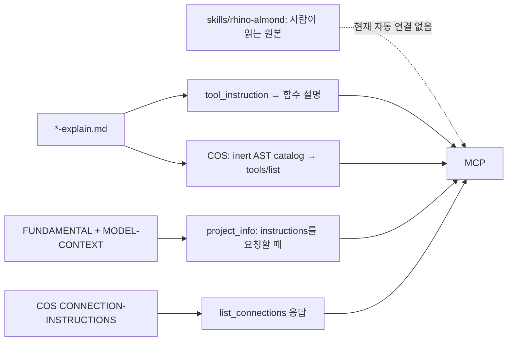

# rhino-almond 지침의 MCP 전달 설계안

상태: **사용자가 C안을 수용하여 P1/P2를 구현했다. 구현 검증·리뷰와 실제 클라이언트의 모델링 행동 검증은 구분한다.**

선택한 방식은 **짧은 시작 안내 + 도구별 조건 문장 + 필요한 때 읽는 주제별 본문**이다.
개인 스킬 설치 없이 MCP에서 의미·사례를 찾아 읽을 수 있다. 아래 대안 비교와 조사 당시
측정을 보존한다. 후속 정리에서 설치형 스킬 폴더를 제거하고 원문·사진을 일반 지침 문서로 이전했다.
현재 구현 계약과 사용 절차는 [MCP SPEC](../../src/mcp/SPEC.md#모델링-안내-전달)에 둔다.

## 1. 요청과 검토 범위

사용자는 현재 `rhino-almond` 스킬을 MCP 시작 지침과 도구에 어느 정도 배분할지 여러
방식을 깊이 검토해 제안하라고 요청했다. 모든 기능의 완성을 요구하지 않았으며, MCP
도구가 계속 바뀔 것을 고려해야 한다. 이 문서는 그 선택을 위한 구체적인 비교와 검증
기준이다. 연결 경로·호스트 소유권은 1번 작업에서, 두 결과의 정렬은 이후 통합 작업에서
다룬다.

최신 사용자 표기는 **`ontological-component`**다. 이 문서에서는 그 의미 단위에 이
표기를 쓰고, 현재 공개 도구명·인자·저장 키의 `component`, `Plan`은 정확한 호출을 위해
그대로 인용한다. `Task`는 현재 API의 `Plan`에 대응한다. 명칭 변경을 API·DB migration으로
확대하지 않는다.

`ask-matt`로 경로를 검토하고 `writing-for-agents`의 공통/선택 로딩·단일 원본 원칙과
`codebase-design`의 작은 인터페이스 기준을 적용했다. `domain-modeling`은 용어와 구현
제약을 구별하는 데 참고했다. 기존 저장소의 문서 구조를 이용하며 새로운 tracker·ADR
운영 체계는 만들지 않는다.

## 2. 어떤 스킬이 원본인가

최초 설계 검토 시점은 2026-10-26이다. 개발 분기는 `480ecad39cde7a56fead126272a28a8c640f0876`에서
시작했고, 사용자 승인으로 최신 스킬 정리 `5e0773776a4924f7c3bf8adf9c19da845f837298`이 main에
반영된 뒤 그 기준으로 rebase했다. **내용 원본은 그 최신 사용자 정리본과 아래 피드백**이며,
구현에서 용어와 피드백을 먼저 저장소 스킬에 반영하고 번들을 생성한다. 아래 고정 링크는 조사
입력 버전을 보존한다. 배포 manifest의 `source_refs` SHA-256은 실제 포함된 현재 본문을 식별한다.

| 입력 | 이 설계에서의 역할 |
|---|---|
| [저장소 SKILL.md @5e07737](https://github.com/hongikkaan/almond-mcp/blob/5e0773776a4924f7c3bf8adf9c19da845f837298/skills/rhino-almond/SKILL.md) | 배분할 최신 의미·작업 안내의 기준 |
| [보존된 사용자 초안 @5e07737](https://github.com/hongikkaan/almond-mcp/blob/5e0773776a4924f7c3bf8adf9c19da845f837298/skills/rhino-almond/skill초안.md) | 무엇을 덜어냈는지 확인하는 요청 원문. 실행 지침으로 자동 주입하지 않음 |
| [asset-workflows.md @5e07737](https://github.com/hongikkaan/almond-mcp/blob/5e0773776a4924f7c3bf8adf9c19da845f837298/skills/rhino-almond/references/asset-workflows.md) | 자산 등록·배치·교환·발행·캡처의 선택 본문 |
| [component-feedback.md @5e07737](https://github.com/hongikkaan/almond-mcp/blob/5e0773776a4924f7c3bf8adf9c19da845f837298/skills/rhino-almond/references/component-feedback.md) 및 연결된 사진 2장 | ontological-component 의미 판단의 사용자 원문·사례. 요약과 구별해 보존 |
| `C:\Users\hopho\.codex\skills\rhino-almond` 설치본 | 오래된 배포본과의 차이 확인용. 런타임 의존 경로로 사용하지 않음 |
| 현재 `tools.py`, `*-explain.md`, 모듈 SPEC·모델링 계약 문서 | 실제 인자·효과·제약을 검증하는 구현 근거 |

설치본에는 Phase 최소 1개·새 과업마다 Plan 생성·모든 검수에서 여러 Named View 등의
강한 절차가 남아 있다. 최신 사용자 초안은 이 강제와 과도한 보고·검수 절을 덜어내라고
명시했다. 설치본을 복사해 MCP로 옮기면 삭제한 규칙을 되살리게 된다. 최신 스킬의
“필요한 뷰·단면·진행 기록”을 모든 호출의 사전 조건으로 바꾸지 않는다.

최신 스킬의 ontological-component 개념은 Scene 미연결 상태도 허용하지만 현재 등록 API는
빈 `scene_ids`를 거부한다. 의미 정의와 구현 제약을 함께 전달해야 하며, 문구만 바꿔
미연결 등록이 구현된 것처럼 보이게 해서는 안 된다. Phase에는 Phase, Task에는 Task를
기록하는 운영 기준과 현재 `depends_on`이 임의 ID 배열을 허용하는 저장 계약도 구별한다.

### 추가 실사용 근거: 진행 중인 세션과 Notion 피드백

[실사용 세션](codex://threads/01a178b9-3449-71ae-8176-e87565650022?hostId=durable)의
최근 13개 turn과 [사용자 Notion 피드백](https://app.notion.com/p/405e0a394120815f9af6c6e3473e9a5a)을
2026-10-26에 조회했다. Notion 응답의 수정 시점은 `2026-10-26T16:36:23.562Z`이며 페이지
검증 상태는 unverified였다. 최신 세션 turn `01a1791c-8c59-7693-962a-04385da8f795`의
사용자 지시까지 포함했다. 모델 자체를 이 설계 작업에서 다시 검사하지는 않았다.

원문 피드백, 세션의 작업 보고, 실제 구현을 구분한다. 특히 페이지의 “등록 오류 해결”은
세션 보고이며 코드 결함의 일반적 해결 증거가 아니다. 과거 “UNIT B는 사용자가 직접 편집
중” 해석은 후속 정정으로 철회됐으므로 계속된 작업 범위 축소 근거로 쓰지 않는다.
이 자료들은 갱신 중이므로 구현·통합 시 최신 사용자 변경을 다시 확인한다.

| 원문·로그에서 확인한 쟁점 | 지침 배분에 반영할 내용 | 지침만으로 해결되지 않는 부분 |
|---|---|---|
| 처음부터 NamedView를 활용하고 사용법을 안내해 달라는 피드백. 사용자가 위치 질문에 NamedView를 보라고 답함 | 관찰·drafting 주제: 범위가 불명확하면 먼저 `view="a"`로 기존 Named View·Layout을 찾고 GUID로 캡처해 표제·실제 대상과 대조. 이름만으로 범위를 확정하거나 새 뷰 생성을 강제하지 않음 | 현재 목록은 이름·GUID이고 카메라·객체 범위 전체를 반환하지 않음. 정확한 추가 관찰이 필요하면 현 도구 계약 안에서 수행 |
| 검증에 computer use를 사용하지 말라는 피드백. 저장 명령 성공 뒤 미저장 표시가 남았다는 보고 | 모델/도면 검수 주제: 이 사용자 작업에서는 MCP 관찰로 확인하며 UI 자동화 fallback을 강제하지 않음. 저장 성공·modified·저장 후 변경을 구별 | 저장 직후 표시가 남는 원인은 미확인. 지침으로 성공 처리하지 않고 해당 도구·native 동작의 재현 과제로 분리 |
| COS를 경유하며 불필요한 토큰이 생기는지 조사해 달라는 피드백 | 초기 요약·선택 주제로 중복 지침을 줄이고, 같은 호출의 직접/COS wire와 텍스트·이미지 전달 횟수를 비교 | 이전 3,000–5,000토큰 추산은 실제 과금 총량이 아님. COS 누수 존재·절감량을 측정 전 확정하지 않음 |
| ontological-component 이해는 좋았지만 블록 교체 뒤 소유권 표식 오류가 발생했다는 기록 | blocks/등록 설명: 변환 전 현재 등록·영속 group·직접 소유 객체를 확인하고, 등록 운반 객체를 삭제하는 교체 순서와 후속 live 정합을 검토 | 원본 삭제 뒤 사후 sync만 하면 항상 복구된다는 보장 없음. 공개 API로 안전한 전환이 불가능한 경우 도구 개선으로 분리. DB/UserString 직접 삭제 우회는 해법이 아님 |
| 재귀 Explode로 곡선이 선분이 되었으며 2D에서 Join할 줄 알아야 한다는 피드백 | drafting 주제: 같은 실물/표현 역할의 연속 선분을 식별하고 문서 공차·끝점·열림/닫힘·분기·중복을 확인해 Join 후보를 판단. 결과 곡선 수·형태·비대상 선 보존을 대조 | 공개 전용 Join 도구는 없음. 일반 스크립트 변경 경로와 검증이 필요. 모든 근접 선을 자동 병합하거나 개폐 궤적을 문짝 윤곽에 섞지 않음 |
| 개폐형 벽·폴딩도어만 범용 이름의 block으로 만들고 의미 group·궤적은 유지하라는 지시. 최신 지시는 block/group의 무조건 보존보다 의미에 따른 판단을 허용 | blocks/ontological-component 주제: 반복 실물과 사용 관계를 구별. 맥락에 맞으면 생성·재사용·Explode·Join을 판단하며 블록 이름을 특정 unit에 고정하지 않음 | 기존 보존을 일률 금지·해체로 뒤집지 않음. 승인 범위·공유 정의 영향·등록 갱신을 함께 확인 |

새 피드백을 스킬의 이미 존재하는 규칙으로 가장하지 않는다. 위 내용은 원문에 근거한
**추가 안내 후보와 개발 쟁점**이다. 실제 사용자 원문을 배포 bundle에 복제하는 작업은
별도이며 이 제안서는 링크와 해석만 남긴다.

### 설계 조사 당시 입력 규모

아래는 UTF-8 텍스트의 CRLF를 LF로 정규화한 바이트 수다. 모델 토큰 수·이미지 토큰
비용·실제 컨텍스트 로딩량은 아니다. AST에서 `@mcp.tool()` 함수만 골라 adjacent
instruction 본문을 합산했다. resource 설명과 오류 응답 문구는 도구 설명 합계에서 제외했다.

| 대상 | 바이트 | 해석 |
|---|---:|---|
| 최신 SKILL.md | 22,862 | 목차·표·본문 포함 |
| asset-workflows.md | 3,456 | 선택 작업 |
| component-feedback.md | 2,759 | 사용자 사례 원문 |
| 위 텍스트 합계 | 29,077 | 모두 상시 로딩하는 안의 최소 텍스트 비용 |
| 연결된 사례 사진 2장 | 194,554 | PNG 원본 합계. 텍스트와 별도 전달 필요 |
| 조사 당시 공통 도구 설명 77개 | 53,336 | AST/Markdown 원문 합계, package 73개 + runtime 4개. 연결관리 도구 제외 |
| FUNDAMENTAL / MODEL-CONTEXT | 2,693 / 927 | 현재 선택 조회되는 안내 |

SKILL.md 하나만 77개 설명에 반복해도 1,760,374바이트가 **추가**된다. 따라서 “모두 MCP로
제공”과 “전부 항상 컨텍스트에 반복”은 별도 선택이다. 현재 도구 수는 측정 시점의 값이며
향후 지원 목록을 이 숫자에 고정하지 않는다.

## 3. 실제 전달 경로와 빠진 연결



| 채널 | 현재 구현·근거 | 설계에 주는 제약 |
|---|---|---|
| 공통 서버 초기화 | [server.py](../../src/mcp/server.py)의 `FastMCP("Almond")`에는 `instructions` 인자가 없음 | 파일명이 FUNDAMENTAL이어도 시작 시 자동 주입되는 것은 아님 |
| 모델 안내 조회 | [configure_project_context](../../src/mcp/runtime/mcp_server.py)의 `project_info`가 `sections`에 `instructions`가 있을 때 두 Markdown을 합침 | 기본 project/document/artifacts 응답에는 지침이 없음. instructions만 조회해도 binding·프로세스는 확인함 |
| 도구 설명 | [instruction_text.py](../../src/mcp/instruction_text.py)가 인접 `*-explain.md`의 지정 절을 `__doc__`로 설정 | 단순하고 이미 검증되는 확장 지점. 각 도구의 인자·효과 설명과 바로 붙일 수 있음 |
| COS 도구 목록 | [build_catalog.py](../../src/cos/build_catalog.py)가 실제 도구를 실행하지 않고 AST·같은 설명 파일로 schema를 만듦 | 이 단계에 스킬 검색·DB import·Rhino 시작을 추가하지 않아야 함 |
| COS 초기화·연결 안내 | [cos_host.py](../../src/cos/cos_host.py)는 `instructions=""`; `list_connections`가 [연결 안내](../../src/cos/CONNECTION-INSTRUCTIONS.md)를 반환 | worker의 초기화 지침은 host 클라이언트에 자동 전달되지 않음. 변경하면 host 전송 경로도 검증 필요 |
| COS `project_info` 설명 | 같은 파일의 `exposed_tools`가 원래 설명을 짧은 고정 문구로 대체 | “before Rhino actions”를 의무 절차로 오해할 수 있고 “does not execute Rhino code”는 기본 document의 live 관찰과 불일치 |
| 변경 감지 | [runtime.py](../../src/cos/runtime.py)의 `source_paths`, `check_contract`, `catalog_identity` | Python·기존 explain 및 지침 2종은 fingerprint에 포함. 일반 새 `guides/*.md`·그림은 자동 포함되지 않음 |
| worker schema 확인 | 같은 파일의 `schema_identity`는 이름·입출력 schema·annotations만 비교 | description 차이는 이것만으로 잡히지 않음. source fingerprint와 실제 전송 설명 비교가 함께 필요 |

현재 [transport 검사](../../src/cos/tests/test_transport.py)는 COS 초기화 지침이 비어 있다는
동작과 tools/list 250,000바이트 미만을 명시적으로 확인한다. 시작 안내 추가는 기존
계약·검사의 의도적인 변경이다. [project context 검사](../../src/mcp/tests/runtime/test_mcp_context.py)는
구성 훅이 기존 instructions를 덮어쓰지 않는 것을 검사한다. 이 훅에서 무조건 안내를
교체하는 방식은 피하고, 서버 생성 위치에서 공통 안내와 경로별 안내를 조립한다.

MCP의 [Tools](https://modelcontextprotocol.io/specification/2026-07-28/server/tools),
[Resources](https://modelcontextprotocol.io/specification/2026-07-28/server/resources),
[Prompts](https://modelcontextprotocol.io/specification/2026-07-28/server/prompts)는 서로 다른
전달 수단이다. prompt는 사용자가 선택하는 템플릿이고 resource의 자동 컨텍스트 포함은
클라이언트 동작에 달려 있다. 텍스트를 프로토콜로 보내는 것과 모델이 읽고 따르는 것은
별도 검증이다. 이 설계는 세 클라이언트가 모든 채널을 동일하게 지원한다고 가정하지 않는다.

## 4. 네 가지 대안

| 안 | 전달 형태 | 장점 | 비용·실패 방식 | 적합한 범위 |
|---|---|---|---|---|
| A. 시작에 전체 본문 | 초기화 instructions에 SKILL·선택 참조를 합침; 그림은 별도 | 찾는 호출이 적고 단순 | 시작부터 최소 29KB 텍스트, 그림·링크 별도. client가 초기화 지침을 쓰지 않으면 전부 누락. 도구가 바뀔 때 전체 안내를 재검토 | 제한된 단일 클라이언트 비교 실험 |
| B. 기존 채널 안에서 배분 | 공통 안내 2종 정리, relevant `*-explain.md`에 필요한 규칙, project_info로 상세 회수 | 새 도구·입력 schema 없이 점진 적용 가능 | 복합 과업·원문 사진을 도구 설명만으로 담기 어려움. `instructions` 전체 조회가 커지고 발견되지 않을 수 있음 | 첫 번째 작은 개선안 |
| C. 짧은 안내 + 주제 조회 | B의 요약과 사용 조건 + `get_modeling_guide` 한 개로 주제·원문·사진 회수 | 전체 스킬 접근 가능, 필요한 부분만 읽음. 도구 재편과 의미 안내를 분리하기 쉬움 | 새 도구·패키징·주제 목록 관리와 1회 이상의 추가 호출. 호출되지 않거나 이미지가 미지원인 경우 남음 | **중기 권장안** |
| D. resource/prompt 중심 | `almond://guides/...` resource와 선택형 과업 prompt | 문서·이미지 원본과 역할이 잘 맞고 사용자가 명시적으로 선택 가능 | 현재 COS host는 tool 목록/호출만 중계. resource·prompt 전달 추가와 각 client 지원 검증 필요. 자동 주입 보장 없음 | C 이후 지원이 확인된 클라이언트 보완 |

A도 전체 스킬을 각 도구 설명에 중복하지 않는다. B를 최종안으로 선택하면 사진·원문 등
미전달 범위를 명시해야 하며 “스킬 전체 MCP 제공 완료”로 보고할 수 없다. D의 prompt만으로
시작 안내나 필요한 도구 사용 조건을 대체하지 않는다. 도구 결과에 매번 전체 스킬을
덧붙이는 방식은 호출 비용·중복·기존 응답 계약을 함께 늘리므로 독립 후보로 권하지 않는다.

## 5. 권장 배분표

아래는 **사용자가 선택한 C안의 배분 설계**다. 현재 구현은 14개 주제를 제공한다. 시작 안내에는
공통 사실과 주제를 찾는 방법만, 도구 설명에는 실행 전에 필요한 조건과 해당 주제의
호출 조건만 둔다. 호출이 끝난 뒤에만 주의사항을 알려 주는 방식에 의존하지 않는다.

| 현재 스킬 내용 | 시작 안내 | 도구 설명·응답 위치 | 필요할 때 읽는 주제 |
|---|---|---|---|
| Rhino 편집·프로젝트·활성 문서·참조 보호 | 활성 문서와 공유 프로젝트의 차이 | project_info, 문서 변경 도구의 대상 조건 | `project` |
| Phase → Task → Step, 중단·재개·관계 | Task = API Plan만 짧게 | planning 도구의 저장·revision 계약 | `planning` |
| Scene·ontological-component·Instance 의미 | 용어 한 줄, 임의 필수 위계 없음 | Scene·등록 도구의 효과와 현재 Scene 필수 제약 | `ontological-component` |
| 마루·지붕 사례와 사용자 원문·사진 | 없음 | 의미 구성 판단 시 사례 주제로 안내 | `ontological-component-evidence` |
| 작업자료·Python | 상대경로·선택한 Task 폴더 | set_working_plan, rename, execute_project_python | `project` |
| 재료·레이어·ByLayer·floor | 없음 | setup_modeling, assign_material, get_modeling_policy | `materials` |
| 문서·선택·화면·probe, 기존 Named View 활용 | 중복 문서 조회 불필요 | context 도구의 효과·단위·미확정 결과, view 목록→GUID 캡처 | `observation` |
| Block·Group·소유권·중첩 경로, 의미에 따른 변환 | 없음 | probe·등록 도구의 GUID/정의 구별, 변환 전후 등록 확인 | `blocks` |
| 형상 편집·구축·설계 근거 | 없음 | execute_rhino_script와 guidance 도구의 역할·반환 한계 | `modeling` |
| 모델링 검수·교차 검사 | 없음 | image·intersection 도구의 관찰 범위 | `model-review` |
| 구조·피난 검토 | 없음 | engine/level·입력 단위·보고서 효과 | `structure` |
| Drafting·도면 검수, 2D 선분 Join 판단 | 없음 | drawing style·hatch·viewport, 일반 실행의 변경 효과 | `drafting` |
| Grasshopper | 없음 | audited capsule·port·bake 효과 | `grasshopper` |
| 자산 검색·등록·배치·파생 도면 | 없음 | asset 도구의 원본 조건·갱신 상태 | `assets` |
| 교환·발행·카메라 경로 | 없음 | exchange/publishing/capture의 파일·외부·화면 효과 | `exchange-capture` |
| 사용자 편집 초안, 테스트 C#·검사 스크립트 | 없음 | 없음 | 개발 근거로 보존; 모델링 지침 payload에서 제외 |

표는 전체 운영 텍스트의 목적지를 제시한다. 미래 배포 시 원문의 각 절이 어디에 대응하는지
manifest로 검사한다. 미연결 자료인 `FloorPlan_made_using_Bonsai.png`(4.9MB)와 최신 본문이
더는 연결하지 않는 `custom-material-layers.png`를 폴더 glob만으로 배포하지 않는다. 삭제도
하지 않는다. 현재 연결된 마루·지붕 사진은 원본 바이트·출처를 보존해 선택 전달한다.

### 실제 문구의 예

**시작 안내 후보** — 경로별 연결 설명은 1번 작업에서 정의한 adapter가 따로 붙인다.

> Almond는 Rhino 건축 모델·도면을 다룬다. 편집은 승인된 활성 문서 범위에서 수행하며
> Worksession 참조는 조회한다. 같은 폴더의 모델은 프로젝트 DB를 공유한다. Task는
> 현재 API의 Plan이며, ontological-component는 실물과 그것이 가능하게 하는 의미를
> 함께 묶는다. 현재 도구 schema가 입력 계약이다. 필요한 프로젝트 정보는 project_info로
> 조회하고, document에서 이미 확인한 문서는 같은 목적으로 다시 조회하지 않는다.
> 작업자료는 선택한 Task의 폴더에 상대경로로 다룬다. 기능별 안내는
> get_modeling_guide(topic="index")에서 고른다.

**도구 설명 후보** — 공통 배경을 모든 설명에 다시 넣지 않는다.

- `project_info`: “선택한 프로젝트 정보를 조회한다. 기본 document는 live 관찰을 포함한다.
  instructions는 선택 항목이다.” COS가 이 설명을 상충하는 문구로 대체하지 않게 한다.
- `upsert_design_component`: “ontological-component의 직접 소유 객체와 자식 관계를
  등록·변경한다. 의미 묶음을 새로 결정할 때는 ontological-component 주제와 사례를 읽는다.
  현재 구현은 최소 한 Scene을 요구한다.” 기존 상세 인자·Undo/소유권 계약은 유지한다.
- `get_rhino_probe`: “현재 형상·블록을 고정 조회한다. unknown·미지원·truncated를 확인되지
  않은 범위로 읽는다. 중첩 블록의 경로·편집 단계를 판단할 때 blocks 주제를 읽는다.”
- `get_rhino_viewport_image`: “선택한 뷰를 캡처한다. 절단·모드 설정 기능은 아니다.
  도면 위치·시점을 찾을 때 `view="a"`로 기존 Named View·Layout을 먼저 확인하고 선택한
  GUID를 캡처한다. 모델 검수면 model-review, Layout 검수면 drafting 주제를 읽는다.”

오류 응답에는 해당 오류의 다음 판단에 필요한 내용만 둔다. 성공 응답에 새 공통 지침 필드를
몰래 추가하거나, 기존 `result_error`를 지침 로딩 성공으로 덮어쓰지 않는다.

## 6. C안의 구현 경계

### 한 번 관리하고 여러 경로로 제공

행동·의미 안내의 원본은 저장소 `docs/modeling/guidance`이고, 정확한 도구 계약의 원본은
기존 schema와 `*-explain.md`다. 둘을 런타임마다 LLM으로 요약하지 않는다. 검토한 주제
manifest가 안정적인 주제 ID, 원본 절, 관련 도구, 선택 이미지, 출처를 연결하고 정해진
생성 과정이 배포용 topic 파일을 만든다. 원본 링크와 코드 계약이 충돌하면 생성 성공으로
덮지 않고 검토에서 해소한다. 처음에는 명시적 section marker/매핑으로 충분하며 검색용
벡터 DB·동적 규칙 엔진·임의 Markdown 실행기를 추가하지 않는다.

배포본은 `almond_mcp` package 안의 정적 안내 bundle로 넣는다. editable checkout과 wheel은
같은 reader를 사용한다. 서버가 사용자의 `.codex/skills`, GitHub, Notion, 모델 DB에서
시작 지침을 동적으로 읽지 않는다. 저장소 밖 설치본을 패치하거나 현재 사용자 스킬을
자동 덮어쓰는 작업도 포함하지 않는다. 배포 스킬을 계속 제공한다면 같은 원본·revision을
표시해 두 개의 독립 편집본이 되지 않게 한다.

### 제안하는 작은 조회 계약

```text
get_modeling_guide(topic="index", include_images=false) -> ToolResult

index: guide_version + topics[{id, title, when_to_read}] (본문·사진 없음)
topic: guide_version + topic_id + text + related_tools + source_refs + images_available
include_images=true: 해당 topic에 allowlist된 원본 PNG만 MCP image content로 추가
unknown topic: 명시적 입력 오류 + index 조회 안내 (전체 본문 fallback 없음)
```

reader 본문은 정적 package 자료만 읽고 모델링·관찰 sender 호출, DB 쓰기, Task 생성,
사용자 산출물 출력을 하지 않는다. **연결 호출 전체의 관리 기록까지 없는 것은 아니다.**
API 입력은 파일 경로·URL·임의 section 이름을 받지 않는다. ToolResult text 안에 JSON을
넣는 등 실제 반환 형식은 기존 이미지 도구와 COS 전달 계약에 맞춰 구현 시 확정한다.
모델 좌표·문서 경로를 안내 텍스트의 `source_refs`로 노출하지 않는다.

첫 구현은 **기존 연결 라우팅을 그대로 사용**한다. 공통 worker 도구 하나로 등록하며 COS의
연결별 호출은 현재처럼 `connection_id`가 필요하다. 따라서 연결 전에는 시작 요약까지만
읽을 수 있다. 현재 [공통 runtime](../../src/mcp/runtime/shared_store.py)은 도구 호출마다
연결의 `operation.json`과 완료 상태를 기록하고, [COS 호출 경로](../../src/cos/cos_host.py)는
Rhino control `begin/end`와 worker 상태 확인을 수행한다. 이 관리 절차는 그대로 유지하며
형상·속성·작업 DB의 내용·사용자 산출물이 바뀌지 않는지를 검사한다. 연결 생성 자체가
DB를 열거나 worker를 시작하는 효과도 본문 조회와 구별한다. 연결 전 전체 안내까지
필요하거나 control·receipt도 없는 조회가 필요하면 host의 static tool
dispatch를 별도 변경으로 검토한다. 이 편의를 위해 현 연결·lease·worker 검사에 예외를
몰래 만들지 않는다.

### 아직 바뀌는 도구에 대응

- 의미 주제 ID는 도구 이름과 분리한다. 도구가 이동·분리되어도 주제의 의미는 유지한다.
  관련 도구 매핑은 현재 catalog와 대조하고 사라진 이름·오래된 인자 예제를 오류로 잡는다.
- 시작 안내·topic·사진 manifest를 source fingerprint와 catalog identity에 포함한다.
  `source_paths`의 현재 `*.py`/`*-explain.md` 수집만으로 새 bundle이 보호된다고 가정하지 않는다.
- generation은 서버 import 없이 수행한다. 생성 중 원본 변경도 검출하고, 새 세션은 새
  본문을 받되 진행 중 worker의 버전을 몰래 섞지 않는다. 현재 source/version 검사를 유지한다.
- 런타임 안내에는 guide_version/content hash를 반환한다. 파일 이동 때문에 주제 ID나
  API를 함께 바꾸지 않는다. 새 schema가 필요하면 호환·클라이언트 catalog 검사를 별도로 한다.
- `ontological-component` 명칭은 의미 안내와 표시 문구에 반영한다. `component_id`,
  `upsert_design_component`, `scope="component"`, DB·Undo identity는 이 작업에서 바꾸지 않는다.
- 규칙은 안내다. 필수 입력·참조 보호·실행 완료 확인 같은 실제 보장은 기존 runtime/native
  계약이 담당한다. 지침을 받았다는 사실만으로 권한·동작 준수를 증명하지 않는다.

## 7. 구현 단계와 검증 기준

| 단계 | 변경·확인 | 통과 근거 |
|---|---|---|
| P0 — 이 제안 | 최신 스킬 원문·현재 호출부·4개 안·전체 배분·제약을 검토 | 문서 링크·계산 재현, 요청 충족/저장소 기준 리뷰. Rhino 실행 주장은 없음 |
| P1 — B 범위의 작은 정리 | 최신 용어·원본 확정, COS project_info 설명의 상충 제거, 두 안내 파일에서 실제 역할에 맞는 설명 정리 | tools/list 실제 설명과 project_info의 선택 응답·live 관찰 범위 검사. 공개 입력 schema 불변 |
| P2 — C 선택 시 본문 전달 | bundle·manifest·조회 1개·짧은 초기 안내·도구별 선택 포인터 | 패키징·AST catalog·fingerprint·본문/이미지 조회·invalid topic·세 연결 경로 검사 |
| P3 — 실사용 평가 | 같은 대표 과업에서 설치 스킬 없이 필요한 지침을 읽고 판단하는지 확인 | 프로토콜 전달 기록과 모델의 실제 지침 사용을 구분한 평가. 실패하면 문구·배분 수정 |
| P4 — 필요할 때 D 보완 | resource·prompt 전달, 연결 전 안내 등 | 지원 확인된 클라이언트에 한해 제공. C의 tool 경로를 임의 제거하지 않음 |

사용자가 C안을 수용했다. P1/P2를 같은 PR에서 구현하고 새 코드에 대해 다시 리뷰받는다.
P3는 통합·배포 뒤 실제 클라이언트 행동 검증으로 남으며, P4는 선택되지 않은 확장이다.

필요한 검증은 다음과 같다.

1. **내용·범위:** 최신 스킬의 각 운영 절·asset workflow·원문/사진이 매핑되거나 명시적으로
   제외돼 있다. Phase 생성 강제·모든 과업에 사진 보고 등 삭제된 절차가 다시 들어오지 않는다.
   Scene 없는 의미 단위와 현재 등록 제한, Task/Plan, 일반 group과 ontological-component를
   구별한다. 이미지 바이트·원문 인용을 검토 없이 재작성하지 않는다.
2. **동작·격리:** 시작/catalog/guide 조회를 fake sender와 격리된 자료로 검사한다. guide reader가
   모델링·관찰 sender를 호출하지 않고 형상·작업 DB 내용·사용자 산출물을 바꾸지 않는지 본다.
   기존 연결 경로의 lock·control begin/end·operation receipt·완료 확인은 유지되는지 별도로
   검사한다. 잘못된 topic은 명시적으로 실패하고, 기존 도구·오류 응답 schema는 보존한다.
3. **배포:** fresh wheel과 editable 설치에서 사용자 스킬 폴더 없이 동일한 version·본문·사진을
   읽는다. 삭제된 topic·누락 이미지·해시 불일치·설명 누락은 packaging 또는 검사에서 드러난다.
   알려진 버전이 다른 host/worker를 연결해 fingerprint 거절을 확인한다.
4. **세 경로:** 외부 Codex 직접 연결, CoS, RhinoTerminal에서 initialize, tools/list, guide 조회,
   이미지 반환을 각각 확인한다. COS는 worker 설명·지침이 자동 전달될 것이라고 추정하지 않는다.
   이 검사에 CoS 없이 직접 연결되는지를 확인하는 1번 작업의 증거를 연결한다.
5. **비용·판단:** 현재 설명 합계·실제 wire bytes와 변경 후 증가량을 함께 기록한다. 시작 요약은
   우선 2KiB, 개별 topic은 12KiB 안팎을 목표로 검토하되 수치 맞추기로 의미를 자르지 않는다.
   필요한 주제가 더 크면 의미 단위로 나눈다. client가 초기화 지침을 생략하는 경우에도
   relevant 도구 설명에서 주제를 찾을 수 있는지 확인한다.

대표 과업은 ① 기존 Layout 한 장 조회(새 Task·형상 생성 강제 없음), ② 바둑 가구와
마루의 의미 묶음 제안(원문·사진 선택 회수), ③ 중첩 block 관찰(내부 GUID와 occurrence
구별), ④ 재료 변경(레이어 보존·ByLayer 구별), ⑤ 자산 발행(외부 효과·실제 대상 구별),
⑥ timeout/result_error 이후 판단(적용 상태와 반환 실패 구별)이다. 해당 작업을 허용한
일회용 문서에서만 변경을 실행한다. 모델이 읽지 않은 그림은 검토 완료로 세지 않는다.

추가 피드백 회귀 과업에는 Named View로 여러 유닛의 범위를 찾기, 폴딩도어 실물과 개폐
궤적을 구별해 block/group을 구성하기, 2D 선분 Join 후보 판단, 등록 객체의 block 교체 후
live 정합 확인을 포함한다. `modified`가 남는 저장 결과는 미확인 상태를 정확히 보고하는지
본다. 이번 사용자 작업의 검증에 computer use를 우회 수단으로 호출하지 않는지도 확인한다.

COS 비용 비교에서는 동일한 catalog·문서·요청·이미지 크기를 고정하고 직접 경로와 COS의
초기 목록 바이트, 실제 tool description 텍스트, 호출별 반환 content, 동일 안내 재전송과
중복 텍스트/image 수를 따로 기록한다. 프로토콜 `structuredContent`와 `content`를 함께
전달하는 것이 곧 모델 입력의 이중 계산인지는 클라이언트 기록으로 확인한다. provider
사용량과 캐시 정보가 없으면 wire 차이만 보고하며 “추가 과금 0”이나 “누수 제거”를 주장하지
않는다. 측정·개선은 1번의 연결 경로 구현과 통합 시 맞춘다.

기존 [instruction 검사](../../src/mcp/tests/test_instruction_text.py),
[context 검사](../../src/mcp/tests/runtime/test_mcp_context.py),
[catalog 검사](../../src/cos/tests/test_catalog.py),
[transport 검사](../../src/cos/tests/test_transport.py)를 확장할 지점을 위에 제시했다.
이번 변경은 Python 안내 코드·데이터·검사와 스킬 문서다. RHP/native/UI 및 의존성 lock은 바꾸지 않는다.
통합·배포 뒤 관련 Codex/CoS MCP와 Terminal almond 세션을 정상 종료하고 새로 시작해야 한다.
이번 안내 변경만으로 RHP 재빌드·등록 변경은 필요하지 않다. 일상 체크아웃 반영과 실행 중
프로세스의 새 안내 로드, 실제 모델링 행동 검증은 별도 증거로 보고한다.

## 8. 리뷰와 통합 경계

1·2번이 각 PR의 리뷰를 먼저 통과한 뒤, 3번이 별도 통합 브랜치 하나에 두 결과를
병합하고 충돌·정합성을 정리한다. 그 통합 코드베이스 전체를 원문 목표와 대조해 검토한다.
타당한 수정은 원 담당 1·2번이 기존 브랜치에서 수행하고 재리뷰하며, 그동안 3번은 대기한다.
통과한 수정은 같은 통합 브랜치에 반영해 재검증한다. 통합 PR의 최종 리뷰를 통과한 뒤 main에
병합하며, 원 작업 브랜치나 일상 설치를 통합 검증용으로 바꾸지 않는다.

두 외부 진입점은 `external_host.py`에서 공통 시작 안내와 도구 설명을 제공한다.
`cos_host.py`는 기존 CoS 진입점으로 유지하고 `codex_host.py`는 CoS 앱을 import하지 않는
직접 진입점으로 유지한다. 공통 본문·fingerprint·worker 계약은 양쪽이 공유한다.

## 9. 구현 범위와 증거의 한계

- `docs/modeling/guidance/modeling-guide.md`와 연결 참조가 편집 원본이다. 명시적 `mcp-guide-map.json`이
  절·조건·관련 도구·원본 사진을 배분한다. 생성기는 숨은 사용자 디렉터리를 읽지 않는다.
- `get_modeling_guide`는 index/선택 주제의 JSON 텍스트 한 개와 요청한 원본 PNG만 반환한다.
  사례 원문·사진은 보존하며 임의 파일 경로·URL 조회는 제공하지 않는다.
- 공통 FastMCP와 외부 stdio host가 같은 시작 안내를 사용한다. catalog와 실제 도구는
  같은 설명 조합기를 쓴다. Google-style Args/Returns 뒤에 붙이면 파서가 안내를 생략하므로
  짧은 조건 문장을 본문 앞에 둔다. 기존 입력 schema는 유지하고 새 조회 도구 하나만 추가한다.
- reader는 모델·DB·사용자 산출물을 수정하지 않는다. 연결된 호출은 기존 binding·lock·
  control begin/end·operation receipt 경로를 유지한다. 정적 조회라고 안전 경계를 우회하지 않는다.
- 본문·manifest·원본 PNG와 시작·프로젝트 안내(`FUNDAMENTAL-INSTRUCTIONS.md`,
  `MODEL-CONTEXT-INSTRUCTIONS.md`)가 버전 및 세션 fingerprint에 포함된다. 초기 안내와
  도구별 조건, 주제 조회, `project_info(sections=["instructions"])`는 같은 검증된 snapshot을 쓴다.
  새 연결·worker 시작 시 source 불일치를 거부한다. 이미 실행 중인 세션은 기존 snapshot을 사용하므로
  변경 후 정상 종료하고 새로 시작한다. 호출마다 디스크 변경을 검사하는 기능은 추가하지 않는다.
- Named View 활용, 2D Join 판단, 의미에 따른 block/group 재구성, 등록 운반 객체 삭제 순서,
  computer use 없는 관찰 및 저장 상태 구분을 반영했다. 네이티브 등록·저장 버그 수정이나
  실제 과금 토큰 누수 해소를 이 안내 변경의 성과로 주장하지 않는다.

검사 결과와 정확한 구현 head는 PR 리뷰 기록에 남긴다. 오프라인 MCP/stdio/broker/receipt 및
wheel 검사는 전송·패키징 계약의 증거다. Codex·CoS UI에서의 모델 판단, RhinoTerminal 안의
실제 모델 편집, 일상 프로세스 로드까지 증명하지 않는다. 이번 통합은 사용자 지시에 따라
Rhino 없는 검사로 마무리하며 실제 Rhino 검증을 수행한 것으로 보고하지 않는다.
