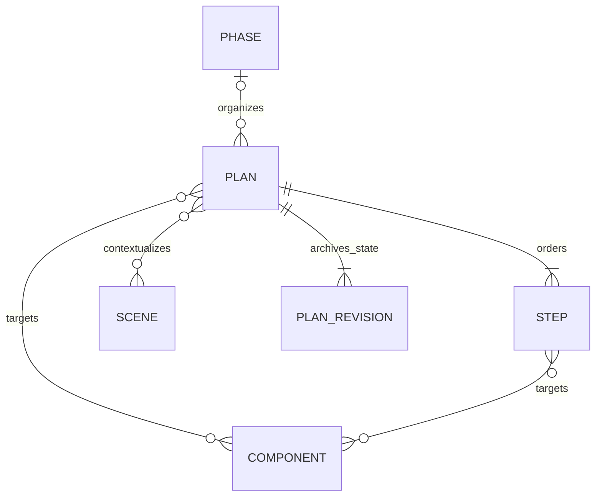

# Scene, Component, planning and construction layers

Scene은 공간 맥락, Component는 창문 한 개·출입문 한 개·계단 한 개처럼 건축적으로 의미 있는 개별 요소를 Rhino group으로 등록한 단위이며 Phase·Plan·Step은 수동 계획 기록이다. Room과 asset instance는 기존 충돌·containment·하중 경로에 남는다.

## Component 구성 기준

건축물에서의 기능·위치·사용 관계가 있는 실제 요소를 Component의 기본 단위로 삼는다. Rhino group은 등록 수단이며, group이나 재료·레이어 분류 자체가 건축 요소를 정의하지 않는다. 창문 하나의 프레임·창짝·유리는 원칙적으로 하나의 창문 Component 안의 객체다. `프레임 전체`·`문틀 전체`·`유리 전체`·`벽 전체`처럼 부품·형상 종류만으로 건물 전체를 나누거나 각 세부 형상을 기계적으로 별도 등록하지 않는다.

부모·자식 계층은 건축 요소 사이의 의미 있는 구성 관계를 표현한다. 세부 부품에 별도 편집·검증·관리 목적이 분명할 때만 하위 Component로 구분하고 그 이유를 설명한다. 이 기준은 모델링·등록 지침이며, 아래의 group identity·소유권·계층 API 계약은 그대로 따른다.

## Native Component hierarchy

### Identity and structure

- A Component is an explicitly registered Rhino group identified by its
  persistent group GUID. Names, material layers and group indices are not IDs.
- Each editable top-level object has at most one direct owner, recorded in the
  almond:component_id attribute. Nested block occurrences remain top-level
  atomic objects; shared definition members and BlockEdit clones are excluded.
- child_component_ids gives direct children and parent_component_id is derived.
  One child has at most one parent; cycles, duplicate parent links and
  cross-document references are prohibited. Reparent by detaching the old
  parent first.
- A parent Rhino group physically contains direct members plus all descendant
  members. objects/object_ids describe direct ownership; effective_objects
  and effective_object_ids contain the set-deduplicated subtree. The ancestor
  group never replaces child ownership stamps.
- Each Component has at least one Scene and a nonempty subtree. A parent can
  own zero objects if it has a child. Parent Scene context includes descendant
  geometry without modifying any child's own Scene list.

Rhino 8.34 tests showed that Group.UserStrings cannot provide correct
Undo/Redo. Instead, each Component registration lives in the
almond:component_record attribute of an **existing member**. The JSON value
is a map keyed by persistent group GUID; each entry has exactly five fields:
component_id, rhino_group_id, name, scene_ids, child_component_ids.
One existing member can host direct-owner and several ancestor records.
Edits preserve unrelated map entries and never create an artificial anchor
object. The old singleton record remains readable and is migrated on edit.
The allowed record fields are listed in modeling_policy.json.

### Upsert, inspect and explicit sync

Native upsert receives the complete list of DIRECT object_ids and the optional
child_component_ids. Omitting children preserves them, while an explicit empty
list detaches all children if the resulting subtree is nonempty.
expected_object_ids refers to cached DIRECT owners, not the whole physical
group. expected_child_component_ids, expected_parent_component_id and
expected_effective_object_ids are supported stale-state guards.

Read-only inspect (get_design_component with live=True) returns a complete
group/owner snapshot. User-added TextDots or other unowned group members appear
in pending_objects and set requires_sync=true; TextDots carry bounded text and
world-millimetre positions. effective_object_ids also exposes these IDs for
the existing get_rhino_probe outline annotation path. Inspection does not
stamp or claim ownership.

Native sync is an explicitly requested reconciliation. It adopts only
previously unowned objects whose deepest registered group is unambiguous and
normalizes ancestor physical group memberships inside one owned Undo record.
Incomparable group memberships, detached stamped objects, foreign ownership
and copied records fail without automatically reassigning or silently
discarding data. A consistent sync performs no native mutation. Upsert/sync
respond with the primary component and affected_components full snapshots;
read-only inspect also returns related ancestor/descendant and supplied prior
relationship peer snapshots to support ledger reconciliation after Undo.

Snapshots distinguish direct and effective members, pending objects,
parent/children, and requires_sync. Native result validation and response
size bounding finish inside the owned Undo record. SQLite validates the
entire returned set before committing. Native Undo and a SQLite transaction
are separate mechanisms: failed DB commit, socket timeout or lost response
must never trigger automatic replay.

### Unregister and uncertain completion

Unregistering a Component still attached to a parent is rejected; detach it
explicitly first. A ROOT Component may unregister with children, including
a root that has no directly owned objects. Its group remains an ordinary
group; its own direct owner stamps and one group-keyed record are cleared,
while descendants, their group records, geometry and ownership are retained.
Children become roots.

The native top-level acknowledgement contains component_id, model_path,
rhino_group_id, detached_child_component_ids and full affected_components
child snapshots. If a database commit is lost after native success, read-only
inspect can prove removal using former expected_object_ids (DIRECT),
expected_child_component_ids and expected_effective_object_ids from the
ledger. It confirms the original group still exists with the same complete
effective membership, all former direct objects are unowned, the former
Component record is absent, and each former child remains registered as a
root with intact ownership. Missing or modified groups are not success proof.

Plan/Step references must be removed before unregistering; the Python
store checks them before native mutation. A parent-only Component with exactly
one child cannot detach the child while remaining a nonempty Component.
When removing that container is intended, unregister the root parent instead.

## Room and structural target limits

**Current Room contract.** `retrieval_store.upsert_room` accepts only six finite
`bounds_mm` values; the `rooms` table has no curve/Brep identity. An assigned
`instance` uses `room.min_z` as its default floor elevation. The
`validate_scene_layout` query runs R-tree instance-AABB collision preflight and
compares each assigned instance AABB with the Room AABB, reporting
`passed_scope=legacy_asset_instances`,
`registered_object_collisions_checked=false` and `live_verified=false`.
An enclosing box or a curved Room reference stored only in metadata does not
support exact curved-boundary containment.

**Current structural analysis contract.** `validate_structure(guids, ...)`
and `visualize_structure(guids, ...)` take explicit Rhino GUIDs, not Component
IDs. `StructureModelExport.Handle` runs `ModelConditioner.Condition`: Points
become support anchors, Curves become member axes, slender Extrusions and
prismatic Breps can heuristically become members, and Mesh/surface/plate-like
geometry becomes shells; other solids can be skipped with warnings. The
native frame solver requires line members and rejects shells. The Karamba
fallback is not automatically equivalent EN 1990 / Eurocode verification.
Passing all architectural Component geometry directly as structural members
would overstate both coverage and analysis validity.

Generated-asset gravity loads are **loads**, not automatically members.
Preserve `AssetPlacementExport.Handle` (including old/new asset-ID tags),
`retrieval_store.scene_instances`, `asset_loads.placements_from_scene`,
`LoadTable.lookup`, `asset_loads.apply`, `structure_study.asset_catalogue`,
`server._structural_loads_path`, `_asset_load_spec`,
`get_asset_passport`, `structural-loads.json`, and generated manifest
`category`, `spatial.support_plane`, `nominal_dimensions_mm`, and stable asset
IDs. This existing path assigns estimated G/Q product/occupancy loads to
frame members while reporting skipped ground-only, wall-mounted and
structural elements. `test_asset_load_tools.py` and `test_asset_loads.py`
cover these consumers. Asset conversion must not drop those identities/loads.

## Phase, Plan and Step

Phase is an organizational parent. A Plan can reference Scenes and Components;
a Step can explicitly reference Components. This does not impose a permanent
rule that Scene belongs only at Phase or Component only at Plan. Explicit
component references need not be restricted to the Plan's contextual Scenes.

The legacy `scene_id` remains compatible with the first entry of `scene_ids`.
The existing scope templates remain; a minimal Component scope supports
inspection, design, modeling and validation without requiring a furniture loop.
There is no new automatic scheduler or arbitrary DAG editor.

Omitted reference arguments preserve prior values; an explicit empty list clears
them. A Step's explicit empty component selection must not silently expand to
the Plan or every object in a Scene. Target resolution is registration context,
not authorization to edit all returned geometry.

Each committed Plan mutation creates an immutable full Plan-state snapshot.
Revision numbers identify these saved states, not design attempts. Existing
Plans receive a clearly labeled migration baseline; earlier history is not
invented. `expected_revision` permits stale-client rejection. These snapshots
archive plan metadata, dependencies, statuses and handles, not Rhino geometry.

Step states include `pending`, `running`, `paused`, `completed`, `failed` and
`blocked`. Work can pause, switch and resume without prerequisite completion or
invalidating later work. Plan `depends_on` is a JSON array of freely related
Plan/Phase IDs, including references across phases. It is not a scheduling gate;
self references, cycles and not-yet-created IDs are allowed. Revision checks and
archival snapshots still share the update transaction.

Phase and Scene always expose `file_name` (empty when unspecified). A selected
Plan owns `artifact_dir` under project `tmp/YYMMDD_name`; `artifact_refs` and Step
input/output references use project-relative paths. `set_working_plan` reuses
that folder. `rename_artifact_folder` updates current references and preserves
historical revisions. `get_selection_references` maps selected objects to their
registered Component ancestors and direct/inherited Plan/Step references.
General queries omit IDs unless `include_ids=true`; get queries omit the supplied
target ID even then.

## Retired drawing registration

Sheet DB create/update/read/sync/remove tools and native registration dispatch
are retired. Existing Sheet rows and Rhino Layouts are preserved. Legacy Sheet
references no longer prevent Component unregister. Drawing asset registration
writes the controlled library manifest and files, not the project DB. Viewports,
Named Views and Layout paper can be listed/captured with `get_rhino_viewport_image`.

## Prepared drawing assets

The canonical new asset is a reviewed, prepared 3DM. Cleanup, orientation and
visual review stay with the external Almond Asset Converter. Registration verifies
millimeters, Z-up coordinates and a bottom-center origin; it does not rotate the
source, claim that a front direction is visually correct, or alter the user's file.
The native extractor reads a copied File3dm, resolves nested block transforms,
meshes supported geometry, and acknowledges source/artifact hashes and measured
bounds. Unsupported geometry or an incomplete extraction prevents publication.

`register_drawing_asset` stages the copied model, plan/front/right DXF and SVG,
and `dimensions.json` under one stable asset ID. It uses the existing GLB drafting
projection code with verified native triangles, preserving the custom GLB path.
An OS lock serializes library writes; all files are checked before an atomic
manifest replacement. Explicit replacement retains old version folders and a
manifest backup. Failures before publication leave the old entry intact. An index
refresh failure after publication is reported as `registration_applied=true`;
reconnect instead of repeating registration.

`get_asset_drawing`, drawing resources, audit and `place_drawing_asset` resolve the
same entry. Placement verifies the 3DM hash, accounts for document units, and
caches block definitions by source revision and units. It preserves old placed
instances when a new source revision is registered. A missing acknowledgement is
not permission to repeat placement.

The public generated/Meshy list/search/recommend/fit/place tools are retired.
Existing generated manifests, resource readers, load consumers and GLB package
derivation remain compatible. Diagram assets, construction and Eurocode analysis
remain available. The native docked Asset Panel reads its installed archive
snapshot; newly registered local assets are immediately visible to the registering
MCP process and its repository UI, not automatically to that bundled panel.
Other running MCP processes must reconnect to reload their cached library.

## Construction layers and material assignment

MCP owns catalog loading, material choices, construction-layer specifications and
metadata policy. `modeling_setup.py` supplies resolved recipes to the shared C#
implementation in `src/mcp/almond_mcp/rhino/`. The Bridge compiles those files to
execute Rhino API operations on its UI thread; it does not independently read the
material or construction manifests. Native document access, Undo recovery,
panels and geometry services remain in RHP. `DocumentLayers.Ensure` is the common
native layer-path adapter used by drawing styles, asset placement and setup.

`setup_modeling(operation="materials")` registers the library under its readable
names. Omit `overwrite` for one Yes/No choice in Rhino; true updates matching
materials, false leaves them as they are. Existing `ALMOND::<id>` names are accepted
for migration, but new materials use the manifest's `name`.

`setup_modeling(operation="layers")` creates/reuses
`M/category/system.name/element.role`, sets material and matching display/print
colors, and leaves all objects in their existing layers. The system default is
the first `render_material_ids` entry. Current role defaults use galvanized steel
for connection/reinforcement/decking and birch plywood for Wood subfloor/sheathing;
these are setup choices, not mappings present in the construction manifest.
M and category containers are gray. Existing matching materials are reused.

`assign_material` preserves the object's layer and unspecified metadata.
Registration, assignment, layer setup and archive placement share one PBR
implementation. Archive recipes with hash-suffixed names reuse only exact names
and remain separate from legacy `ALMOND::<id>` materials.
Direct batch scripts may call `ModelingMaterials.CreateAttributes`
with a resolved recipe JSON string; passing only a library ID is no longer supported.
No operation guesses a layer from a material name or watches material-table events
to move unrelated objects. Catalog reads and plugin startup create no modeling state.

MCP checks `modeling_materials=2` before these mutations; older Bridges with automatic
material routing are rejected. RHP source changes require a rebuilt Bridge and a
new Rhino process. Rebuilding a file does not change a running process's assembly.

`modeling_policy.json` defines supported keys. Public modeling metadata is
Component ID, floor and construction-detail label; names remain optional/free.
The Component's group-GUID-keyed internal record map on existing objects carries
name, Scene references and direct children. Necessary stable material
IDs, asset provenance and licensing fields are retained where real consumers
need them. New assignments stop duplicating material name/category, UE slot and
PBR channels onto object user strings: native materials hold the visual values.
Existing unrelated user strings are preserved. Legacy key names remain documented
for reading existing files, not as a list of required new stamps.

The existing construction catalog contains preliminary construction systems,
not verified detail drawings. A human-readable construction label and a typed
stable source reference are stored separately. A system ID is not relabeled
as a certified detail ID. Floor values are supplied, not inferred from names or
layer strings. Metadata updates do not erase unrelated user keys.

## Skill tool integration

All five existing helper capabilities already have fixed MCP routing:
`outline`, `resolve-block`, `sections`, `vertical-probe` and `joint-pairs` through
`get_rhino_probe`. Their implementation moves into Bridge's `Probes` source
directory, with tests and documentation updated; no duplicate tool wrappers or
arbitrary script execution endpoint is added. Usage guidance remains in the
skill and points to public MCP inputs and outputs.
