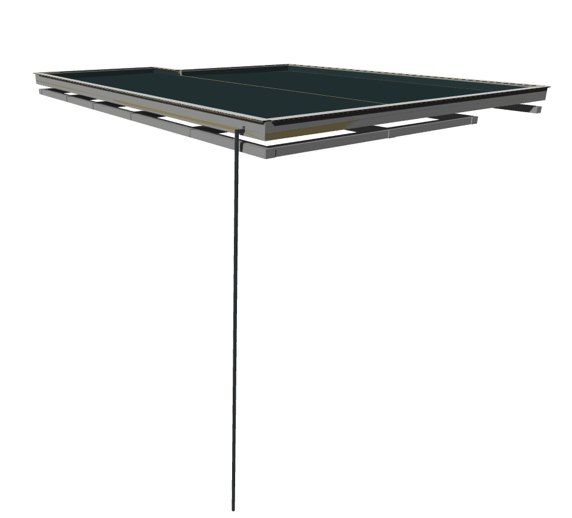

# Rhino 모델링 지침

## Rhino 편집

Almond MCP로 Rhino 건축 모델을 조회·편집하고 도면을 작성한다. 아래 도구명은 공통 이름이며, COS에서는 연결별 `connection_id`를 함께 전달한다. 인자는 현재 연결에 노출된 schema를 따른다.

## 목차

- [Rhino 편집](#rhino-편집)
- [프로젝트 기본 구조](#프로젝트-기본-구조)
  - [프로젝트·문서·파일](#프로젝트문서파일)
  - [Phase → Task → Step](#phase--task--step)
  - [Scene·ontological_component](#sceneontological_component)
- [기본 작업](#기본-작업)
  - [템플릿·재료·구축 레이어](#템플릿재료구축-레이어)
  - [조회·화면 도구](#조회화면-도구)
- [모델링](#모델링)
  - [형상 편집·설계 자료](#형상-편집설계-자료)
  - [모델링 검수](#모델링-검수)
  - [구조 검토](#구조-검토)
- [Drafting](#drafting)
  - [도면 표현](#도면-표현)
  - [도면 검수](#도면-검수)
- [거의 사용하지 않는 기능](#거의-사용하지-않는-기능)
  - [Grasshopper](#grasshopper)
  - [자산 목록·검색](#자산-목록검색)

## 프로젝트 기본 구조

### 프로젝트·문서·파일

같은 폴더의 여러 `.3dm`이 하나의 프로젝트이며 `.almond/scene.sqlite3`를 공유한다. **Rhino 편집 대상은 활성 문서만**이다. Worksession의 attached/reference 문서는 조회만 한다.

프로젝트·현재 파일은 `project_info`로 확인한다. DB 기록은 도구가 저장하고, 작업자료는 Task를 선택하면 `tmp/YYMMDD_작업명`에 관리된다. 관리 도구에는 프로젝트 상대경로를 전달하면 되므로 TEMP나 절대경로를 따로 조립하지 않는다. Rhino 모델의 `.3dm` 저장은 DB 기록과 별개다.

같은 문서의 연속 지시는 알고 있는 맥락을 재사용한다. `project_info` 재조회는 첫 연결·재연결, 사용자나 도구가 알려 준 문서 변경, 새 프로젝트·경로 정보 부족, 명시적 조회 요청이 있을 때 필요한 sections로 한정한다. 새 메시지가 왔다는 사실만으로 재조회하지 않는다. `document`가 live 문서를 함께 확인하므로 같은 확인을 위해 `get_rhino_context`를 이어 호출하지 않는다.

일상 편집마다 모델 전체나 DB의 별도 백업을 만들지 않는다. 명시적 요청이나 정해진 마이그레이션 계약이 있을 때만 별도 사본을 만든다. 기존 모델·DB·백업과 관련 없는 사용자 속성은 보존한다.

| 도구 | 입력 | 할 수 있는 일 |
| ------- | ----- | ----- |
| `project_info` | 필요한 `sections`: project, document, artifacts, runtime, instructions | 프로젝트 루트·파일명·공유 DB·현재 문서·작업자료 위치 조회. document에 live 확인이 포함된다. |
| `save_rhino_document` | 없음 | 연결된 기존 `.3dm` 전체를 같은 경로에 비대화식 저장. |
| `set_working_plan` | `plan_id`, 선택적 `step_id`, `artifact_name` | Task의 작업자료 폴더 선택·재사용. |
| `rename_artifact_folder` | `name`, 선택적 `plan_id` | 작업자료 폴더와 관련 참조를 함께 변경. |
| `execute_project_python` | `code`, 선택적 `timeout_seconds` | 선택한 작업자료 폴더에서 Python 실행. Rhino 형상 편집용 도구는 아니다. |

저장이 필요한 편집 묶음 뒤에는 `save_rhino_document()`를 사용한다. 저장되지 않은 문서·읽기 전용 파일·연결과 다른 문서·활성 또는 불명확한 group/block 편집은 쓰기 전에 거절된다. 확인된 결과는 `saved=true`와 실제 `modified` 값이며, `saved=null, requires_reconciliation=true`는 완료 불명이다. Save/SaveAs/Enter를 명령 스크립트로 실행하거나 파일 수정 시각으로 요청 완료를 추정하지 않는다. 완료 불명은 자동 재시도하거나 연결의 완료 보호를 지우지 말고 실제 결과를 확인한다.

### Phase → Task → Step

**Phase는 작업 묶음, Task는 수행할 과업, Step은 과업 내부 단계**다. 현재 API에서 Task의 이름은 `Plan`이고 ID는 `plan_id`다. 진행 중이거나 중단된 작업을 조회해 이어서 사용할 수 있다. 상태는 `pending`, `running`, `paused`, `completed`, `failed`, `blocked`다.

새 지시의 **도구 선택 전에** 현재 Task와의 관계를 판단한다. 알고 있는 Phase·Task·문서부터 사용하고, 빠진 정보만 작은 범위로 조회한다.

| Given: 지시의 맥락 | When: 판단·도구 선택 | Then: 필요한 행동·기록 |
| --- | --- | --- |
| 진행 중 Task의 보완 | 기존 목표·대상과 이어진다 | 같은 Task·Phase를 유지하고 필요한 실행을 한다. Step은 의미 있는 상태·대상·결과가 바뀔 때 기록한다. |
| 다른 과업으로 전환 | 기존 Task의 목표·대상이 달라진다 | 진행 중 Task는 필요하면 paused로 남기고 관련 Phase의 Task를 선택·재개하거나 만든다. 완료한 Task에 새 과업을 조용히 누적하지 않는다. |
| 맥락이 부족 | 현재 Task·대상·문서 중 무엇이 부족한지 먼저 정한다 | 알고 있는 ID는 단건 조회하고 모르면 status·Phase·Scene으로 목록을 좁힌다. 문서·경로 정보가 부족할 때만 project_info의 해당 sections를 읽고, 그래도 모호한 작업 대상은 사용자에게 확인한다. |
| 일회성 조회 | 이름·개수·상태만 묻는다 | 해당 요약 조회만 수행한다. 새 Phase·Task·Step을 만들거나 전체 계획을 다시 읽지 않는다. |

작업자료를 작성할 때는 선택한 Task에 `set_working_plan`을 적용한다. 실행·검수·중단·재개·완료의 의미 있는 상태를 해당 Step에 남기고, 도구 호출마다 기록을 늘리지 않는다. Task 완료는 요청한 실행과 필요한 검수가 끝난 뒤 판단한다.

Task의 상위 Phase는 `phase_id`로 지정한다. 관련성은 **Phase에는 Phase, Task에는 Task**를 기록하며, 같은 프로젝트의 다른 파일에 속한 항목도 참조할 수 있다. Task 간 참조는 `depends_on` 배열에 기록한다. Phase에는 전용 관계 필드가 없으므로 `description`에 관련 Phase ID를 적는다. 관계 기록은 참고용이며 실행 순서나 자동 완료를 강제하지 않는다.

| 도구 | 입력 | 할 수 있는 일 |
| ----- | ----- | ----- |
| `list_phases` | 선택적 `limit` | 프로젝트의 Phase 목록 조회. |
| `get_phase` | `phase_id` | Phase 설명·파일명·소속 Task 수 조회. |
| `create_phase`  | `name`, 선택적 `description`, `file_name` | Phase 생성. |
| `update_phase`  | `phase_id`, 바꿀 `name`, `description`, `file_name` | Phase 정보 수정. |
| `list_plans` | 선택적 `phase_id`, `scene_id`, `status`, `limit` | 조건에 맞는 Task 목록 조회. |
| `get_plan`| `plan_id`, 선택적 `revision` | Task·Step의 대상·상태·기록 조회. |
| `create_plan`| `goal`, `scope`, 선택적 `phase_id`, `scene_ids`, `component_ids`, `depends_on` | Task와 기본 Step 생성. scope는 house, interior, structure, drawing, component. |
| `update_plan`| `plan_id`, 바꿀 목표·참조·상태·`artifact_refs`, `expected_revision` | Task 정보와 진행 기록 수정. |
| `update_step`| `plan_id`, `step_id`, `status`, 선택적 입출력 참조·대상, `expected_revision` | Step의 진행·중단·결과 기록. | 
| `resolve_targets`  | `plan_id`, 선택적 `step_id` | Task 또는 Step이 가리키는 ontological_component·문서·group 확인. |
| `list_plan_revisions` | `plan_id`, 선택적 `limit` | Task의 저장된 변경 이력 조회. |

Task의 `scene_ids`는 맥락, `component_ids`는 편집 대상이다. Step의 대상이 `null`이면 Task 대상을 상속하고 `[]`이면 대상이 없다. 수정에는 조회한 `revision`을 `expected_revision`으로 전달한다. 상태·참조 기록은 형상 실행과 별개다.

목록은 status·Phase·Scene과 작은 limit으로 좁힌다. 기본 조회는 요약이며, 실제 Step이 필요하면 `get_plan(..., field_groups=["steps"])`, 관계가 필요하면 `["references"]`, 산출물 위치가 필요하면 `["artifacts"]`를 추가한다. 지원 group은 도구별로 확인한다. 쓰기 응답의 handle·revision·개수·경고로 다음 행동을 정하고, 전체 기록을 즉시 다시 읽는 절차를 만들지 않는다.

### Scene·ontological_component

Scene은 행태·프로그램·장면의 맥락이고, ontological_component는 그 장면을 가능하게 하는 건축 요소와 의미의 묶음이다. 등록할 때는 해당 Scene 맥락을 반드시 지정하며 여러 Scene에 참여할 수 있다. Scene에는 의미 단위 밖의 객체도 직접 연결할 수 있다. 기본 모델링은 Scene·ontological_component와 실제 Rhino group/block을 사용한다. 자산 배치용 Almond Instance 대장은 기본 작업에 추가하지 않는다.

#### Scene

Scene은 특정 공간에서 일어나는 **행태·프로그램·장면·가치**다. 파일 전체를 Scene 하나로 치환하지 않는다. Scene의 `file_name`을 필요할 때 조회해 현재 활성 파일과 대조한다. 이 필드는 작업 문서의 안내 정보이며 파일을 이동하거나 문서를 자동 전환하지 않는다.

| 도구 | 입력 | 할 수 있는 일 |
| -- | ----- | --- |
| `list_design_scenes` | 선택적 `name`, `file_name`, `limit=50`, `offset=0`, `field_groups`, `include_ids` | 프로젝트 전체 Scene 이름의 제한된 페이지 조회. |
| `get_design_scene` | `scene_id`, 선택적 `field_groups`, `include_ids` | Scene 요약·개수와 필요한 상세 조회. |
| `create_design_scene` | `name`, 선택적 `units`, `file_name` | Scene 생성. |
| `update_design_scene` | `scene_id`, `file_name` | 기존 Scene의 파일명 기록. |
| `register_scene_objects` | `scene_id`, 최상위 `object_ids`, `mode`: add/remove/replace | ontological_component 없이 객체를 Scene에 직접 연결·해제.|
| `get_scene_objects`| `scene_id`, 선택적 `limit=50`, `offset=0`, `field_groups`, `include_ids` | 직접 연결 객체와 하위 ontological_component 객체의 합집합을 페이지로 조회. |

Scene 이름만 필요하면 `list_design_scenes()`를 사용한다. Plan·live 문서·SQLite 직접 조회 없이 여러 파일과 빈 Scene까지 포함한다. `name`은 대소문자를 구분하지 않는 부분검색이고 `file_name`은 정확한 필터다. 기본 행은 이름만 반환하며 선택용 handle은 `include_ids=true`, 파일명·단위는 `field_groups=["scope"]`, revision은 `["state"]`로 추가한다. 목록과 객체 페이지의 limit은 1–200이며 total·truncated를 확인한다. Scene 삭제 도구는 없고 등록 변경에는 공개 도구를 사용한다.

#### ontological_component

ontological_component는 **건축 요소와, 그 요소들이 함께 가능하게 하는 사용·행태·구조적 역할을 묶은 의미 단위**다. 무엇을 만들었는지와 그 묶음이 무엇을 가능하게 하는지를 함께 설명할 수 있어야 한다. 객체 종류·재료·거리만으로 경계를 정하지 않는다. 예를 들어 창문 하나를 일률적으로 ontological_component로 등록하는 대신, 바깥 풍경을 보며 머무르는 장소를 만드는 벽·창문 등의 관계를 보고 묶는다.

이렇게 정한 객체들을 한 `.3dm` 안에서 Rhino group으로 정의하고 ontological_component로 등록한다. **일반 group이 자동으로 ontological_component가 되는 것은 아니다.** 그 의미 단위를 구현하는 내부 구축 시스템·부재·element는 일반 group이나 block으로 정리한다. 이 내부 묶음은 조립·반복·선택·편집을 위한 것으로, 그 자체를 별도 ontological_component로 등록할 이유가 되지는 않는다. **ontological_component는 건축 요소와 의미를 함께 정의하고, 내부 group/block은 그 실물의 구축·모델링 구성을 정리한다.**

작은 계단참과 마루에서 사람들이 머물고 교류하는 행태가 Scene이다. 그 Scene을 이루는 ontological_component는 다음처럼 **실물 구성과 그것이 가능하게 하는 것**을 함께 갖는다.

| ontological_component | 함께 구성하는 요소와 의미 |
|---|---|
| 마루 위 공간을 지지하는 구조 | 기둥·보 여러 개가 함께 위에서 오는 하중을 지지한다. 기둥마다 따로 등록하지 않는다. |
| 사람들이 걸터앉는 마루·계단참 | 지지 콘크리트와 마루 마감이 함께 단차와 앉을 자리를 만든다. 마루라는 실물이면서 걸터앉을 수 있게 하는 장치다. 공유 바닥슬래브 전체를 포함할 필요는 없다. |
| 마루에서 바둑 두는 가구 묶음 | 방석·낮은 탁자·바둑판·바둑알과 통·시계 등이 함께 앉아서 바둑 두는 행위를 가능하게 하고 유도한다. 가구 하나씩 나누지 않고, 그 행위와 사용 관계로 묶는다. |

지붕의 의미에는 덮는 역할과 함께 집수·배수가 이어진다. 우수관이 여러 층을 지나거나 기둥 속 콘크리트에 매립돼 있어도 그 역할이 이어지므로 지붕 ontological_component에 포함한다. 지붕 안의 구축 시스템과 우수관 element들은 일반 group으로 나눠 관리할 수 있다. **물리적으로 떨어져 있어도 하나의 역할을 이루면 같은 ontological_component가 될 수 있다.** 두 사례의 [사용자 설명 원문과 사진](references/component-feedback.md)은 별도로 보존한다.

| 도구 | 입력 | 할 수 있는 일 |
| --- | ----- | -- |
| `list_design_components`  | 선택적 `scene_id`, `recursive=false`, `field_groups`, `include_ids` | 지정 Scene 또는 연결 문서의 등록 root 목록 조회. |
| `get_design_component` | `component_id`, 선택적 `live=false`, `recursive=false`, `field_groups`, `include_ids` | 저장 요약 또는 현재 group 관찰. 상세와 자손 형상은 명시 요청. |
| `upsert_design_component` | `name`, 직접 소유 `object_ids`, `scene_ids`, 선택적 기존 ID·group GUID·`child_component_ids` | 의미 등록·Scene/자식 관계 변경·일치하는 기존 group 채택. |
| `sync_design_component`| `component_id` 또는 `component_ids` 또는 `scene_id`; 생략은 연결 문서 | 안정된 Rhino 기준으로 선택 범위를 한 번 정합. |
| `remove_design_component` | `component_id` | ontological_component 등록 해제. 형상과 group은 유지. |

등록하려는 사용·행태·역할을 설명하는 Scene을 먼저 선택한다. `scene_ids`에는 기존 Scene을 한 개 이상 지정한다. 이 Scene 귀속은 단순한 API 우회용 값이 아니며, 파일 전체를 의미 없이 Scene으로 만들지 않는다.

등록은 객체 속성 대신 **문서 private registry**에 의미 handle·영속 group GUID·Scene·명시한 semantic 자식 관계를 저장한다. 현재 group의 이름·멤버가 기준이며 객체의 직접 소유 관계는 이 구조에서 계산한다. 기존 group은 현재 이름과 실제 멤버가 일치해야 하고, 같은 구성이 여러 개면 group GUID를 지정한다. upsert는 형상 교체·멤버 복구·기존 group rename 도구가 아니다. 일반 Rhino group 이름을 바꾼 뒤 query/정합으로 반영한다.

등록·Scene 관계 변경·해제의 semantic Undo와 Rhino group-table 동작을 구별한다. 명시 생성한 group의 등록을 Undo하면 원래 객체 membership은 복원되고 의미 등록은 비활성화되며 빈 group-table 항목이 남을 수 있다. 같은 이름의 live group이 있으면 새 생성은 suffix를 붙이지 않고 거절한다. 기존 group rename/delete의 일반 Undo 복구를 약속하거나 등록을 자동 재실행·멤버 복구하지 않는다.

일반 조회는 DB snapshot이다. 수동 편집·Undo/Redo 또는 멤버 교체가 있었으면 한 편집 묶음이 끝난 뒤 영향받은/dirty 등록 범위를 한 번 정합한다. 목록 전체에 `get(live=True) → sync → get`을 반복하지 말고 현재 schema가 제공하는 범위 정합 도구를 사용한다. 이름·색 변경만으로 멤버십 정합을 반복하지 않는다. 기존 정보 수정 시 생략한 인자는 유지되며 `child_component_ids=[]`는 자식 분리다.

목록은 기본적으로 범위의 root만 반환하고 `recursive=true`로 등록 자손을 포함한다. parent가 다른 Scene에 있어도 해당 Scene에 직접 속한 child는 조회 범위에 남는다. 실제 형상이 필요할 때만 `field_groups=["geometry"]`, 관계는 `["references"]`를 요청하며 자손 형상은 recursive도 함께 선택한다. 경로는 연결이 공급하므로 Scene 조회를 위해 model_path를 기억해 반복 입력하지 않는다.

정합 대상 형식은 서로 섞지 않는다. 명시한 parent/Scene 범위는 등록 자손을 포함하고 최대 64개·native 응답 2 MiB를 넘으면 좁힌다. compact 결과의 checked·changed·unavailable·problems를 읽는다. 완전한 범위가 부족하다는 오류는 제시된 parent/required handle로 다음 범위를 명시하며, 불확실한 수정을 재실행하는 근거로 쓰지 않는다. 누락 group은 참조·history를 유지하고, 개별 오류는 관련 없는 정상 등록의 관찰을 막지 않는다.

정합의 형상 기준은 **현재 안정된 Rhino 문서의 group·멤버·block 배치**다. DB와 다르다는 이유로 형상을 재생성하거나 일반 group을 해체하지 않는다. GroupEdit·BlockEdit 등 편집 격리가 활성 또는 불명확하면 모드·대상을 확인하고 안정된 문서 상태가 될 때까지 삭제 판단·정합을 보류한다. 불완전한 관찰은 삭제의 증거가 아니다. 타임아웃·결과 불명확은 rollback이 아니므로 실제 완료 결과를 먼저 확인하며 자동 재시도하지 않는다.

component·Scene·Plan·Phase·재료 key 등 Almond 관리 UserStrings를 개별 객체에 신규 자동 기록하지 않는다. 기존 사용자 속성을 보존하고, 작업에 필요한 일반 layer·Name·재료 속성 편집과 구별한다. 등록 해제는 의미 등록의 제거이고 물리적 group/block 해체와 별개 결정이다.

#### Instance

Almond의 Instance는 **자산을 Scene의 어디에 어떻게 배치했는지 기록한 DB 항목**이다. `instance_id`로 식별하고 자산 `asset_id`, 위치·회전·축척, 선택적 Rhino 객체 `rhino_guid`를 저장한다. Rhino block instance는 실제 모델 안의 블록 배치 객체이므로 서로 다른 개념이다. DB 배치 기록만으로 Rhino 객체가 생성되는 것도 아니다.

Almond Instance와 Room은 기존 자산 배치 검사에 남아 있는 기능이며 현재 기본 작업에서는 사용하지 않는다. Rhino block의 재사용·편집은 아래 Block 항목을 따른다.

## 기본 작업

### 템플릿·재료·구축 레이어

`setup_modeling`은 재료 라이브러리의 `manifest.json` 레시피로 Rhino 재료를 등록하고, 구축 시스템에 맞는 레이어·기본 재료·색을 준비한다. 재료 준비는 `operation="materials"`, 레이어 준비는 `operation="layers"`로 실행한다. 재료 ID나 레시피가 필요하면 `list_materials`로 조회한다.

| 도구 | 입력 | 할 수 있는 일 |
|---|---|---|
| `setup_modeling` | `operation="materials"` 또는 `"layers"`; materials에만 선택적 `overwrite` | PBR 재료 일괄 등록 또는 `M::category::system.name::element.role` 레이어·기본 재료·색 준비. |
| `list_materials` | 선택적 `category`, `query`, `field_groups`, `include_ids` | 재료 후보 요약과 필요한 display/physical 등의 레시피 상세 조회. |

### 조회·화면 도구

기본 조회는 필요한 요약부터 읽고, 도구가 지원하는 `field_groups`로 다음 판단에 필요한 상세만 추가한다. 일반 필드군 조회의 None/[]는 요약이고 `all`은 전체 상세다. ID는 `include_ids=True`, 기술 timestamp는 audit/all로 각각 선택한다. 오류·불완전·완료 불명·native proof는 표시 옵션으로 숨기지 않는다. 이미 프로젝트 정보에서 확인한 문서를 같은 목적으로 다시 조회할 필요는 없다.

도면·유닛의 위치나 작업 시점이 불명확하면 질문 전에 `get_rhino_viewport_image(view="a")`로 기존 Named View·Layout을 먼저 찾는다. 선택한 GUID를 캡처해 표제와 실제 대상·주변 관계를 대조한다. 이름만으로 범위를 확정하거나 조회를 위해 새 Named View를 만들지는 않는다.

| 도구 | 입력 | 할 수 있는 일 |
| ---- | ---- | --- |
| `get_rhino_context`  | 필요한 `sections`: document/selection/viewport/editor/display_modes; 선택적 `selection_limit`, `recursive=false`, `depth=1`, `include_image=false` | 선택·편집 모드/대상·카메라·설치 mode를 관찰하고 필요 시 같은 호출의 PNG 수신. |
| `get_selection_references` | 선택적 `selection_limit`, `limit`, `field_groups`, `include_ids` | 선택 객체에 연결된 ontological_component·Task·Step 역조회. |
| `get_rhino_probe` | 아래의 `probe`와 `options` | 형상·블록을 읽기 전용으로 관찰·측정.  |
| `get_rhino_viewport_image` | 현재 화면은 생략, 목록은 `view="a"`, 지정 뷰는 `view=GUID`; 선택적 `display_mode`, `labels=true`, `depth=1`, `scale_percent=50`, `target_kind`, `target_id` | 뷰 목록 또는 선택한 시점·group·block의 PNG 캡처. |
| `focus_components`| `component_ids` | 해당 ontological_component 선택·격리·확대. 화면 상태가 바뀐다. |

document/selection/viewport 조회에는 compact editor mode·target·stable도 포함된다. `sections=["editor"]`는 provider evidence와 경고를 더 읽고, 모드·대상 unknown은 미확인으로 남긴다. 선택은 기본 nonrecursive이며 필요할 때만 recursive와 depth(1–8)를 늘린다. `include_image=true`는 같은 native 호출의 JSON text 다음에 현재 PNG를 반환하고, 실패한 이미지는 image_error로 남겨 가능한 context를 보존한다.

표시 모드는 `get_rhino_context(sections=["display_modes"], include_ids=true)`의 실제 설치 이름/GUID에서 고른다. Shaded·Dark·CadWhite를 설치 확인 없이 가정하지 않는다. 캡처의 빈 display_mode는 현재 viewport에서 현재 mode를 유지하고 Named View/group/block에서는 Shaded를 사용한다. Named View는 저장 카메라를 별도 viewport에서 렌더링하므로 작업 중 active view를 바꾸지 않는다.

group/block을 볼 때는 `target_kind="group"` 또는 `"block"`과 영속 group GUID/최상위 block instance GUID를 target_id로 지정하고 view는 비운다. 별도 카메라가 대상 bounds를 잡고 주변 형상은 유지한다. 조회 목적의 캡처와 선택·격리·확대를 수행하는 focus_components는 구별한다. Layout은 Detail mode를 유지해 mode override를 거절하며 Detail 라벨 미지원 경고를 반환한다.

labels는 기본 true이고 최상위 group 이름+GUID, block instance GUID, 독립 객체 GUID를 transient pixels로 표시한다. TextDot·객체·속성을 만들지 않으며 JSON의 include_ids와 독립적으로 labels가 제어한다. depth는 1–8, 라벨은 최대 200개다. 잘림 경고가 있으면 대상·깊이를 좁힌다. PNG는 16 메가픽셀·4 MiB 이내이며 초과하면 scale_percent(1–100)를 명시적으로 낮춘다.

`get_rhino_probe`의 옵션은 아래와 같다. 좌표·길이·공차는 현재 문서 단위다. 반환의 `unknown`·미지원·`truncated`는 미확인 범위이며 0이나 통과를 뜻하지 않는다. 범위가 잘리면 대상·표본을 나눠 조회한다.

| probe 값  | options에 넣을 입력  | 알 수 있는 것|
| ----- | ----- | ----- |
| `outline` | `ids` 또는 `path`; 생략 시 `scope`: selected/viewport/document. 선택적 `depth`, `field_groups`, `include_geometry`, `annotations` | 기본 개수·이름 요약. objects/annotations/transforms를 선택해 필요한 상세만 조회. |
| `resolve-block`  | `path=[최상위 GUID, 내부 멤버 GUID, ...]` | 현재 편집 단계에서 선택 가능한 블록 후보. |
| `sections` | `ids`, `axis`: X/Y/Z, `stations`; 선택적 `sample_points` | 지정 좌표의 절단 곡선 수·길이·bbox·표본점. Brep·Mesh·Extrusion 지원.|
| `vertical-probe` | `ids`, `xy=[[x,y],...]`; 선택적 `z_min`, `z_max`는 함께 지정 | 표본 수직선의 교차 Z와 닫힌 형상의 채움·중복 구간. 열린 형상은 교차점만 반환. |
| `joint-pairs` | `pairs=[[GUID_A,GUID_B],...]`; 선택적 `tolerance`, `compare_operations`, `max_pairs` | 유효 닫힌 최상위 Brep·Extrusion 쌍의 교차체적과 선택적 Join/Union 결과. |

outline의 field_groups는 options 안에 두며 summary/objects/annotations/transforms의 비어 있지 않은 배열이다. 일반 조회와 달리 명시 []나 all은 지원하지 않는다. 기존 include_geometry/annotations의 명시 상세 요청도 유지되며, max_items/방문 budget과 truncation을 확인해 IDs·branch path·depth를 좁힌다.

#### Block·주석

Rhino block instance는 하나의 형상 정의를 위치·회전·축척별로 배치한 객체다. 정의를 수정하면 이를 사용하는 모든 배치에 반영된다. ontological_component에 블록을 포함할 때는 정의 내부 객체 대신 최상위 배치 GUID를 등록한다.

중첩 구조의 편집 경로가 필요하면 `get_rhino_probe(probe="outline", options={"ids":[최상위_GUID], "depth":깊이, "field_groups":["objects","transforms"]}, include_ids=True)`로 상세 조회한다. 경로는 최상위 배치에서 내부 멤버로 이어지며 누적 변환으로 문서 좌표를 읽는다. TextDot 관계는 필요한 annotations 필드군을 추가한다. 내부 GUID와 현재 선택 가능한 객체 ID는 다를 수 있다.

BlockEditNew에서는 부모를 연 뒤 `resolve-block`에 `path`를 한 단계씩 늘려 편집 후보를 확인한다. 정의 저장·멤버 교체 뒤에는 경로를 다시 조회한다. TextDot의 동명 대상은 같은 정의 안에서 찾고 주변 관계와 함께 읽는다.

의미와 편집 목적에 맞춰 block을 생성·재사용하거나 Explode할 수 있다. block/group이라는 이유만으로 항상 보존하거나 항상 해체하지 않는다. 반복 실물의 블록 이름은 `UNIT A`처럼 특정 배치에 고정하지 않는다. 폴딩도어 실물과 개폐 궤적은 구별하며, 문짝·프레임은 재사용 block으로, 함께 설명할 사용 관계는 일반 group으로 구성할 수 있다.

반복되는 가구·문 실물은 기존 정의의 형상·규격·표현 목적을 비교한 뒤 같은 block 정의를 재사용한다. 배치마다 새 정의와 전역 번호를 만들지 않는다. 이름은 `책상 1200`, `폴딩도어 4짝`처럼 재사용에 필요한 차이만 남기고, 위치·층·UNIT는 구별이 필요한 배치나 group 이름에만 둔다.

등록된 객체를 block으로 교체하거나 해체하기 전에는 현재 멤버·영속 group GUID·관련 의미 등록을 확인한다. 의도한 물리적 편집 뒤 안정된 문서에서 영향 범위를 한 번 정합한다. 문서 registry와 DB는 삭제된 형상·멤버십을 복원하지 않으며 upsert로 실제 group을 수리하지 않는다. 안전한 전환이 지원되지 않으면 미해결로 남기고 DB·기존 UserString 직접 삭제로 우회하지 않는다.

#### Group

일반 group은 선택·편집 편의를 위한 객체 묶음이다. 내부에 일반 group·block을 둘 수 있고, 멤버십이 겹칠 수도 있다. group의 겹치는 멤버십과 block 정의의 중첩은 다르다. 블록 내부 중첩은 위의 `outline` 재귀 조회와 `resolve-block` 경로 조회를 사용한다.

객체 하나를 감싸기 위해 단일 객체 group을 만들지 않는다. 묶음은 함께 선택·편집할 필요가 있을 때만 만들고 `철골 보`, `창호`처럼 짧은 종류·기능 이름을 쓴다. 부모 이름·레이어·GUID·번호를 모든 내부 객체 Name에 반복하지 않는다. 의미 단위의 이름은 `풍경을 보며 머무는 자리`처럼 가능한 역할을 짧게 쓴다. 기존 이름·멤버·용도를 확인한 뒤 중복을 정리하고, 의미 등록이 아니라는 이유만으로 유용한 일반 group/block을 해체하지 않는다.

같은 멤버의 group을 중복 생성해 편집 오류를 우회하지 말고 기존 묶음을 재사용한다. GroupEdit·BlockEdit에서는 확인된 현재 편집 단계의 대상을 다루며, 중첩 group의 외부 선택·표시 상태를 임의로 재설정하지 않는다. 선택 오류가 남으면 모드·대상·멤버 증거를 확인하고 미해결로 보고한다.

semantic parent를 등록하려면 실제 parent group에 선언한 자손의 현재 멤버가 이미 포함돼 있어야 한다. 등록은 이 조건을 검사하며 일반 group이나 멤버 순서를 재구성하지 않는다. 직접 소유 관계는 자식에 남는다. 자식을 등록 해제하려면 semantic parent에서 먼저 분리하고, parent를 해제하면 자식은 자기 Scene 맥락을 가진 root로 남는다. 객체는 저장된 모델 경로+GUID, group은 영속 group GUID로 식별한다.

## 모델링

### 형상 편집·설계 자료

구축 시스템 후보는 `get_construction_guidance`의 기본 요약으로 좁히고, 실제 span·부재·구성 요소·권장 재료를 판단할 때 `field_groups=["rules"]`를 요청한다. 유형 서술 본문은 `get_typology_narrative(..., field_groups=["narrative"])`, 참고 출처는 필요한 source 필드군으로 읽는다. 시스템을 하나의 단순 형상으로 표현하면 해당 시스템 레이어에 두고, 실제 부재·마감을 따로 모델링하면 `M::분류::시스템명::요소역할`의 대응 하위 레이어에 둔다. 재료명·해시마다 별도 Custom 레이어를 만들지 않는다.

ontological_component마다 별도 레이어를 만들지 않는다. 의미 등록과 Scene 관계는 등록 정보로 다루고, 레이어는 실제 구축 요소·재료·도면 표현에 필요한 분류에 사용한다.

`assign_material`은 지정한 객체의 재료를 바꾸며 레이어는 이동하지 않는다. ByLayer로 표현하려면 객체의 재료·색 source를 ByLayer로 설정하고 해당 레이어의 재료·색을 맞춘다. 개별 재료 직접 지정과 구분한다. `attach_metadata=false`가 기본이므로 관리 UserStrings를 자동 부가하지 않는다. 사용자가 명시적으로 요청한 메타데이터 작업은 현재 도구 schema·정책을 별도로 확인한다.

| 도구 | 입력 | 할 수 있는 일 |
| ------- | ------- | ----- |
| `execute_rhino_script`| `script` | Rhino 형상·속성을 편집하는 C# 실행. 조회는 앞의 전용 도구를 사용. |
| `get_typology_narrative` | 검색어, 선택적 construction_system·structure_type | 유형·설계 근거의 서술 자료 조회. |
| `search_detail_sources`  | `query` | 구축 상세의 참고 출처 검색. |
| `get_construction_guidance` | 검색어, 선택적 category·material·structure_type·span_m | 구축 시스템·요소·권장 재료와 예비 설계 지침 조회. |
| `get_modeling_policy` | 없음 | 현재 재료·레이어·메타데이터 규칙 조회. |
| `assign_material`  | 객체 `guids`, `material_id`, 선택적 floor·구축 참조·적용 플래그 | 기존 객체에 재료·선택한 메타데이터 적용. 객체 레이어는 유지. |

### 모델링 검수

요청 범위의 실제 이미지를 열어 사용 관계와 구축을 확인한다. 필요한 눈높이 Perspective·평면·종횡단면을 선택하고, 재사용할 시점은 Named View로 남긴다. 절단은 실제 clipping plane으로 준비하며 평·단면은 설치된 `AGENT_Section_Glass` 등 적합한 모드를 사용한다. 표시 모드는 현재 도구 schema와 설치된 모드에 맞춰 선택한다.

검증에는 MCP의 관찰·캡처를 사용하며 computer use를 검증의 우회 수단으로 호출하지 않는다. 필요한 파일 저장은 `save_rhino_document`를 사용하고 확인된 saved·실제 modified 값과 저장본 검증을 구별한다. modified가 남으면 저장 이후 변경·확인하지 못한 상태를 보고하며 표시를 강제로 지워 성공으로 만들지 않는다.

ontological_component의 의미와 함께 내부·인접 요소의 지지·연결·두께·높이·마감·배수를 본다. 특히 마감/슬래브, 후레싱/벽, 지붕/우수관의 의도하지 않은 중첩을 단면·확대와 수치로 대조한다. 수정한 곳은 같은 조건에서 다시 확인하고 미검사 범위는 구분해 보고한다.

완료 판단은 요청한 변경 범위와 남은 불확실성의 영향에 맞춘다. 먼저 변경부와 주변의 관련 시점을 검수하고, 안전·접합·사용 관계에 큰 결과를 줄 수 있는 불확실성에는 수치·단면 확인을 더한다. 판단을 바꾸지 않을 같은 캡처·전체 목록·정합은 반복하지 않는다. 필요한 근거를 확보하면 완료하고 미검사 범위·잔존 문제를 짧게 보고한다. 실행 성공·객체 수·DB sync만으로 시각적 적합성을 판정하거나, 지침 수정만으로 재현하지 않은 오류를 해결했다고 보고하지 않는다.

| 도구 | 입력 | 할 수 있는 일 |
| - |  | -- |
| `get_component_intersections` | `component_ids`, 선택적 `max_pairs` | ontological_component 내부·인접 객체 쌍의 교차 검사. 유효 닫힌 최상위 Brep·Extrusion 지원. |
| `check_egress` | `plate_bounds_mm`, `exits`, 용도·층수·피난 조건  | 출구 수·분리·폭·이동거리 검토. |

교차 검사는 한 번에 1–32 ontological_component·최대 512 객체·64 후보쌍이다. `complete`·미지원 객체·미평가 쌍을 확인한다. 블록·Mesh·열린 형상은 이 검사로 검증되지 않는다. bbox 겹침은 실제 관입이 아니며, 교차체적 0도 접합 적합성을 보장하지 않는다.

### 구조 검토

명시한 부재·재료·하중·지지 조건으로 구조를 검토한다. 응답의 engine·해석 수준을 확인하며, `rule_based/low` 결과는 FEA 결과와 구분한다.

| 도구 | 입력 | 할 수 있는 일 |
|---|---|---|
| `list_design_codes` | 선택적 `include_ids` | 지원 구조 설계 코드 목록 조회.|
| `validate_structure` | 객체 `guids`, 구조 형식·재료·하중·지지·해석 조건 | 구조 검토 실행·이력 기록. 응답의 engine·해석 수준 확인. |
| `visualize_structure`| 대상·해석 조건, 선택적 표시 설정 | 구조 검토 결과를 Rhino 화면에 표시. |
| `export_structural_report` | 선택적 `path`, `limit`  | 구조 검토 이력 보고서 출력.|

## Drafting

### 도면 표현

기존 Layout·PageSpace·Detail을 기준으로 필요한 도면을 편집한다. Sheet DB 등록 기능은 현재 제공하지 않는다.

2D 곡선이 재귀 Explode로 선분이 됐다면 같은 실물·표현 역할의 연속 선분을 식별하고 Join 필요성을 판단한다. 문서 공차·끝점·열림/닫힘·분기·중복을 확인하고, 결과의 곡선 수·형태와 비대상 선 보존을 대조한다. 근접한 선 전체를 일괄 Join하거나 개폐 궤적을 문짝 윤곽에 섞지 않는다. 전용 Join 도구는 없으므로 현재 일반 스크립트의 변경 경로를 사용하고 결과를 확인한다.

| 도구| 입력 | 할 수 있는 일|
| --- | ---- |  |
| `list_drawing_recipes` | 선택적 `include_ids` | 도면 표현 recipe 목록 조회. |
| `get_drawing_recipe`| `recipe_id` | recipe의 레이어·색·선종류·출력두께 조회.|
| `apply_drawing_style`  | `recipe_id` | recipe에 따른 Rhino 도면 레이어·출력 속성 적용. |
| `import_drawing_hatch_patterns` | `asset_id`  | 선택한 해치 패턴을 문서로 가져오기.  |

### 도면 검수

뷰 목록에서 Layout GUID를 골라 용지와 Detail을 캡처한다. 용지 크기·축척·선두께·선종류·해치·문자와 치수의 가독성·잘림을 확인한다. 정적 도면의 축척은 이름으로 추정하지 않는다. 파일을 출력했다면 출력본도 열어 확인하고 수정한 부분을 다시 검수한다.

## 거의 사용하지 않는 기능

### Grasshopper

| 도구| 입력| 할 수 있는 일|
| --- | --- | --- |
| `list_library`| 선택적 `include_ids`| Grasshopper 로직 목록 조회. |
| `get_logic_by_id`| `logic_id` | 로직 원형·설명 조회. |
| `list_capsules`  | 선택적 `capability`, `audited_only=True`  | 실행 가능한 audited capsule과 입출력 port 확인.  |
| `run_gh_definition` | `capsule_id`, port 계약에 맞는 `inputs`, 선택적 `seed`, `timeout_s` | audited capsule 실행. 정의에 따라 Rhino에 bake할 수 있다. |

### 자산 목록·검색

Drawing 자산은 준비된 3DM, Diagram 자산은 도식용 자료다. [등록·생성·배치·교환·외부 발행·카메라 경로 작업](references/asset-workflows.md)은 해당 작업을 할 때만 읽는다.

이름·종류로 후보를 좁힌 뒤 치수는 dimensions, 실제 파일은 paths, 출처·라이선스는 source 등 해당 도구가 지원하는 field_groups로 추가한다. include_ids만 켜서 모든 상세를 받은 것으로 해석하지 않는다. 기존 자산 provenance·라이선스는 보존한다.

| 도구| 입력  | 할 수 있는 일  |
| --- | -- | -- |
| `search_asset_repository` | `query`, 선택적 `kind`, `drawing_ready`, `limit` | 통합 자산 후보 검색. |
| `list_drawing_assets`  | 선택적 `category`, `limit`, `offset`| Drawing 자산 목록 조회. |
| `search_drawing_assets`| 검색어·분류·최대 치수 조건  | 크기와 용도에 맞는 Drawing 자산 검색.  |
| `get_drawing_asset` | `asset_id`| 3DM 가용성·측정 치수·메타데이터 조회.|
| `get_asset_drawing` | `asset_id`| 자산의 평면·정면·측면 도면 파일 목록 조회. |
| `list_diagram_assets`  | 선택적 `category`, `limit`, `offset`| Diagram 자산 목록 조회. |
| `search_diagram_assets`| 검색어·분류·최대 치수 조건  | Diagram 자산 검색.|
| `get_diagram_asset` | `asset_id`| Diagram 파일·크기·배치 조건 조회. |
| `get_retrieval_status` | 선택적 `include_ids`  | 자산 색인·검색 기능 상태 조회.  |
