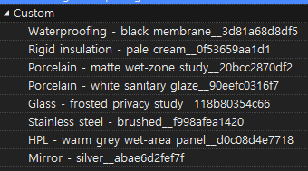

# 사용자 설명과 사진 원문

Component 구성 판단에는 이 원문을 사진과 함께 읽는다. 2026-10-25 Notion 직접 조회본이며 아래 원문 구간은 fetch가 반환한 본문을 그대로 보존했다. 해석·운영 지침은 [구성 기준](components-and-plans.md#component를-나누는-기준)과 [구축 검수](visual-review.md#구축-관계와-중첩)에 별도로 둔다. 원본 Notion 본문·사진을 수정하거나 요약으로 대체하지 않았다. 사진 사본은 원본 다운로드 바이트를 유지한다.

## 출처: [광장 접근](https://app.notion.com/p/404e0a39412081e4b43ccd334dd08539)

<!-- 사용자 원문 시작 -->
# 작업 피드백

이거 재료리스트를 왜 또 파일로 생성했는지 모르겠음. 하면 안되는 짓임<br /><code>.almond\tmp\calls\bbb2655c3ad24e5191275e195821d84a\reorganize\library.json (+1 -0)</code>

이런거 왜 파일을 만들어서 쓰는지 모르겠음<br />

```javascript
• Edited .almond\tmp\calls\f5c486b51a154d6cb751c486e478c2dc\reorganize_20261025\cleanup_db.py (+5 -3)

- assert {r['component_id'] for r in current}=={r['component_id'] for r in old['components']}
- assert ids.issubset({r['component_id'] for r in current})
- outside_at_start=[r for r in current if r['component_id'] not in ids]
```

키값에서 <code>material_id</code>제외. <code>almond</code> prefix제거

<code>floor</code>키는 비어있으면 파악해서 기입해야 함

construction\_detail키 필요없음. 상위레이어에서 get할 수 있으니 <code>almond:component_record</code>는 왜 있는지<br />Scene\_id 있어야 함. 빈 값으로라도 있어야 함.

<code>structural_role</code>보단 <code>role</code>이 맞는 것 같음

type을 추가하면 좋을 것 같긴 함.

모든 객체에 이름 부여할 필요 없음. 가능한 empty로 둘 것.

부재 1,2,3,4, 이딴짓거리를 하지 말고, 넘버링한 걸 component로 묶게 해야 함. 현재의 컴포넌트같은 묶는 기준을 적용하고, 그 내부에서 동일한 부재는 group해도 되지, 대신 componet로 upsert하면 안되고 ㄹㅇ 라이노 내에서의 부재 group인걸로.

컴포넌트로 등록 안하는 group은 그룹이름 좆대로 지어도 됨. 근데 component인 그룹의 이름을 또 컴포넌트 id를 기입할 필요 없음. 구성요소의 적절한 명명이 그룹명으로 적용되어야지.

9개 작업 중, 이 파일의 작업만 유일하게 건축적 요소+의미단위로 컴포넌트를 묶었음. 근데, 그 컴포넌트 내에 객체들은 텍토닉에 맞게 구축되어야 함. 근데 slab위에 finising이런거 중첩되어있음. 이는 2개가 문제인건데, finishing이 어떻게 구축되어야 하는지 고려를 안했거나 올바르게 판단 못한 것이고, 검수할때도 못알아차린 것이고, 두번째는 중첩 검사를 일부러 안했는지 모르겠지만 했다면 찾고 boolean difference하던가 다른 조치를 하던가 했어야 함. 지금 몇몇 컴포넌트만 그런게 아니고 거의 대부분 문서에서 대부분의 컴포넌트에 중첩이 있음.

<p />

<!-- 사용자 원문 끝 -->

## 출처: [군대 초소](https://app.notion.com/p/404e0a39412081eeafecd2d2f9229c31)


<!-- 사용자 원문 시작 -->
# 피드백

<p>
컴포넌트를 무슨 sketchUp의 component로 이해한 것 같은데 씨발.. 기둥 1, 2,3,4,5,....바닥 1,2,3,4,5,,,,,이러면 안되지. 개 씨발. 유일하게 계단은 똑바로 했다. 계단 외에는 그냥 기둥, 슬라브, 가구, 문, 창문을 각각 개별 컴포넌트로 만들었음 개 병신새끼가 작업한게 분명함. 어휴…  
</p>

<p />

<p>
\- block잘 활용하게 해야겠음. 계단이 예시.<br />= 창문이 하나의 컴포넌트...  group으로 묶어도 되지만 component는 아니어야지. component는 구축의 어떤 단위 묶음+의미 묶음이다. 씨발  하… 그 창문이 위치하는 공간을 에워싸는 요소들이 여럿 있고, (바닥, 마루, 출입벽, 바깥 풍경이 보이는 벽+창문 이렇게 의미단위로 묶어야지 개 씨발.  일단 block으로 만들 수 있는건 다 블록으로 만들고서 컴포넌트를 묶게 해야 함. 그리고 reculsive grouping하되 그룹이 컴포넌트가 아니어도 되고 적절히 잘 활용하게 해야 함. 
</p>

<p>
후레싱이 벽에 충접돼있음. 이거 충돌검사 안하나? 못하나? 
</p>

<image source="notion-file-block://404e0a39-4120-8033-a0be-e5b2d8f7b335/f1cebce0-4144-4809-980e-b0475e733708?space_id=dd209ba4-896b-435c-805f-a0803a8049c0&name=image.png" />

<p>
사진에 지붕은 하나의 컴포넌트로 잘 구성해놨네. 근데 우수관은 별도의 컴포넌트로 했음. 의미단위로 컴포넌트를 정의하면, 지붕의 역할을 생각해야겠지, 그러면 우수관이 전층에 걸쳐있고 혹은 기둥 내부에 놓인채로 타설된 콘크리트 내부에 있다고 할지라도 그건 지붕 컴포넌트여야지. 그리고 지붕 컴포넌트 내에 우수관 element들이 그룹으로 되어있어야 하고 그룹이지만 component는 아니고. 그리고 지붕의 구축 시스템이 있는데 여러개 시스템이 있으면 분리해서 (reculsive group)했어야지. 
</p>

<p />

<p />

<p />

<p />

<!-- 사용자 원문 끝 -->

## 출처: [주민시설](https://app.notion.com/p/404e0a39412081fabaaee5d5f43b4650)




<!-- 사용자 원문 시작 -->
# 피드백

<image source="notion-file-block://404e0a39-4120-801e-87d9-ef0f6165f79f/0e058069-af66-4cef-9609-6e763d318792?space_id=dd209ba4-896b-435c-805f-a0803a8049c0&name=image.png" />

<p>
위 사진의 레이어 생기는거 아직도 남아있는지 확인하고 처리해야 함. 
</p>

<p />

<p>
그냥 존나 낱개로 컴포넌트 존나게 많이 정의해놨는데 아무 의미도 없음 개 씨발. 

<image source="notion-file-block://404e0a39-4120-8021-83ff-ccec18b4f182/f2a31738-eb58-4557-80ce-2adfdad43df0?space_id=dd209ba4-896b-435c-805f-a0803a8049c0&name=image.png" />

<p>
이런 공간이 있는데, 작은 계단참과 마루같은공간에서의 행태가 scene(프로그램, 장면, 가치)이고, 그 scene에는 그 장면을 가능하게 위로부터의 하중을 지지해주는 기둥보 6개? 그리고 계단, 마루, 가구들이 있는데, 기둥/보가 컴포넌트 하나(구조적 의미/역할), 바닥슬라브는 전체랑 통합돼있으니 없어도 되고, 계단참과 마루 지지하는 콘크리트와 마루 마감재가 하나의 컴포넌트이고 그것은 사람들이 마루에 걸터앉을 수 있게 해주는, 그러면서도 마루 그 자체인거야. 마루 위의 가구는 그 마루 위에 앉아있는 사람이 사용할 수 있는 혹은 그 마루를 이용하는데있어서 몇몇 행위를 가능하게 하고 유도할 수 있는 컴포넌트이고. 예를 들어 어르신들과 젊은 청년이 바둑 두고 있으면, 가구는 하나하나 따로 두는게 아니라, 방석 여러개와 낮은 책상? 그리고 바둑판, 바둑알 통, 바둑알, 시계재는거 있으면 그런거, 등등 가구가 속한? 행태, 이벤트, 의미 그리고 그것이 가능하게 하는 것들의 묶음이 컴포넌트여야 해. 하 씨발… 이게 그렇\~게 어렵나? 스킬에 아예 이 사진과 내 설명을 넣는게 맞는 것 같다. 
</p>
</p>

<!-- 사용자 원문 끝 -->
