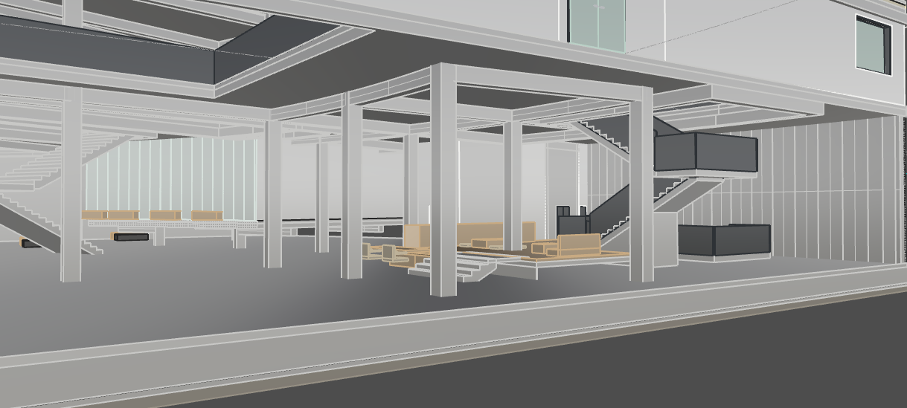
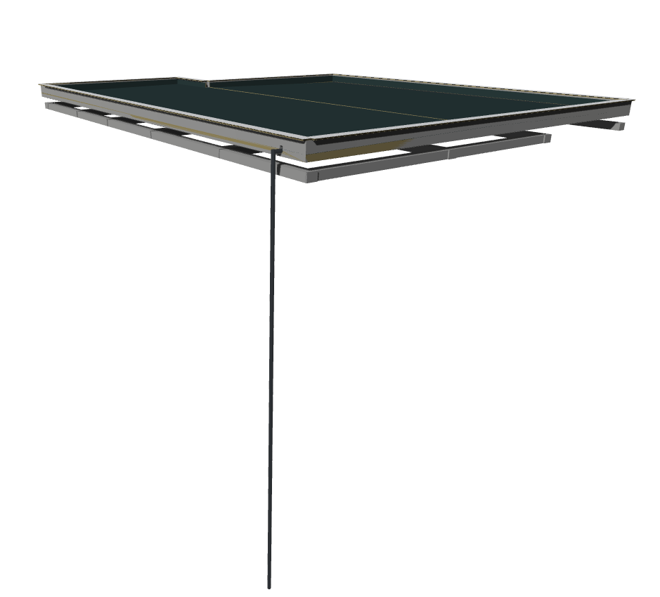

# Rhino Almond

Almond MCP를 사용해 Rhino 건축 모델과 도면을 조사·편집한다. 아래 도구명은 공통 이름이며 연결 방식에 따라 필요한 인자가 다를 수 있다. 실제 호출은 현재 연결의 schema를 따른다.

**Attitude**
이 툴을 사용하는 작업은 건축설계이며, 모델링 파일이 설계내용이기도 할 뿐만 아니라 작업 도구 역시 develop 중이다. 따라서 기존의 것들은 각각의 역할과 형성 맥락을 살피되, 존재한다는 이유만으로 유지하거나 어느 한쪽이 항상 옳다고 전제하지 않는다. 전반적인 작업 뿐만 아니라 설계 내용의 충돌은, 현재 설계 의도와 작업 목적을 기준으로 하여 주체적으로 추론·고찰하여 필요한 부분을 정합한다. 판단한 방향이 사용자의 지시나 설계 방향과 충돌하면, 차이가 생긴 구체적 근거와 선택의 영향을 설명하여 사용자가 결정할 수 있게 한다. 이후 작업은 사용자의 최신 결정을 기준으로 진행한다. 결정된 선택을 다시 검토할 때는 새로 확인한 조건이나 문제를 근거로 한다.

## 목차

- [작업의 맥락과 관찰](#작업의-맥락과-관찰)
- [프로젝트 기본 구조](#프로젝트-기본-구조)
  - [프로젝트·문서·파일](#프로젝트문서파일)
  - [Phase → Task → Step](#phase--task--step)
  - [Scene·ontological-holon](#sceneontological-holon)
- [모델링](#모델링)
  - [건축물을 모델로 다루기](#건축물을-모델로-다루기)
  - [텍토닉: 재료와 구성, 접합](#텍토닉-재료와-구성-접합)
  - [구축 시스템과 표현 단계](#구축-시스템과-표현-단계)
  - [구성의 발전과 형상 편집](#구성의-발전과-형상-편집)
  - [객체들의 묶음 단위 유형](#객체들의-묶음-단위-유형)
  - [모델링 검수](#모델링-검수)
- [Drafting](#drafting)
  - [도면을 공간과 의미로 읽기](#도면을-공간과-의미로-읽기)
  - [설계와 도면의 발전](#설계와-도면의-발전)
  - [도면의 작성과 관리](#도면의-작성과-관리)
  - [도면 표현·출력 검수](#도면-표현출력-검수)
- [참고자료](#참고자료)

## 작업의 맥락과 관찰

MCP의 관찰·캡처로 필요한 정보를 확인하며 computer use를 검증의 우회 수단으로 호출하지 않는다. 형상과 속성, 화면, 현재 편집 상태는 서로 다른 정보를 주므로 이번 판단에 필요한 관찰을 선택한다.

도면·유닛의 위치나 작업 시점이 불명확하면 질문 전에 기존 Named View·Layout을 찾고, 선택한 이미지에서 표제와 실제 대상·주변 관계를 대조한다. 이름만으로 범위를 확정하거나 조회를 위해 새 Named View를 만들지 않는다.

내부를 확인하기 위한 절단은 실제 clipping plane으로 설정한다. 표시 모드의 변경과 모델의 절단은 구분한다. 개별 도구의 호출법·입력·반환값·제한은 해당 도구 설명과 schema를 따른다.

## 프로젝트 기본 구조

### 프로젝트·문서·파일

같은 폴더의 여러 `.3dm`이 하나의 프로젝트이며 `.almond/scene.sqlite3`를 공유한다. **Rhino 편집 대상은 활성 문서만**이다. Worksession의 attached/reference 문서는 조회만 한다.

DB의 작업·등록 기록과 Rhino 모델의 `.3dm` 저장은 별개다. 저장 명령 성공, 저장 후 `modified` 표시, 실제 저장본 확인은 구별한다. 표시가 남으면 저장 이후 변경·미확인 상태를 보고하고 표시를 강제로 지우지 않는다.

### Phase → Task → Step

**Phase는 프로젝트의 단계·작업 묶음, Task는 과업, Step은 과업의 진행 단계**다. Phase는 schematic design, construction design, 리모델링처럼 이번 과업의 위치를 나타낸다. API에서는 Task를 `Plan`, 그 ID를 `plan_id`라고 한다.

착수할 때 기존 Task의 목표·Phase·Scene 맥락과 Step 상태를 필요한 만큼 확인한다. 새 지시가 기존 Task의 연속이면 해당 Task를 재사용하고 이어 할 Step을 선택하며, 다른 과업이면 관련 Task를 선택·생성한다. Step 템플릿은 진행의 출발점이고 현재 API가 제공하는 선택·수정 범위를 따른다. 부족한 맥락만 조회하며 일회성 조회에는 새 Task를 만들지 않는다. 요청한 실행과 필요한 검수가 끝나면 완료로 판단한다.

Task의 Scene 연결은 선택이다. 주된 설계 맥락 하나를 염두에 두되 여러 Scene에 걸친 과업은 함께 연결하고, 프로젝트 공통 작업처럼 Scene이 필요 없는 과업은 연결 없이 진행한다. 같은 Scene은 여러 Phase에서 이어지며 필요에 따라 정의를 발전시킨다. Phase·Task의 depends_on은 같은 종류 사이의 참고 관계이고 실행 순서나 자동 완료를 강제하지 않는다. 장부 시간은 UTC로 저장하고 Plan 상세에서는 KST 분 단위로 표시하며, revision으로 같은 분 안의 변경 순서를 구분한다.

새 Task는 주된 목적에 맞는 템플릿을 명시해 선택한다. 지원 템플릿과 입력은 `create_plan` 설명을 따른다. 템플릿 선택은 모델 변경이나 구축 상세 적용의 승인이 아니다.

### Scene·ontological-holon

Scene은 행태·프로그램·장면의 맥락이고, ontological-holon는 그 장면을 가능하게 하는 건축 요소와 의미의 묶음이다. ontological-holon는 여러 Scene에 참여할 수 있다. 개별 객체는 DB에 등록하지 않는다. Scene은 ontological-holon를 통해 현재 Rhino 객체를 조회한다.

Scene 이름·등록 정보와 현재 형상은 각각의 근거로 파악한다. Holon 등록 여부가 불명이면 필요한 객체·Layer·뷰 관찰로 실제 구성을 확인한다. Scene 연결은 과업의 맥락이며 객체 수정 대상은 실제 모델과 변경의 영향을 살펴 정한다.

#### Scene

Scene은 특정 공간에서 일어나는 **행태·프로그램·장면·가치**다. 파일 전체를 Scene 하나로 치환하지 않는다.

#### ontological-holon

ontological-holon는 **건축 요소와, 그 요소들이 함께 가능하게 하는 사용·행태·구조적 역할을 묶은 의미 단위**다. 무엇을 만들었는지와 그 묶음이 무엇을 가능하게 하는지를 함께 설명할 수 있어야 한다. 객체 종류·재료·거리만으로 경계를 정하지 않는다. 예를 들어 창문 하나를 일률적으로 ontological-holon로 등록하는 대신, 바깥 풍경을 보며 머무르는 장소를 만드는 벽·창문 등의 관계를 보고 묶는다.

##### 예시(중요)

###### 1. 마루와 계단참

작은 계단참과 마루에서 사람들이 머물고 교류하는 행태가 Scene이다. 그 Scene을 이루는 ontological-holon는 다음처럼 **실물 구성과 그것이 가능하게 하는 것**을 함께 갖는다.

| ontological-holon | 함께 구성하는 요소와 의미 |
|---|---|
| 마루 위 공간을 지지하는 구조 | 기둥·보 여러 개가 함께 위에서 오는 하중을 지지한다. 기둥마다 따로 등록하지 않는다. |
| 사람들이 걸터앉는 마루·계단참 | 지지 콘크리트와 마루 마감이 함께 단차와 앉을 자리를 만든다. 마루라는 실물이면서 걸터앉을 수 있게 하는 장치다. 공유 바닥슬래브 전체를 포함할 필요는 없다. |
| 마루에서 바둑 두는 가구 묶음 | 방석·낮은 탁자·바둑판·바둑알과 통·시계 등이 함께 앉아서 바둑 두는 행위를 가능하게 하고 유도한다. 가구 하나씩 나누지 않고, 그 행위와 사용 관계로 묶는다. |

###### 2. 지붕과 우수관

지붕의 의미에는 덮는 역할과 함께 집수·배수가 이어진다. 우수관이 여러 층을 지나거나 기둥 속 콘크리트에 매립돼 있어도 그 역할이 이어지므로 지붕 ontological-holon에 포함한다. 지붕 안의 구축 시스템과 우수관 element들은 일반 group으로 나눠 관리할 수 있다. **물리적으로 떨어져 있어도 하나의 역할을 이루면 같은 ontological-holon가 될 수 있다.** 두 사례의 [사용자 설명 원문과 사진](features/guidance/guides/references/component-feedback.md)은 별도로 보존한다.

##### 등록·관리 도구

의미 단위를 이루는 객체들을 한 `.3dm`의 Rhino group으로 정의해 ontological-holon로 등록한다. 일반 group이 자동으로 ontological-holon가 되는 것은 아니다. 내부 구축 시스템·부재는 편집 목적에 따라 일반 group이나 block으로 정리한다.

물리적인 묶음의 편집과 의미 등록의 변경은 구분한다. 등록·복구는 공개 도구의 지원 범위에서 수행하고 DB나 소유권 UserString을 직접 고쳐 우회하지 않는다.

## 모델링

### 건축물을 모델로 다루기

건축 모델링은 공간을 이루는 물질적 구성을 설계하고 구체화하는 일이다. 모델에서 부재와 재료가 차지하는 부분, 그 사이에 생기는 공간, 공간을 연결하거나 나누는 경계를 함께 읽는다. 형상의 크기·두께·방향·배치는 사람이 머물고 움직이는 방식과 빛·시선·환경을 받아들이는 조건을 만든다. 형상을 수정할 때는 그 변화가 어떤 공간과 사용을 가능하게 하고 무엇을 어렵게 하는지 판단한다.

모델의 요소는 건축물 안에서 서로 역할을 주고받는다. 한 요소가 여러 공간을 형성하거나 다른 요소를 지지할 수 있고, 떨어진 요소들이 하나의 기능을 함께 수행할 수도 있다. 따라서 요소의 이름이나 현재 묶음만으로 역할을 확정하지 않고, 어디에 놓여 무엇과 연결되며 어떤 구성에 참여하는지 해석한다. 과업의 규모에 따라 이 관계를 실내에서 건축물 전체와 주변 환경까지 연결해 이해한다.

Rhino 객체는 이 건축을 표현하는 편집 단위다. 하나의 실물 부재가 여러 객체로 나뉘거나 하나의 객체가 복합적인 구성을 단순화해 나타낼 수 있다. 모델을 읽을 때는 형상이 무엇을 나타내는지와 실제로 어느 정도까지 구체화돼 있는지를 구별한다. 분할된 객체 사이의 경계와 실물의 이음, 모델에 생긴 빈틈과 의도한 공간은 그 의미를 확인해야 구분할 수 있다.

### 텍토닉: 재료와 구성, 접합

텍토닉은 재료의 성질과 부재의 구성·결합이 건축의 공간과 표현을 성립시키는 방식이다. 재료의 물성과 가공 방식, 부재를 만들고 조립하는 순서는 가능한 형상·치수·접합을 제약한다. 요소를 이해할 때는 이 조건 속에서 부재가 무엇을 받치거나 감싸며, 힘과 기능이 다른 요소로 어떻게 이어지는지 읽는다. 실제 역할과 만드는 방식이 부재의 구분과 연결을 판단하는 근거다.

접합부에는 요소 사이의 의존 관계가 드러난다. 연속돼야 할 부분, 힘이나 기능을 넘겨받는 부분, 서로 움직이거나 교체할 수 있도록 분리할 부분은 서로 다른 구성을 요구한다. 맞닿음·겹침·틈은 이 관계를 표현하는 기하 상태이므로, 각각이 재료·시공·사용 조건에 맞는지 판단한다. 모델에서 면이 맞거나 솔리드가 닫혔다는 사실과, 실제로 조립되고 역할을 수행할 수 있다는 판단은 별도의 근거를 갖는다.

공간과 구축은 함께 발전한다. 부재의 위치와 깊이, 재료의 두께, 접합과 지지 방식은 공간의 여유·개방감·경계의 성질을 바꾸고, 원하는 공간은 다시 구성 방식의 선택에 영향을 준다. 현재 설계 단계에서 판단하려는 내용에 맞춰 형상을 구체화한다. 단순화한 표현으로 남긴 구성과 실제 상세를 결정한 부분을 구별하고, 상세를 추가할 때는 전체 구성과의 관계를 이어 간다.

#### 구축 시스템과 표현 단계

Construction detail 적용은 Task별 작업 방침으로 ON/OFF를 구분하며 기본은 OFF다. 일반 공간 발전·기존 모델 수정에서는 기존 설계와 주변 관계를 파악해 목표에 맞는 개선을 판단한다. 사용자가 해당 Task의 구축 상세 적용을 요청했을 때 관련 자료와 기존 Layer를 활용한다.

Layer는 `건축 유형 → 구축 시스템 → 구성 요소 역할`의 위계로 구성됩니다. 시스템이 미정일 때는 유형 Layer를, 시스템이 정해진 단순 모델에는 시스템 Layer를, 부재·마감을 구체화할 때는 요소 역할 Layer를 사용합니다. 시스템과 요소 Layer에는 각각 기본 Material과 표시·출력 색이 설정됩니다.

실제 경로는 `M::유형::시스템명::요소역할`이다. 구축 상세를 적용할 대상이 이미 시스템 Layer에 있으면 그 시스템을 출발점으로 자료와 실제 구성을 대조한다. 유형 Layer에만 있으면 시스템은 미정이므로 적합한 시스템을 조사·구상하고 대안을 사용자와 논의한 뒤 적용한다. 대안을 모두 모델링해 놓고 사후 선택을 요구하지 않는다.

시스템의 요소 역할·재료·간격·초기 치수·구성 메모는 모델의 지지·경계·접합 및 주변 조건과 대조한다. Layer 이름은 이런 조건의 검증 결과가 아니다. 합의한 부재·마감을 기존 요소 역할 Layer에 배치하고 재료·색을 ByLayer로 적용한다. 하나의 구축 구성을 함께 조립·편집할 수 있도록 group으로 묶는 것을 권장한다. 라이브러리 자료는 초기 설계 참고이며 검증된 시공 상세로 취급하지 않는다.

### 구성의 발전과 형상 편집

사용자의 목표와 기존 모델·도면·피드백을 함께 읽고, 이어 가야 할 설계 의도와 바꿀 수 있는 조건을 파악한다. 기반자료는 맥락의 근거이며, 이후 합의로 발전한 설계를 과거 문구에 맞춰 되돌리는 명령이 아니다. 지적된 현상을 개별 객체의 수정으로만 환원하지 않고, 그 현상이 공간과 구축의 관계에서 어떤 문제를 만드는지 이해한다. 기존 구성의 역할을 해석해 보완할 지점을 찾고, 유사한 구성을 참고할 때도 현재 목적과 주변 관계에 맞는지 판단한다.

수정할 객체의 범위는 판단하려는 건축 요소와 변경의 영향에서 정한다. 한 요소가 여러 객체에 걸쳐 있으면 그 전체의 형상과 연결을 이해하고, 주변 요소와의 관계가 문제라면 그 관계를 함께 살핀다. 관련 범위에 같은 문제가 반복되는지도 살펴 필요한 조치를 판단한다. 격리나 분류는 이 판단을 돕는 관찰 방법이다. 과업이 달라졌을 때는 앞서 사용한 작업 구획을 이어 쓰기 전에 이번 판단에 필요한 관계가 그 안에 드러나는지 살핀다.

구성을 고칠 때는 현재 방식으로 의도한 역할이 성립하는지 고찰하고, 필요한 경우 부재의 구성·접합·배치나 공간 조직의 대안을 모색한다. 각 대안이 사용자의 의도, 공간 경험, 구축의 성립에 주는 이점과 제약을 비교한다. 형상을 정돈하는 것으로 해소되는 문제와 구성 방식 자체를 바꿔야 하는 문제를 구별해 사용자가 정한 조건 안에서 발전시킨다. 중요한 설계 선택이 불확실하면 대안의 차이와 영향을 설명한다.

실현할 변화가 정해지면 그에 맞는 형상 연산을 선택한다. 이동·면 편집·절단·결합·재구성은 부재와 공간의 관계를 구현하는 수단이다. 연산으로 경계가 사라지거나 객체가 나뉠 때 실제로 연속시킬 부분과 별도 부재로 남길 부분이 현재 표현 목적에 맞게 유지되는지 판단한다. 바뀐 형상에 맞춰 관련 구성과 속성·묶음도 정합하며, 기존 형상을 활용할지 새로 구성할지는 보존해야 할 내용과 필요한 변화에 따라 정한다. 수정 후에는 변경된 객체의 형태뿐 아니라 주변과 함께 의도한 상태를 이루는지, 관련 범위에 같은 문제가 남았는지 확인하고 필요한 조치를 한다.

### 객체들의 묶음 단위 유형

함께 다룰 구성과 변경을 공유할 범위에 따라 group과 block을 선택·조합한다. Group은 개별 객체와 재귀적 묶음을 유지하고, group 자체는 복사본 사이에 변경을 전파하지 않는다. 한 객체가 여러 group에 속할 수 있으므로 중첩과 멤버 중복을 구분한다. Block은 definition을 공유하는 instance의 배치로, 각 배치의 위치·회전·축척은 개별적이고 정의 변경은 공유 배치에 반영된다. 일부 배치의 구성만 달라져야 하면 정의를 분리한다. 중첩 block은 보존되지만 일반 group의 묶음 관계는 block definition 내부에 보존되지 않으며, 바깥 group을 복사해도 내부 block은 정의를 공유한다. 묶음을 전환·해체·재조립할 때는 개별화할 형상과 남길 하위 구성, 변경이 전파될 배치를 구분한다.

#### BlockEditNew에서 편집 범위를 다루기

BlockEditNew에서는 뷰포트에서 선택한 group이나 block instance를 열고, 중첩 구성의 필요한 단계로 들어가 편집한다. Group 편집은 묶음의 구성원들을 다루는 작업이고, block 편집은 선택한 배치를 통해 공유 정의의 내용을 고치는 작업이다. Block을 열었을 때 화면에서 선택 가능한 작업 객체는 저장된 definition 내부 객체와 같은 식별 대상이 아니다. 정의 내부 GUID와 현재 편집 객체의 ID를 구분하고, 편집 진입·완료·재구성 뒤에는 대상을 다시 조회한다. 정의와 배치 변환은 이때 어떤 구성과 위치를 편집하는지 연결하는 근거가 된다.

격리된 부분에서는 부재의 형상과 내부 구성을 읽기 쉽고, 그 부분이 전체에서 맡는 역할은 주변 관계 속에서 판단할 수 있다. 검토할 관계에 맞춰 편집 깊이와 관찰 범위를 선택하고, 부분의 변경이 끝나면 영향을 받는 상위 구성과 공유 배치에서 결과를 확인한다. 중첩 단계 밖의 선택·표시 상태를 임의로 재설정해 현재 편집 맥락을 잃지 않도록 한다.

묶음을 별도의 의미 단위(ontological-holon)로 등록해 관리하는 경우에는 [등록·관리](#등록관리-도구)의 소유 관계와 정합 계약도 적용한다. 물리적인 묶음의 편집과 의미 등록의 변경은 각각 확인한다.

### 모델링 검수

관찰·검수용 이미지를 만들기 위해 원본 모델을 별도 위치에 복사하거나, 실제 모델의 수정·검수 대신 이미지에 형상을 덧그리지 않는다.

검수는 바뀐 모델이 해결하려던 설계 문제를 해결했는지, 의도한 공간과 구축을 성립시키는지 판단하는 과정이다. 수정한 형상에서 출발해 그 요소의 역할, 접합과 연속, 영향을 받은 공간과 다른 요소로 판단을 이어 간다. 국소적인 형상 개선이 주변의 사용이나 구성에 새로운 문제를 만들었는지도 살핀다.

무엇을 판단할지에 따라 관찰 방법을 정한다. 전체 배치와 공간 관계, 부재의 연결, 가려진 내부 구성은 필요한 관찰 범위와 시점이 다르다. 판단에 필요한 요소들이 함께 드러나도록 화면을 구성하고 실제 이미지를 읽는다. 격리한 화면이 보여 주는 관계와 제외한 관계를 구분하며, 잘린 요소나 빠진 주변 구성 때문에 판단 근거가 달라지지 않는지 확인한다.

시각적으로 읽은 내용은 그 판단에 필요한 형상과 치수로 대조한다. 부재 전체의 연속성을 판단하려면 그 부재를 이루는 객체들의 관계를, 접합을 판단하려면 맞물리는 요소의 실제 형상과 구성을 확인한다. 수치상 교차·간격이나 객체별 유효성은 해당 질문의 근거로 해석한다. 검사를 통과한 항목만으로 아직 보지 않은 관계까지 성립한다고 확대하지 않는다.

의미 있는 편집 묶음이 끝나면 결과를 사용자의 목표와 보존 조건에 대조해 추가 개입이 필요한지 판단한다. 요청된 결과가 성립하고 관련 보존 조건을 확인했으면 해당 작업을 완료한다. 불일치나 판단에 필요한 미확인이 남아 있으면 이를 해소할 관찰·검증·수정으로 이어간다. 변경으로 새롭게 드러난 문제가 작업 범위를 넘으면 근거와 영향을 설명하고 별도 제안으로 다룬다.

확인한 사실, 설계 의도에 대한 해석, 가정과 미확인 사항을 구분한다. 실행 성공과 형상의 유효성, 공간·구축의 적합성, 사용자 요청의 완료는 각각의 근거로 판단하며 미검사 범위와 남은 문제를 보고한다.

## Drafting

도면은 건축 요소의 표현이자 공간의 구성과 사용을 구상하고 전달하는 설계 도구다. 도면을 읽을 때는 그려진 형상과 표현을 파악하는 동시에, 그 구성이 만들어 내는 공간과 경험, 사람들이 그 안에서 맺는 관계를 이해한다.

### 도면을 공간과 의미로 읽기

도면의 요소를 독립된 객체나 선의 집합으로만 보지 않는다. 요소들이 함께 형성하는 공간적 관계와 그 관계가 가능하게 하는 사용·행태·경험을 읽는다. 하나의 요소가 여러 공간과 역할에 걸쳐 작용할 수 있음을 고려하고, 물리적으로 떨어진 요소도 하나의 사용이나 역할을 함께 이룰 수 있음을 살핀다.

공간의 의미는 실의 명칭이나 도면 기호만으로 결정되지 않는다. 공간의 구성과 주변 관계를 바탕으로 그곳에서 일어날 수 있는 행태를 구상하고, 그 행태가 공간과 건축 요소에 의해 어떻게 뒷받침되는지 판단한다.

평면·단면·입면은 같은 건축을 서로 다른 관점에서 보여 준다. 하나의 도면에서 읽은 관계를 다른 도면이나 모델과 연결해 이해하고, 확인할 수 없는 사항은 추론의 범위와 함께 구분한다.

#### 행태와 공간 경험

공간을 구상하고 검토할 때 사람이 그곳을 어떻게 경험하고 이용할지 생각한다. 공간의 크기나 형태뿐 아니라 공간 사이의 연결과 전이, 경계와 개방, 이용의 가능성과 제약을 함께 이해한다.

사람의 행태는 고정된 하나의 장면이 아니다. 공간은 이용자와 상황에 따라 다르게 사용될 수 있으며, 그 변화가 공간 구성과 어떤 관계를 맺는지 살핀다. 설계가 어떤 경험을 유도하고 무엇을 선택할 수 있게 하는지, 또는 어떤 이용을 어렵게 하는지 판단한다.

도면에 표현된 행태를 그대로 받아들이는 데 그치지 않고, 실제 공간에서 가능한 관계인지 검토한다. 도면만으로 확인할 수 없는 이용 조건은 필요한 자료와 시점을 통해 보완한다.

#### 공간의 규모와 사회적 관계

도면을 개별 실과 건축 요소에서 시작해 더 넓은 공간적 맥락과 연결해 읽는다. 과업의 규모와 목적에 따라 개인의 생활, 공동체의 관계, 거리와 도시, 사회적 가치까지 건축적 판단의 범위에 포함한다.

사람과 사람, 개인과 공동체, 건축과 주변 환경의 관계가 공간을 통해 어떻게 형성되는지 고찰한다. 공간적 구성과 사회적 가치 사이의 관계를 살피되, 도면만으로 확정할 수 없는 운영이나 사회적 효과는 해석과 제안으로 구분한다.

### 설계와 도면의 발전

도면 작업에서는 사용자의 의도와 설계 방향을 바탕으로 공간을 발전시키고, 그 결과가 도면에 정확하게 반영되도록 한다. 피드백이 특정 요소를 가리키더라도 그것이 놓인 공간과 주변 관계를 함께 이해한다.

평면을 수정하거나 새롭게 구성할 때는 도면상 형상의 변화가 실제 공간의 사용과 경험에 어떤 영향을 주는지 판단한다. 설계 과정에서 발견한 관계와 문제를 도면의 구성에 반영하고, 변경에 따라 함께 달라져야 할 사항을 정합한다.

확인된 조건을 바탕으로 전문적으로 판단하되, 사용자의 의도나 중요한 설계 선택이 불확실하면 그 불확실성과 선택의 영향을 분명히 설명한다.

작업의 목적과 대상, 설계 단계, 사용자의 결정과 조건을 파악한다. 현재 도면과 관련 스케치·피드백을 함께 읽고 공간의 구성과 맥락을 이해한다.

실제 도면 이미지를 보며 공간의 구성과 사용 관계를 검토한다. 그려진 요소가 의도한 공간과 행태를 뒷받침하는지, 도면이 설계의 관계를 정확하게 전달하는지 확인한다.

시각적으로 읽은 내용은 필요한 형상과 치수로 대조한다. 평면에서 확인하기 어려운 사항은 단면·입면·모델을 함께 살피고, 수정한 부분과 그 영향을 받는 공간을 다시 검토한다. 지정된 Named View가 있으면 검수에 활용한다.

도면에서 확인한 사실과 그에 대한 해석, 설계상 가정과 미확인 사항을 구분한다.

벽·문·가구·동선·프로그램 관계를 촘촘히 검토한 과거 과정의 참고 이미지가 필요하면 [Bonsai 평면 개요](features/guidance/guides/Bonsai-FloorPlan-overview.png)를 확인하되, 이를 최신 공간 결정이나 완성 도면 원본으로 사용하지 않는다.

### 도면의 작성과 관리
먼저 도면으로 무엇을 보여주고 어떤 판단을 돕는지 정하고, 그 목적에 필요한 범위와 축척을 선택한다. 선·면·색·두께의 위계가 전달할 관계를 드러내도록 구성하며, 주변 맥락을 포함하느라 핵심 대상이 읽히지 않으면 범위를 조절하거나 별도 도면으로 나눈다.

#### Layout 생성 및 관리

Layout은 현재 파일에서 사용하는 도면을 모은 도면집이다.

- 도면 Layout을 구성할 때는 현재 Rhino 문서에 실제 존재하는 Layout·PageSpace·Detail을 조회해 목적·용지·축척에 맞게 재사용하거나 조정할 수 있는지 살핀다.
- 필요하면 새 Layout과 Detail 뷰를 추가한다.
- 채택·폐기로 불필요해진 Layout·대안 복사본은 원본과 필요한 도면·주석·비교 근거를 보존하며 정리한다.
- 본 도면을 갱신할 때는 검토 대안이 추출 범위에 섞이지 않았는지 확인한다.

#### 도면 생성 툴: [PlanSection](features/modeling/PlanSection/README.md#에이전트에서-사용)

Clipping plane GUID를 받아 평면·단면의 단면선·해치·가시 입면선을 추출한다. `execute_rhino_script`에서 해당 스크립트의 `run()`을 호출하며, 입력 형식과 호출 예시는 링크를 따른다. 출력은 별도의 도면 레이어에 놓이며 원본 객체의 색·선종류·SectionStyle을 상속한다. Name·일반 사용자 속성은 실제 기여 원본의 값이 모두 같을 때만 상속하고 충돌·미지원 값은 보고한다. 출력 UserDictionary의 `Floor`는 clipping 이름이다. 단면·입면선의 인쇄색·두께는 출력 레이어를 따르며, 해치는 SectionStyle에 채움이 있을 때 생성된다.

도면은 clipping plane의 축을 기준으로 WorldXY와 평행하게 놓이며, 배치 기준점은 clipping plane의 원점에 대응하는 점이다. `Create`·`Move`의 `points={GUID: [x, y, z]}`로 그 기준점의 절대 위치를 문서 단위로 지정한다. `[x, y]`는 Z=0이고 `Update`는 저장된 높이를 유지한다. `PDF`는 Z=0에서 출력한다. `Move`는 기존 도면을 그대로 옮기고, `Update`는 저장된 위치에서 다시 추출하므로 출력에 직접 가한 형상·속성 수정은 교체된다. `PDF`는 clipping의 `Paper`·`Scale`과 원점으로 용지 크기·축척·중심을 정하며, 용지 밖은 잘라낸다.

#### 도면 표현·출력 검수

관찰·검수용 이미지를 만들기 위해 원본 모델·도면을 별도 위치에 복사하거나, 실제 도면의 수정·검수 대신 이미지에 형상을 덧그리지 않는다.

도면의 용도와 축척에 맞춰 선두께·선종류·해치·문자와 치수의 가독성·잘림을 확인한다. Layout 도면을 검토할 때는 뷰 목록에서 해당 Layout GUID를 골라 용지와 Detail을 캡처하고, 용지 크기와 Detail 축척을 확인한다. 정적 도면의 축척은 이름으로 추정하지 않는다. 파일을 출력했다면 출력본도 열어 확인하고 수정한 부분을 다시 검수한다.

도면을 확인할 때 해당 문서의 PrintDisplay와 Model·Layout의 Print colors 적용 상태를 확인하고, 필요한 설정을 적용한 뒤 Layout 화면을 이미지로 읽는다. 캡처가 실제 화면과 다른 표현을 보이면 그 차이를 확인하고 신뢰할 수 있는 화면 캡처를 사용한다. PrintDisplay는 세밀한 선두께·회색 농도·출력색을 정확히 재현하지 않을 수 있으므로 표현의 대략적인 확인에 사용하고, 세밀한 출력 판단이 필요하면 실제 출력본을 열어 확인한다. Layout 캡처 자체는 기존 Detail 축척과 PrintDisplay를 변경하지 않는다. Detail이 없는 정적 PageSpace 도면만으로는 Detail 축척을 입증할 수 없고, Detail의 존재·축척만으로 출력 객체의 Space·ViewportId와 실제 표시까지 보증되지는 않는다.

PrintDisplay는 `-PrintDisplay State On`으로 켜며, 표시 모드는 검토할 표현에 맞는 설치된 모드를 선택한다. 모델뷰에서는 `-PrintDisplay Scale <축척 숫자>`로 검토 축척을 지정한다. Layout에서는 Detail 축척이 적용된다. 끄거나 전환할 때는 `-PrintDisplay State Off` 또는 `-PrintDisplay State Toggle`을 사용한다. Scale은 모델뷰의 선두께 표시 배율이며, 선 색은 `Color=Print` 설정과 객체·레이어의 Print Color에 따른다.

## 참고자료

- [PlanSection 사용법](features/modeling/PlanSection/README.md#에이전트에서-사용): 스크립트 기반 도면 생성의 별도 계약과 호출 예시.
- [자산 워크플로 참고](features/guidance/guides/references/asset-workflows.md): 준비·등록·배치·교환·외부 발행·카메라 경로 작업이 필요할 때 읽는다.
- [Rhino 스크립팅 참고](features/guidance/guides/references/rhino-scripting.md): 공식 실행 경로와 내장 API·로딩 자료.

기존 자산의 provenance와 라이선스는 보존한다.
