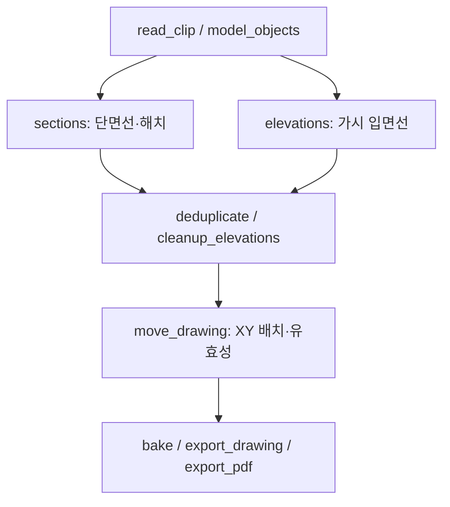

# PlanSection — 동작과 구현 명세

PlanSection은 clipping plane으로 **현재 활성 Rhino 문서의 모델**을 잘라 단면선·해치·가시 입면선을 만든다. Worksession의 다른 파일에서 clipping을 가져올 수 있지만, attached 모델의 최상위 객체는 도면에 포함하지 않는다. 숨김·잠금은 모델 입력을 제외하는 조건이 아니다.

이 문서는 현재 동작과 수정 위치를 설명한다. 실행 결과와 변경 이력은 [log.md](log.md), 구현은 [PlanSection.py](PlanSection.py), 자동 검사는 [tests/](tests/)를 기준으로 한다. Windows의 Rhino 8 / RhinoCommon / IronPython을 사용하며 Grasshopper와 MCP가 없어도 실행·검증할 수 있다.

## 1. 실행과 출력 모드

Rhino 명령행에서 실행한다.

```text
_-RunPythonScript "C:\TOOL\Rhino\mcp\almond-mcp\src\mcp\features\modeling\PlanSection\PlanSection.py"
```

첫 단계에서 User/Agent 사용 방식을 선택한 뒤 Create·Update·Move·PDF 네 작업 중 하나를 선택한다. User는 이름 내림차순 clipping 목록 창을 바로 열고, Agent는 GUID를 쉼표·공백으로 입력한다. 목록은 동명을 GUID로 구분하며 Ctrl/Shift 다중 선택과 Enter 확정을 지원한다. 여러 GUID는 요청 순서를 유지하고 중복은 제거하며, 없는 GUID가 하나라도 있으면 전체 요청을 실행 전에 거절한다.

Create·Update·PDF는 선택 후 Enter로 표시된 설정을 사용하고 `Change`로 옵션을 수정한다. Move는 표현 옵션을 묻지 않는다. 초기값은 Hatch=True, Elevation=True, PickPlacement=False, SmallDetails=Keep, Near/Far Width=0.09/0.04mm, Near/Far Dark=80/45%다. Darkness 100%는 검정이다. 최근 표현 옵션은 같은 Rhino 세션에서 재사용하되 작업은 매번 명시적으로 선택한다. Output=Document/Files와 PickPlacement는 Create에만 있다. Update·Move·PDF는 생성 옵션에 들어가지 않는다. 아래 표의 Placement는 Move 작업의 내부 모드명이다.

| Output | 하는 일 | 도면 원점 | 기존 도면과 객체 ID |
| --- | --- | --- | --- |
| Document | 활성 문서에 생성·교체 | clipping의 `draft_plane` 또는 WorldXY; PickPlacement=True이면 클릭점 XY | 해당 clipping의 이전 로컬 도면만 교체하며 새 ID를 만든다 |
| Files | 도면별 Rhino 8 `.3dm` 저장 | Document와 동일 | 활성 문서에 bake하지 않는다 |
| Update | 기존 로컬 도면을 현재 옵션으로 재계산 | 기존 도면의 `ps:placement` 우선 | 새 ID로 교체한다. 수동 형상·속성 편집은 재생성 결과로 바뀐다 |
| Placement | 기존 로컬 도면을 XY 평행이동 | 클릭한 새 clipping 원점 | 계산을 반복하지 않으며 ID와 수동 형상·시각 속성 편집을 유지한다 |
| PDF | 도면별 단일 페이지 벡터 PDF 저장 | clipping 원점을 종이 중심에 배치 | 활성 문서와 `draft_plane`을 변경하지 않는다 |

Update는 기존 도면이 없으면 건너뛰고 Document로 먼저 생성하도록 안내한다. Placement는 기존 도면이 없으면 실패한다. 둘 다 Files로만 내보낸 도면은 대상으로 삼지 않는다. Update/PDF는 PickPlacement를 무시한다.

`0 < FarWidth <= NearWidth`, `0 <= FarDark <= NearDark <= 100`이어야 하며 숫자는 유한해야 한다. Files/PDF는 실행당 저장 폴더를 한 번 선택한다.

## 2. 전체 처리 흐름과 코드 위치

`main`은 작업·사용자/에이전트 선택과 옵션을 담당한다. `run(doc, operation, clipping_ids, points=None, folder=None, ...)`은 입력 창 없는 에이전트 진입점이다. Move는 GUID마다 유한한 XY 배치점이 필수이고 Create는 선택적이다. Update/PDF에는 배치점을 받지 않는다. Files/PDF에는 기존 출력 폴더가 필요하다. `run_selected`는 두 진입점이 공유하는 취소·Undo·일괄 반복이며, `process_clipping`은 도면 하나를 처리한다. 결과에는 완료·건너뜀·실패·취소, 생성 ID나 출력 경로가 구분된다. 배치 중 일부 실패가 앞선 완료를 되돌리지는 않는다. 호출 예시는 [README.md](README.md)를 따른다. 실제 형상 계산은 문서에 출력하지 않는 `generate`에 모여 있다. 모델 파일명·건물 용도·clipping 이름에 따른 생산 계산 분기는 없다.



| 단계 | 입력 → 출력 | 담당 함수와 조건 |
| --- | --- | --- |
| Clipping 해석 | Rhino clipping → plane/depth/참여 목록/배치 plane | `clipping_planes`, `read_clip` |
| 모델 수집 | 활성 모델·중첩 블록 → world geometry record 목록 | `model_objects`, `resolved_attributes` |
| 단면 | record 목록 → section/hatch 항목 | `sections`, `intersect`, `clean_closed_curve`, `planar_union`, `region_boundaries` |
| 입면 | record 목록·깊이 → 가시 elevation 항목 | `elevations`; HLD와 거리별 인쇄 표현 |
| 선 정리 | 단면·입면 → 중복 정리·입면 Join·Keep/Omit | `deduplicate`, `cleanup_elevations`, `split_crossings` |
| 배치 | clipping 좌표의 도면 → XY 도면 | `drawing_transform`, `move_drawing`; 최종 Z=0 |
| 출력 | 검증된 도면 → 문서 또는 파일 | `bake`, `export_drawing`, `export_pdf` |
| 기존 도면 이동 | 로컬 출력 → 같은 ID의 이동 결과 | `drawing_objects`, `saved_placement`, `reposition_drawing` |

`generate(doc, cp, ..., place=True, small_details=True, profile=None, model_cache=None)`는 `{objects, report}`를 반환한다. `small_details=True`가 Keep, False가 Omit이다. `place=False`는 배치 전 좌표로 돌려주며, main의 점 지정 경로가 나중에 `move_drawing`을 호출한다.

- 모델 record: `geometry`는 복제·변환한 world geometry, `attributes`는 원본 속성 복사본, `resolved`는 상속을 해석한 출력용 속성, `source`는 `instance GUID/.../member GUID` 경로다. `record_bounds`는 정확한 world bbox를 한 번 계산해 단면 후보 검사와 입면 깊이 표현에 재사용한다.
- 출력 항목: `{geometry, attributes, role}`이며 role은 `section` / `hatch` / `elevation`이다.
- report: 실제 입력 수 `sources`, 제외·경고 `skipped`, 입면 정리 통계 `cleanup`, 역할별 출력 수다. `cleanup`에는 모드, Join·복구·분할·제거·보호 개수가 들어간다.
- 단독 `generate`는 복제한 입력 형상을 finally에서 해제한다. 여러 clipping을 선택한 main/독립 PDF 명령은 `ModelCache`가 필요한 world geometry와 bbox를 지연 준비해 공유하고, 명령의 finally에서 해제한다. 키는 source 경로·RhinoObject RuntimeSerialNumber·누적 변환 행렬이며 캐시는 명령을 넘어 유지하지 않는다. 참여 목록과 블록 경로는 clipping마다 탐색하고 원본/상속 속성은 매번 새로 해석한다. Placement와 단일 clipping은 이 캐시를 만들지 않는다.
- `generate`는 이미 반환받은 단면·입면 결과를 소유한다. 중복 제거·입면 정리가 새 결과를 반환하면 `dispose_drawing_items`로 다음 단계에서 사용하지 않는 이전 형상을 해제한다. 같은 객체를 그대로 넘긴 단면·해치·무수정 곡선은 보존하고 동일 객체를 두 번 해제하지 않는다. 이후 취소·배치·속성 처리에서 실패하면 마지막 완성 단계의 출력을 해제한다. 단계 함수가 반환 전에 내부에서 실패한 미반환 임시 형상까지 이 경계가 추적하는 것은 아니다.
- 모든 후처리가 성공하면 최종 출력 형상의 소유권을 호출자에게 넘긴다. `process_clipping`과 독립 PDF 실행기는 성공·배치 취소·출력 실패 모두에서 이를 finally로 해제한다. 모델 record와 입력 캐시는 출력 해제 대상이 아니며, Placement가 빌려 읽는 기존 문서 형상도 포함하지 않는다. 원본 RhinoObject와 block definition을 explode하거나 교체하지 않는다.
- `profile`에 dict를 넘기면 HLD Compute/Rejoin/출력 변환 시간을 기록한다. 선택한 clipping들이 사용하는 형상 합집합을 명령 종료까지 보유하므로, 여러 도면에서 입력을 재사용하는 대신 clipping별 즉시 해제보다 최대 메모리가 커질 수 있다.

## 3. Clipping과 모델 입력의 범위

### Clipping 선택

모든 레이어의 clipping을 찾고 이름·GUID·레이어를 목록에 표시한다. GUID 입력도 동일한 범위를 사용한다. 원본의 고정 `setting::clipping::Section` 레이어 제한을 제거했으며 원본 레이어·이름을 변경하지 않는다. Worksession 참조·숨김·잠금 clipping은 선택할 수 있고 삭제 객체와 block definition 안의 clipping은 제외한다.

`read_clip`은 유효한 plane, 활성화된 depth의 유한·음수 아님 조건, 배치 plane을 검증한다. Depth 비활성이면 무한 범위, 활성값 0이면 입면 없이 절단면만 생성한다.

### Worksession과 참여 목록

| 대상 | 입력에 포함하는 규칙 |
| --- | --- |
| 활성 문서의 일반 객체 | 형상 종류·유효성·participation·깊이를 확인한다 |
| 활성 문서의 hidden/locked 객체, off/locked 레이어 | 표시·잠금 상태에 관계없이 동일하게 계산한다 |
| 활성 문서의 nested/linked block | 활성 최상위 instance에서 재귀 탐색한다. 변환과 부모 속성을 누적한다 |
| Attached 모델의 최상위 객체 | 로컬 clipping과 참조 clipping 모두에서 제외한다 |
| Attached 파일의 clipping | 방향·깊이·기본 배치를 읽는다. 참조 파일의 participation 목록은 적용·검증하지 않는다 |
| 기존 도면·삭제 객체 | legacy generator 태그가 붙은 생성물과 삭제 객체는 제외한다. 일반 curve/hatch 출력도 지원 모델 종류가 아니므로 모델 계산에 들어가지 않는다 |

로컬 clipping에서 participation이 활성화되어 있으면 객체 GUID 또는 **정확한 레이어 index**의 OR로 매치한다. 포함 instance는 하위 가지 전체를 포함하고, 제외 instance는 가지 전체를 제외한다. 내부 멤버나 레이어를 직접 지정할 수도 있다. 부모 레이어 지정은 하위 레이어 전체로 확장하지 않는다. 빈 포함 목록은 빈 입력이다. 끊어진 객체 GUID나 삭제·범위 밖 레이어 참조는 도면 오류다.

`model_objects`는 가시성 필터를 사용하지 않는다. 먼저 보수적인 world bbox로 깊이 밖 객체를 제외하고 필요한 형상만 복제·변환한다. 명령 캐시를 사용해도 위의 활성/참조·hidden/locked·참여 목록·중첩 블록 규칙은 같다. 누락·순환 block definition은 오류로 보고한다.

### 지원 형상

| 원본 형상 | 계산과 채움 |
| --- | --- |
| Brep, Extrusion, Surface | 필요한 경우 Brep로 변환한다 |
| 비솔리드 단일 face Brep / Surface | 절단선만 만든다. 절단선이 닫혀 있어도 해치하지 않는다 |
| Open polysurface / open mesh | 열린 절단선은 유지한다. 닫힌 영역의 채움은 SectionStyle 규칙에 따른다 |
| Disjoint mesh | 단면 계산 때만 조각으로 나눈다. 조각별 solid 여부를 판정하며 입면 입력은 원래 mesh다 |
| SubD | 복사본을 ToBrep한다. 기본 변환이 없거나 무효일 때만 DefaultPacked로 재시도한다 |
| Curve, Point, Text/annotation 등 | `unsupported`로 집계하고 제외한다 |

무효 입력이나 변환 후 무효 형상은 `invalid`로 집계한다. 해당 수치는 “모든 원본이 처리됐다”는 뜻이 아니므로 report에서 확인해야 한다. SubD 원본을 수리하거나 바꾸지 않는다.

## 4. 단면선과 해치 생성

단면은 **절단 → 객체별 영역화 → 같은 스타일끼리 union → 공통 경계 → 선택적 해치** 순서다. Hatch=False도 단면 경계까지 같은 경로를 사용한다.

1. **후보 선별과 절단 (`sections` / `intersect`).** `sections`가 모든 원본의 world bbox를 먼저 검사한다. 절단면과 만나는 mesh만 disjoint 조각으로 나누고 조각별 bbox도 검사한다. 선별된 Brep/Mesh에 `intersect`가 BrepPlane/MeshPlane과 교차선 Join만 수행한다. 실제 교차선이 있을 때 원본 스타일 그룹을 결정한다. 비솔리드 단일 face는 이후 영역화를 거치지 않고 선으로 남긴다.
2. **닫힌 loop 정리 (`clean_closed_curve`).** 유효한 평면 폐곡선이며 자기교차가 없고 면적이 계산 오차보다 크면 원래 loop를 유지한다. 이 정상 경로에는 Boolean 재구성이 없다. 나머지만 각각 CreateBooleanRegions로 정리한다. 외곽·구멍의 loop를 한꺼번에 합치지 않고 반환된 RegionCurves의 내부 경계도 유지한다. 기본 topology 공차로 유효한 닫힌 결과를 얻지 못하면 공차의 1/10로 한 번 재시도한다.
3. **왕복·빈 Boolean 처리.** Boolean 뒤 정확한 왕복 spur가 남으면 `split_crossings`로 닫힌 영역과 열린 선을 분리한다. 입력 단면에서는 둘 다 유지한다. 빈 영역은 공선 polyline의 모든 점이 ZeroTolerance 이내일 때만 면적 없는 선으로 취급한다. 부호 있는 면적은 반대 방향 loop끼리 상쇄될 수 있으므로 면적 없는 형상의 증거로 사용하지 않는다. 설명되지 않는 빈 Boolean 결과는 출력 전에 오류로 보고한다.
4. **영역화와 union (`sections` / `planar_union`).** 한 객체에서 정리한 닫힌 경계들을 CreatePlanarBreps로 만든다. 같은 원본 레이어·해석된 스타일끼리 묶고 bbox가 공차 이내로 닿는 연결 묶음만 CreatePlanarUnion한다. 떨어진 단독 영역은 유지한다. 결과가 없을 때만 복사한 plane을 뒤집어 한 번 더 시도하며, 계속 없거나 무효이면 실패한다.
5. **공통 경계 (`region_boundaries`).** union의 DuplicateNakedEdgeCurves와 JoinCurves로 외곽·구멍을 얻는다. 유효하고 닫힌 Simplify 결과만 채택한다. 자기교차 경계는 같은 loop 정리 함수를 쓰되 union 경계에는 닫힌 결과만 사용한다. 짧은 열린 잔여는 제거하고 닫힌 구멍은 경계 추출에서 보존한다. 닫힌 유효 경계를 얻지 못하면 실패한다.
6. **단면선과 해치.** 공통 경계를 단면선으로 출력한다. 열린 절단선은 자기교차를 분리해 선으로 출력하며 면으로 강제 변환하지 않는다.

해치는 Hatch=True이면서 적용 SectionStyle이 채움을 지정한 경우에만 만든다. 지정 패턴이 없고 SolidColor 배경도 없으면 해치 0개가 정상이다.

- `ClosedCurves`는 열린 모델에서 생긴 닫힌 영역도 채운다. `SolidObjects`는 IsSolid인 입력만 채운다. 단일 열린 Surface/Brep는 선 전용 규칙이 우선한다.
- 모든 영역이 채움 대상이면 단면선의 union 결과를 재사용한다. 일부만 대상이면 그 부분만 별도로 union한다.
- 패턴·scale·rotation·foreground/background 화면색을 적용한다. 색이 미지정이면 해석된 원본 화면색을 사용하며 base point는 clipping 원점이다.
- 지정 pattern index가 없거나 삭제되었으면 Solid로 대체하고 원본 레이어·index를 경고한다. 원본 SectionStyle은 바꾸지 않는다.
- `create_hatches`는 경계의 ArcCurve를 정확한 NURBS로 바꿔 생성하고 실패하면 전체 경계를 NURBS로 재시도한다. 그래도 실패하면 동일 union Brep의 face를 CreateFromBrep에 전달한다. 최종 해치가 없거나 무효이면 도면 오류다.

## 5. 입면, 중복 제거와 Omit

### 가시 입면과 깊이 표현

Clipping plane의 signed distance를 `s`라 하면 입면 범위는 depth 비활성일 때 `s >= 0`, 활성일 때 `0 <= s <= depth`다. 카메라는 원본 plane 법선 방향을 본다. HLD에 전달할 때는 clipping 부호가 반대이므로 시작 plane을 뒤집고 유한 depth에는 끝 plane을 추가한다.

`elevations`는 HLD의 Visible segment만 사용한다. Tangent edge는 포함하고 hidden curve·tangent seam·인공 SectionCut edge는 제외한다. 화면의 활성 clipping 상태와 무관하게 계산한다. 동일 입력의 반복 계산에서 가시 구간이 달라지는 병렬 경로를 피하도록 HLD는 단일 스레드로 실행한다. RejoinCompatibleVisible로 같은 FullCurve의 연속 가시 구간을 먼저 재결합한다.

거리값은 원본 객체 bbox 중심의 signed distance를 0 이상으로 제한한 값이며 가시선을 낸 원본마다 한 번 계산한다. 실제 가시 출력의 최소·최대 깊이로 정규화한 `t`를 써서 `width = near + (far - near) * t`와 darkness를 선형 보간한다. 완전히 가려진 후보는 이 최소·최대값에 포함하지 않는다. 한 깊이만 있으면 near 값을 쓴다. 최종 속성 템플릿도 원본마다 한 번 만들고 각 곡선에는 독립 복사본을 준다. 입면 plot width와 print grayscale은 이 계산값이 우선하며 display color·linetype은 원본에서 상속한다. 긴 한 객체의 segment마다 다른 깊이를 주지는 않는다.

### 선 정리 순서

1. `deduplicate`는 원본 레이어와 해석된 원본 스타일별 RTree로 중첩 후보를 찾는다. 단면선이 먼저, 입면은 가까운 것부터 들어오므로 겹치는 구간은 앞선 선이 남는다. 단면끼리는 topology 공차, 들어오는 입면과 기존 단면/입면은 문서 공차로 CurveCurve overlap 구간만 자른다. 통째로 남는 생성 곡선은 다시 복제하지 않는다. 임의 NURBS를 직선으로 근사하지 않으며 중복선·부분 중복 정리를 생략하지 않는다.
2. `cleanup_elevations`는 **입면만 최종 출력 스타일별로 Join**한다. 거리별 width/grayscale이 다르면 합치지 않는다. native Join의 입력-출력 매핑으로 출처를 합치며 문서 공차보다 큰 입력이 사라지면 실패한다. IronPython은 명시적 out 참조를, Python.NET은 4인자 overload의 `(joined, mapping)` 반환을 사용한다.
3. Join 뒤 공차 이하 bbox 잔여를 먼저 제외한다. 더 큰 무효 polyline은 정확한 왕복·겹친 정점 복구를 시도하고 해결되지 않으면 문서 공차의 native Simplify가 유효할 때만 사용한다.
4. `split_crossings`는 자기교차/overlap 위치에서 선을 나누고 중첩을 정리한다. 폐곡선 seam 교차는 각 구간 Trim을 사용한다. 끝점 간격이 연산 공차 이내일 때만 닫으며 가려진 선을 새로 연결하지 않는다.
5. 아래 Keep/Omit 규칙을 적용한다. 단면·해치는 이 크기 필터 대상이 아니다.

### Keep/Omit 판정

크기는 **clipping plane 좌표에서의 bbox 대각선**이다. 커브 길이나 둘레가 아니며 20mm를 모델 단위로 환산한다.

| Join·분할 후 입면 | Keep | Omit |
| --- | --- | --- |
| bbox가 문서 공차 이하인 잔여 | 제거 | 제거 |
| bbox가 20mm 초과 | 유지 | 유지 |
| 20mm 이하의 유효한 작은 폐곡선 | 유지 | 제거 |
| 20mm 이하의 고립선·한쪽만 붙은 가지·다른 선 내부에 붙은 T접합 | 유지 | 제거 |
| 작은 열린 선들이 끝점으로 이어져 묶음 bbox가 20mm 초과 | 유지 | 유지 |
| 작은 열린 선 묶음이 서로 떨어진 두 위치에서 긴 단면/입면의 끝점에 연결 | 유지 | bridge로 보호 |

따라서 Omit 결과에도 작은 열린 선이 남을 수 있다. 긴 윤곽을 완성하는 짧은 조각을 Join 전에 삭제하지 않는 것이 이 순서의 이유다. 요소별 Rhino 그룹은 만들지 않는다.

## 6. 좌표와 공용 원점

도면 원점은 **clipping plane의 Origin에 대응하는 점**이다. 도면 bbox 중심이나 좌하단이 아니다.

Clipping의 world plane을 `(O, X, Y)`, 배치점을 `T=(Tx,Ty,0)`라 하면 plane상의 점 `p`는 다음 위치로 간다.

```text
u = (p - O) · X
v = (p - O) · Y
drawing(p) = (Tx + u, Ty - v, 0)
```

`drawing_transform`은 PlaneToPlane → 배치점을 지나는 World XZ 평면에 대한 반전 → WorldXY 투영 순서다. 축척은 바꾸지 않고 최종 Z=0을 고정한다. 원본 절단 좌표의 Z를 먼저 없애지 않는다. `move_drawing`은 투영 후 무효 polyline에도 `repair_invalid_polyline`을 적용하고 유효성을 확인한다.

기본 배치는 clipping ObjectAttributes user text의 `draft_plane`에서 읽는다.

```json
{"origin":[10000,20000,0],"xaxis":[1,0,0],"yaxis":[0,1,0]}
```

세 벡터와 plane은 유효해야 하지만 최종 배치는 origin의 X/Y만 사용한다. 저장된 축이나 Z로 도면을 기울이지 않는다. 값이 없으면 WorldXY 원점이다.

| 상황 | 위치 선택·저장 |
| --- | --- |
| 새 Document/Files, PickPlacement=False | 공용 clipping의 draft_plane/WorldXY. 기존 로컬 도면의 ps:placement는 기본값에 영향을 주지 않는다 |
| Document/Files, PickPlacement=True | 계산 후 도면별 클릭점 XY. 파란 Clipping origin 표식과 bbox preview가 같은 변환을 쓴다 |
| Update | 기존 ps:placement, 없으면 clipping draft_plane/WorldXY. 클릭하지 않고 clipping metadata도 바꾸지 않는다 |
| Placement | 저장된 기존 원점에서 새 클릭점까지 평행이동만 한다. 반전·HLD를 반복하지 않는다 |
| 로컬 clipping에서 점 지정 성공 | 정규화한 target plane을 로컬 draft_plane에 저장한다 |
| 참조 clipping에서 점 지정 성공 | 참조 clipping은 변경하지 않는다. 선택 위치는 로컬 출력/출력 파일의 ps:placement에만 남긴다 |

같은 좌표계에서 동일한 attached clipping을 사용하는 A/B 모델은 신규 생성 원점이 같다. A에서 도면을 옮겨도 B의 신규 생성 기본값은 변하지 않는다. A의 Update는 A 도면에 저장한 이동 위치를 유지한다.

기존 도면 안의 ps:placement 값이 서로 다르면 Update/Placement는 오류로 보고한다. Document로 다시 생성하여 일관된 배치 정보를 만들 수 있다.

모든 clipping에 draft_plane이 없으면 원점이 겹친다. 자동 간격 배치는 없다. Rhino Move로 도면을 옮기면 ps:placement가 갱신되지 않으므로 이후 Placement/Update의 기준도 자동 추적하지 않는다.

## 7. 공차: 값과 적용 위치

문서의 단위·절대/각도/상대 공차 설정은 변경하지 않는다. mm 문서의 0.5/1mm·0.5°는 검증 조건이며 생산 코드가 강제하는 문서 설정이 아니다. 단면 위상 공차와 입면 표현/정리 공차를 구분한다. 작은 공차가 모든 native 연산을 빠르게 한다고 가정하지 않는다.

| 값 | 적용 위치 | 예시·주의 |
| --- | --- | --- |
| `topology = min(docTol, 0.01mm의 모델 단위 값)` | 단면 교차·Join·Brep 생성·union·경계 정리·해치, 단면끼리 중복 제거·짧은 단면 조각 제거 | `section_tolerance`에서 결정한다. docTol=0.5/1mm이면 topology=0.01mm; 더 작은 문서 공차는 그대로 사용한다 |
| `topology / 10` | clean_closed_curve의 Boolean 재시도 한 번 | 다른 연산이나 문서/HLD 공차를 함께 줄이지 않는다 |
| `doc.ModelAbsoluteTolerance` | HLD, 입면→단면/입면 중복 제거, 입면 Join/분할/접점 판정, 일반 Simplify | 단면 union 경계에서는 짧은 **열린** 잔여를 거르는 기준으로도 사용한다 |
| `doc.ModelAngleToleranceRadians` | topology/입면 Simplify 등 각도 판정 | 문서 각도 공차 사용 |
| `RhinoMath.ZeroTolerance` | 정확한 A→B→A/겹친 정점 복구, 수치적 영길이 제외 | 유효한 작은 XY 디테일을 문서 공차로 지우지 않기 위한 복구다 |
| `20mm의 모델 단위 값` | Omit bbox 크기 판정 | Join/교차 공차가 아니다 |

`repair_invalid_polyline`은 정확히 같은 끝점을 가진 무효 3점 A→B→A를 한 LineCurve로 바꾼다. 그 외 무효 polyline은 ZeroTolerance로 Simplify한 결과가 유효할 때만 채택한다. 복구하지 못한 무효 형상을 정상으로 취급하지 않는다.

## 8. 속성, 소유 정보와 문서 변경

`resolved_attributes`는 Object/Layer/Parent source를 따라 화면색·인쇄색·굵기·linetype·scale·SectionStyle을 해석한다. ByParent는 가까운 중첩 instance부터 올라간다. `style_key`는 원본 layer index와 해석된 색/굵기/선종류/scale/SectionStyle을 포함하므로 같은 레이어 안의 서로 다른 custom도 분리된다.

| 출력 | 로컬 레이어 | 표현 |
| --- | --- | --- |
| 단면선 | `Drawing::Section` | 해석한 원본 표현에 SectionStyle boundary color/print color/custom linetype 적용 |
| 해치 | `D::Hatch::Pattern` | SectionStyle 패턴·화면색; print color는 ByLayer |
| 입면선 | `Drawing::Elevation` | 원본 display/linetype + 거리별 plot width/grayscale |

원본의 숨김·잠금·그룹·참조 소유권·재질은 출력 속성으로 복사하지 않는다. 목적 레이어나 부모가 참조·숨김·잠금이면 Document 출력은 명시적으로 실패한다. SectionAttributesSource.FromSectioner는 지원하지 않는다. BoundaryVisible/화면용 BoundaryWidthScale, 재질, viewport별 override를 일반 도면 속성으로 변환하지 않는다.

모든 출력 객체의 Name은 clipping 이름이다. 저장되는 user text는 `ps:source_layer`와 `ps:placement` 두 개다. 계산 중의 `ps:sources`·`ps:role`·`ps:style`·`ps:depth` 등은 출력 시 제거한다. Placement도 이 두 key로 정리하므로 임의로 추가한 출력 user text 보존을 보장하지 않는다.

소유 정보는 로컬 `Drawing` 루트 레이어의 `ps:clip:<clipping GUID>`에 출력 GUID 목록으로 저장한다. `drawing_objects`는 이 목록과 이전 버전 generator/clip 태그로 **해당 clipping의 로컬 출력만** 찾는다. 참조 도면은 이동·교체하지 않는다.

`bake`의 교체 순서는 다음과 같다.

1. 형상 계산·배치 검증을 완료하고 새 객체를 추가한다.
2. 필요한 로컬 draft_plane과 Drawing 레이어의 소유 목록을 갱신한다.
3. 이전 출력 객체를 삭제한다.
4. 중간 실패는 삭제한 이전 객체를 Undelete하고 새 객체를 제거하며 metadata를 복원한다.

Placement는 먼저 이동할 복사본 전체를 검증한 뒤 같은 GUID에 Replace한다. 실패 시 변경한 형상·속성을 되돌리며 복구가 불완전하면 Undo 필요 오류를 보고한다. Drawing 레이어는 EnsurePrivateCopy 후 Modify하여 소유 목록도 native Undo에 포함시킨다.

PDF 이외 실행은 기존 Undo record가 없을 때만 PlanSection record를 열고 그 record만 종료한다. RhinoCode wrapper나 Rhino 명령이 이미 연 record는 재사용한다. 자동 저장은 하지 않는다. Files/PDF로 생성한 외부 파일은 Undo로 지워지지 않는다. 빈 정상 계산 결과는 Document/Update에서 기존 해당 도면을 빈 결과로 교체할 수 있으며 빈 결과 자체가 항상 오류인 것은 아니다.

## 9. 실패와 취소의 의미

| 조건 | 처리 |
| --- | --- |
| unsupported/invalid/outside_depth 입력 | report.skipped에 집계하고 나머지 입력을 계산 |
| 지정 해치 패턴 누락·삭제 | Solid 대체 경고; 원본 스타일은 유지 |
| 잘못된 clipping/participation/draft_plane/옵션 | 해당 도면 오류 |
| 설명되지 않은 빈 Boolean, union/해치/HLD/최종 형상 오류 | 해당 도면을 출력 단계로 넘기지 않음 |
| 문서 추가·교체·이동 실패 | 해당 동작의 복구 경로 실행, 오류 표시 |
| 여러 clipping 중 하나 실패 | `FAILED <clipping>: <원인>`을 표시하고 다음 도면 계속 처리 |
| Esc 또는 배치점 취소 | 현재 미출력 도면과 남은 도면 중단, 이미 완료된 도면 유지 |

Native union/HLD 안에서는 Esc 반응이 늦을 수 있다. Files 내보내기 후 로컬 draft_plane 저장만 실패하면 이미 만들어진 파일과 오류를 보고한다. 파일 출력은 임시 파일을 쓴 뒤 최종 이름으로 이동한다. 이름의 금지 문자를 바꾸고 충돌 시 `_2`, `_3`을 붙여 기존 파일을 덮어쓰지 않는다.

## 10. 3DM·PDF 출력과 독립 PDF 실행

**Files:** 출력 curve/hatch, 목적 레이어와 부모, 필요한 linetype/hatch pattern만 Rhino 8 파일에 저장한다. 출력 파일의 테이블 index로 재매핑하며 문서 단위·절대/상대/각도 공차를 복사한다. 레이어는 visible/unlocked이고 기존 로컬 출력 레이어의 색·인쇄색·굵기는 이어받는다.

**PDF:** clipping user text `Paper`는 mm 단위 `폭*높이`(기본 `210*297`), `Scale`은 1:N의 숫자 N(기본 `300`)이다. 양의 유한 값이어야 한다. clipping 원점을 종이 중심에 두고 지정 축척을 유지한다. 자동 맞춤 축소는 없다.

출력 대상만 임시 3dm에 쓰고 OpenHeadless로 연 뒤 독립 Top viewport와 FilePdf로 인쇄한다. 종이 밖 객체는 인쇄 굵기 여유를 둔 bbox로 제외하고 걸친 부분은 native 인쇄 범위에서 잘라낸다. 종이에 들어오는 객체가 없으면 오류다. 원본 문서·뷰·선택·draft_plane은 바꾸지 않으며 임시 문서/파일은 정리한다.

PrintColor/UsePrintWidths를 사용하고 미지정 굵기는 0.18mm다. 최소 선굵기 보존을 위해 dot 크기는 최대 0.01mm로 두며 더 얇은 양의 print width가 있으면 해상도를 높인다. 출력은 벡터다. 종이 치수는 dot 간격으로 반올림된다. Grid/Axis/배경/머리말/꼬리말은 없다. None/Unset/CustomUnits는 물리 축척을 추측하지 않고 실패한다.

Rhino UI를 미리 열지 않는 별도 실행기는 [PlanSectionPDF.ps1](PlanSectionPDF.ps1)이다.

```powershell
# 대화식: 모델 선택 → clipping/Keep 선택 → 출력 폴더
& 'C:\TOOL\Rhino\mcp\almond-mcp\src\mcp\features\modeling\PlanSection\PlanSectionPDF.ps1'

# 자동: 지정 이름 또는 GUID. -Clipping 생략 시 파일의 대상 clipping 전체
& 'C:\TOOL\Rhino\mcp\almond-mcp\src\mcp\features\modeling\PlanSection\PlanSectionPDF.ps1' `
    -Model 'C:\Models\building.3dm' -OutputFolder 'C:\Drawings' `
    -Clipping '3F' -SmallDetails Omit
```

[PlanSectionPDF.py](PlanSectionPDF.py)는 동일한 clipping/generate/pdf 함수를 호출하며 해치·입면을 켜고 기본 선 표현을 쓴다. 실패한 도면은 원인을 출력하고 나머지를 계속하며 하나라도 실패하면 실패 종료 코드를 돌려준다. 선택한 파일의 저장 상태만 읽고 .rws나 미저장 라이브 변경은 읽지 않는다.

## 11. MCP 없는 테스트

### 모델 없는 유지보수 검사

```powershell
$sectionFolder = 'C:\TOOL\Rhino\mcp\almond-mcp\src\mcp\features\modeling\PlanSection'
py -3 -m unittest discover -s "$sectionFolder\tests" -p 'test_*.py' -v
```

CPython 표준 라이브러리만 필요하다. Rhino·라이선스·MCP·모델 로딩 없이 실제 Python 함수의 옵션 검증, 메타데이터, 로컬/참조 입력 분기, 닫힌 seam의 Trim/Split API 계약, 정상 폐곡선의 Boolean 생략·빈 Boolean 오류, 단면/입면 중복 공차 분리·mm 환산, 단계 교체·성공 반환·실패 시 출력 소유권, Update/Document/Files/PDF/Placement와 취소·실패 흐름을 검사한다. Rhino API는 모의 객체이므로 native 교차·Boolean·HLD·해치의 정확성을 증명하지 않는다. `test_fixture_policy.py`는 보관된 `.3dm`이 `TEST.3dm` 한 개인지 검사한다.

### 보존된 대표 모델 native 검사

아래는 원본에서 함께 복사한 검사 자료다. Almond 통합 작업의 실제 기능 확인은 사용자가 지정한 연결 문서를 사용한다. 아래 fixture를 실제 사용자 문서에 실행하지 않으며, 테스트만을 위한 별도 Rhino 실행은 자동으로 하지 않는다. 기존 **TEST.3dm만** 보관한다. 실제 다층 중첩 블록, Brep/Mesh, clipping 12개를 읽는다. 이 파일을 코드로 재모델링하지 않는다. 새 checkout에서 LFS pointer만 있으면 저장소 루트에서 `git lfs pull --include="src/mcp/features/modeling/PlanSection/TEST.3dm"`로 받는다.

Windows PowerShell, 설치된 Rhino 8(기본 `C:\Program Files\Rhino 8\System`), 사용 가능한 Rhino 라이선스가 필요하다. 실행기는 별도 STA RhinoCore 프로세스를 사용하며 사용자 Rhino 문서나 MCP에 연결하지 않는다. 첫 실행 시 포함된 C# 소스로 `%TEMP%/PlanSection-runtime/native_check_host.exe`를 빌드한다.

```powershell
& "$sectionFolder\data\run_native_check.ps1"
& "$sectionFolder\data\run_native_check.ps1" -Script "$sectionFolder\tests\check_worksession.py"
& "$sectionFolder\data\run_native_check.ps1" -Script "$sectionFolder\tests\check_command.py"
& "$sectionFolder\data\run_native_check.ps1" -Script "$sectionFolder\tests\check_cache.py"
# pypdf가 없는 환경에서는 임시 폴더에 한 번 설치한다.
py -3 -m pip install --target "$env:TEMP\PlanSection-python" pypdf
$env:PYTHONPATH = "$env:TEMP\PlanSection-python;$env:PYTHONPATH"
py -3 "$sectionFolder\tests\inspect_pdf.py"
```

실행 정책이 막으면 `powershell.exe -NoProfile -ExecutionPolicy Bypass -File`로 실행기 경로를 전달한다. 성공은 종료 코드 0과 보고서의 `passed=true`이며 실패/Python 예외는 실패 종료 코드로 전달한다.

| 검사 | 검증 범위 | 결과 |
| --- | --- | --- |
| `tests/check_model.py` (기본) | 12 clipping × Keep/Omit 24개, 역할·유효성·Z=0·3dm export/reopen·3F PDF, 원본 파일 SHA/객체·블록·레이어 속성/저장 상태 | `model.json`, `3F*.pdf` |
| `tests/check_worksession.py` | 실제 입력을 메모리 A/B로 나눠 3F/Sec-D × Keep/Omit 8개, 활성 source 제한·hidden/locked·블록·공용 원점·로컬 bake·Placement GUID/수동 형상·시각 속성·Update 위치·실패 복구·Undo·저장 후 소유 정보 | `worksession.json` |
| `tests/check_command.py` | TEST의 실제 main을 모의 UI 응답으로 실행: Document 지정 배치·Placement·Update·취소, 3F/Sec-D 다중 Files/PDF, 캐시·임시 형상 해제 후 문서/파일 출력 유효성 | `command.json` |
| `tests/check_cache.py` | TEST의 반복 clipping 준비에서 형상 재사용·속성 독립·입력 CRC·출력 소유권·Dispose, 임시 문서의 Replace/Transform/CommitChanges/블록 수정 시 cache key 식별 | `cache.json` |
| `tests/check_geometry.py` | 같은 prepared records로 이전/현재 raw section을 비교: 역할·레이어·스타일별 native GeometryEquals 또는 최대거리의 일대일 대응, 해치 외곽/구멍 대응·면적, 원본 불변 | `geometry-comparison.json` |
| `tests/benchmark_performance.py` | 같은 저장 모델·공차에서 revision별 단계 시간, HLD 시간, 명령 캐시 준비·해제를 포함한 계산 배치 시간 | `performance.json` |
| `tests/inspect_pdf.py` | 방금 생성한 실제 모델 PDF의 용지 크기·단일 페이지·벡터 경로·페이지 clipping·비어 있지 않음 | `pdf.json` |

결과는 `%TEMP%/PlanSection-checks/`에 쓴다. `PLANSECTION_TEST_OUTPUT`으로 분리할 수 있다. 보고서는 생산 코드 SHA를 포함한다. 과거 PDF/JSON을 저장소에서 복원할 필요 없이 위 순서로 재생성한다. 생성된 PDF의 정확한 기준선 길이·해치 간격·특수 굵기 등 예전 calibration 전체를 대체하는 검사는 아니다.

TEST의 B1F/1F/2F는 모델 최저 높이보다 아래에서 아래쪽을 보므로 두 모드 모두 빈 출력이다(6개). 나머지 18개는 section/hatch/elevation이 모두 있어야 한다. 모델을 교체하면 이 기대값도 검토한다.

Worksession 검사는 원본을 별도로 읽은 임시 문서에서 제외할 최상위 객체를 Purge하고, 원본 master에서 상대 모델·clipping을 native 참조 레이어/객체로 복사한다. 원래 활성 객체 GUID·레이어 테이블·중첩 블록은 유지하고 A/B/clipping 파일은 저장하지 않는다. Headless 참조 instance 제약 때문에 attached 블록만 leaf를 복사하며 활성 블록은 그대로다. 실제 `.rws` attach/reload UI 검사는 아니다.

### 같은 입력의 revision·공차 비교

비교할 revision의 `PlanSection.py`를 임시 경로에 준비하고 그 경로를 지정한다. 기본 입력은 기존 TEST이며, 외부 실제 모델은 아래의 `PLANSECTION_MODEL`/`PLANSECTION_CLIPPING`을 함께 지정할 수 있다.

```powershell
$env:PLANSECTION_BENCH_BASELINE = 'C:\Temp\PlanSection_baseline.py'
$env:PLANSECTION_BENCH_CASES = '3F,Sec-D'
$env:PLANSECTION_BENCH_TOLERANCES = '0.5,1'
$env:PLANSECTION_BENCH_REPEATS = '2'
$env:PLANSECTION_BENCH_MODES = 'Keep'
& "$sectionFolder\data\run_native_check.ps1" -Script "$sectionFolder\tests\benchmark_performance.py"
$env:PLANSECTION_CASES = '3F,Sec-D'
$env:PLANSECTION_DOC_TOLERANCE_MM = '0.5'
& "$sectionFolder\data\run_native_check.ps1" -Script "$sectionFolder\tests\check_geometry.py"
```

성능 검사는 문서 설정을 임시 headless 문서에만 적용하고 원본 파일·객체·블록·레이어를 전후 비교한다. 반복마다 revision 순서를 교대하고 Keep/Omit마다 캐시를 새로 만든다. `batch_seconds`는 캐시 생성 + generate 호출 합계 + 캐시 해제다. 모델 로딩·진단·출력 형상 해제·bake/export를 포함한 사용자 명령 전체 시간은 아니다. 실패한 계산 시간도 기록하되 정상 완료 표본끼리만 성능을 비교한다.

성능 검사의 PASS는 실행 성공과 입력 보존을 뜻하며 가시선 동등성 증명이 아니다. `check_geometry`는 중복 제거 전 단면과 해치의 경계를 native GeometryEquals 또는 최대거리로 일대일 비교한다. 거리 계산이 실패한 후보를 일치로 처리하지 않으며 모든 경계에 대응이 있어야 통과한다. 단면 중복 제거 공차 변경으로 보존되는 작은 선이나 HLD 입면선의 동등성을 이 검사 결과로 주장하지 않는다.

HLD 공차만 실험하려면 `PLANSECTION_BENCH_HLD_TOLERANCES='0.01,0.1'`을 설정한다. 메모리에서 HLD AbsoluteTolerance 대입 하나만 `min(docTol, 지정 mm 환산값)`으로 바꾼 비교 모듈을 만들며, 입력 후보 수집과 후처리 공차는 그대로다. 생산 파일을 수정하지 않고 실행한 메모리 소스 SHA와 실제 적용 공차를 기록한다. 실험 후 환경변수를 비우면 추가 비교 모듈을 만들지 않는다.

### 별도 실제 주거동 문제를 재확인할 때

`tests/check_housing.py`는 보고된 주거동 및 공유 clipping **외부 원본이 있는 환경에서만** 쓴다. 저장소의 필수 입력을 추가하거나 건물을 코드로 재구성하지 않는다.

```powershell
$env:PLANSECTION_MODEL = 'C:\Models\주거동.3dm'
$env:PLANSECTION_CLIPPING = 'C:\Models\Clipping_for_PlanDrawings.3dm'
$env:PLANSECTION_CASES = '3F,4F,Sec-D,Sec-C,Sec-B,Sec-A'
& "$sectionFolder\data\run_native_check.ps1" -Script "$sectionFolder\tests\check_housing.py"
```

전체 Omit, 역할·Z=0·유효성·원본 파일 SHA/객체·블록·레이어 속성/저장 상태를 검사하고 `housing.json`을 쓴다. 보고된 4F의 해치 0은 채움 지정 레이어와 교차하지 않기 때문이다. 다른 모델에 이 기대값을 그대로 적용하지 않는다. 실패는 원래 traceback·단계·source GUID가 포함된 오류로 남기고 다음 도면을 처리한다. 실패 형상 `.3dm`을 자동 축적하지 않는다.

### 자료 정리와 검증 공백

입력은 `TEST.3dm` 하나, 코드는 `tests/`, 공용 실행기는 `data/`로 구분한다. 이전 작은 회귀 `.3dm` 24개와 그것을 읽는 거대한 통합 검사, 모델 준비/캡처 스크립트는 제거했다. 모두 이전 Git 커밋에서 복원 가능하다. 사용자 작업 원본은 정리 대상이 아니다. export/reopen의 임시 `.3dm`은 삭제하며 결과 JSON/PDF/host는 커밋하지 않는다.

| 제거한 입력·검사 | 대체 범위와 한계 |
| --- | --- |
| `plansection_dev`, `hatch_regression` 및 부재별 boundary/union | 옵션·분기·소유 정보는 모델 없는 검사, 실제 형상은 TEST. 기존 작은 모델의 정확한 면적/구멍 기대값은 더 이상 직접 검사하지 않음 |
| `housing_3F*`, `housing_4F*`, `housing_Sec-B/C/D_mesh`, `omit_open_split_failure`, `reported_Sec-D/E*` | 오류 처리·seam API 계약 + TEST 전체 생성. 해당 추출 형상의 특수 topology/단위 변환은 동일하게 커버되지 않음; 필요시 외부 실제 주거동 검사 |
| `reported_subd.3dm` | TEST에 그 SubD가 없어 711-face packed fallback 실패 사례를 검증하지 못함. 동일 문제를 확인하려면 실제 SubD 입력이 필요하며 임의 코드 형상으로 대신하지 않음 |
| PDF calibration·독립 선택 폼 | 실제 모델 PDF 생성/분석과 모델 없는 옵션 검증. 특수 선굵기·점선·해치 간격과 실제 폼 조작은 현재 자동 범위 밖 |

## 12. 확인된 한계

- 원본 폴더의 이전 native 검사는 Rhino 8.34에서 수행됐다. 이번 통합의 실제 검증과 구분한다. 버전별 실제 실행 결과는 log.md를 따른다. 필요한 API가 없는 Rhino 버전을 지원한다고 추측하지 않는다.
- 실제 .rws attach/reload UI, 미저장 라이브 상태는 자동 검사에 포함하지 않는다. 별도 RhinoCore는 저장된 입력과 메모리 문서를 검사한다.
- 해당 headless 환경에서 Undo는 확인했지만 Redo는 단순 point 대조군에서도 false였다. Redo 성공을 보장하지 않는다.
- Native HLD는 같은 입력의 반복 실행에서도 입면선 개수가 달라질 수 있다. Update 계약은 저장 위치와 유효 출력이며 재생성 전후 객체 수 일치는 아니다.
- 거의 공면인 open mesh를 다른 단위로 변환하면 MeshPlane 연결 관계가 달라질 수 있다. Sec-B의 mm→m에서 확인했으며 복잡한 mesh의 단위 변환 전후 동일 단면을 보장하지 않는다.
- 입면 깊이는 객체 bbox 중심 하나를 사용한다. 길거나 휜 한 객체 내부에서 세그먼트별 명암이 필요해질 때 깊이 계산을 재검토한다.
