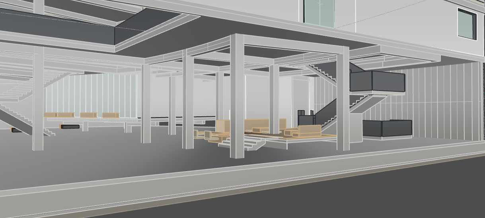

# Rhino Almond

## Rhino 편집

Almond MCP로 Rhino 건축 모델을 조회·편집하고 도면을 작성한다. 아래 도구명은 공통 이름이며, COS에서는 연결별 `connection_id`를 함께 전달한다. 인자는 현재 연결에 노출된 schema를 따른다.

## 목차

- [Rhino 편집](#rhino-편집)
- [프로젝트 기본 구조](#프로젝트-기본-구조)
  - [프로젝트·문서·파일](#프로젝트문서파일)
  - [Phase → Task → Step](#phase--task--step)
  - [Scene·ontological-component·Instance](#sceneontological-componentinstance)
- [기본 작업](#기본-작업)
  - [템플릿·재료·구축 레이어](#템플릿재료구축-레이어)
  - [조회·화면 도구](#조회화면-도구)
- [모델링](#모델링)
  - [형상 편집·설계 자료](#형상-편집설계-자료)
  - [모델링 검수](#모델링-검수)
  - [구조 검토](#구조-검토)
- [Drafting](#drafting)
  - [도면 표현](#도면-표현)
  - [도면 검수](#도면-검수)
- [거의 사용하지 않는 기능](#거의-사용하지-않는-기능)
  - [Grasshopper](#grasshopper)
  - [자산 목록·검색](#자산-목록검색)

## 프로젝트 기본 구조

### 프로젝트·문서·파일

같은 폴더의 여러 `.3dm`이 하나의 프로젝트이며 `.almond/DB`를 공유한다. **Rhino 편집 대상은 활성 문서만**이다. Worksession의 attached/reference 문서는 조회만 한다.

프로젝트·현재 파일은 `project_info`로 확인한다. DB 기록은 도구가 저장하고, 작업자료는 Task를 선택하면 `tmp/YYMMDD_작업명`에 관리된다. 관리 도구에는 프로젝트 상대경로를 전달하면 되므로 TEMP나 절대경로를 따로 조립하지 않는다. Rhino 모델의 `.3dm` 저장은 DB 기록과 별개다.

| 도구 | 입력 | 할 수 있는 일 |
| ------- | ----- | ----- |
| `project_info` | 필요한 `sections`: project, document, artifacts, runtime, instructions | 프로젝트 루트·파일명·공유 DB·현재 문서·작업자료 위치 조회. document에 live 확인이 포함된다. |
| `set_working_plan` | `plan_id`, 선택적 `step_id`, `artifact_name` | Task의 작업자료 폴더 선택·재사용. |
| `rename_artifact_folder` | `name`, 선택적 `plan_id` | 작업자료 폴더와 관련 참조를 함께 변경. |
| `execute_project_python` | `code`, 선택적 `timeout_seconds` | 선택한 작업자료 폴더에서 Python 실행. Rhino 형상 편집용 도구는 아니다. |

### Phase → Task → Step

**Phase는 작업 묶음, Task는 수행할 과업, Step은 과업 내부 단계**다. 현재 API에서 Task의 이름은 `Plan`이고 ID는 `plan_id`다. 진행 중이거나 중단된 작업을 조회해 이어서 사용할 수 있다. 상태는 `pending`, `running`, `paused`, `completed`, `failed`, `blocked`다.

Task의 상위 Phase는 `phase_id`로 지정한다. 관련성은 **Phase에는 Phase, Task에는 Task**를 기록하며, 같은 프로젝트의 다른 파일에 속한 항목도 참조할 수 있다. Task 간 참조는 `depends_on` 배열에 기록한다. Phase에는 전용 관계 필드가 없으므로 `description`에 관련 Phase ID를 적는다. 관계 기록은 참고용이며 실행 순서나 자동 완료를 강제하지 않는다.

| 도구 | 입력 | 할 수 있는 일 |
| ----- | ----- | ----- |
| `list_phases` | 선택적 `limit` | 프로젝트의 Phase 목록 조회. |
| `get_phase` | `phase_id` | Phase 설명·파일명·소속 Task 수 조회. |
| `create_phase`  | `name`, 선택적 `description`, `file_name` | Phase 생성. |
| `update_phase`  | `phase_id`, 바꿀 `name`, `description`, `file_name` | Phase 정보 수정. |
| `list_plans` | 선택적 `phase_id`, `scene_id`, `status`, `limit` | 조건에 맞는 Task 목록 조회. |
| `get_plan`| `plan_id`, 선택적 `revision` | Task·Step의 대상·상태·기록 조회. |
| `create_plan`| `goal`, `scope`, 선택적 `phase_id`, `scene_ids`, `component_ids`, `depends_on` | Task와 기본 Step 생성. scope는 house, interior, structure, drawing, component. |
| `update_plan`| `plan_id`, 바꿀 목표·참조·상태·`artifact_refs`, `expected_revision` | Task 정보와 진행 기록 수정. |
| `update_step`| `plan_id`, `step_id`, `status`, 선택적 입출력 참조·대상, `expected_revision` | Step의 진행·중단·결과 기록. |
| `resolve_targets`  | `plan_id`, 선택적 `step_id` | Task 또는 Step이 가리키는 ontological-component·문서·group 확인. |
| `list_plan_revisions` | `plan_id`, 선택적 `limit` | Task의 저장된 변경 이력 조회. |

Task의 `scene_ids`는 맥락, `component_ids`는 편집 대상이다. Step의 대상이 `null`이면 Task 대상을 상속하고 `[]`이면 대상이 없다. 수정에는 조회한 `revision`을 `expected_revision`으로 전달한다. 상태·참조 기록은 형상 실행과 별개다.

### Scene·ontological-component·Instance

Scene은 행태·프로그램·장면의 맥락이고, ontological-component는 그 장면을 가능하게 하는 건축 요소와 의미의 묶음이다. ontological-component는 특정 Scene에 종속되지 않으며 여러 Scene에 참여하거나 아직 연결되지 않은 상태도 가능하다. Scene에는 ontological-component 밖의 객체도 직접 연결할 수 있다. Almond Instance는 별도의 자산 배치 기록으로, 이 셋이 필수적인 부모·자식 위계를 이루는 것은 아니다.

#### Scene

Scene은 특정 공간에서 일어나는 **행태·프로그램·장면·가치**다. 파일 전체를 Scene 하나로 치환하지 않는다. Scene의 `file_name`을 필요할 때 조회해 현재 활성 파일과 대조한다. 이 필드는 작업 문서의 안내 정보이며 파일을 이동하거나 문서를 자동 전환하지 않는다.

| 도구 | 입력 | 할 수 있는 일 |
| -- | ----- | --- |
| `get_design_scene` | `scene_id` | Scene의 이름·파일명·연결 정보 조회. |
| `create_design_scene` | `name`, 선택적 `units`, `file_name` | Scene 생성. |
| `update_design_scene` | `scene_id`, `file_name` | 기존 Scene의 파일명 기록. |
| `register_scene_objects` | `scene_id`, 최상위 `object_ids`, `mode`: add/remove/replace | ontological-component 없이 객체를 Scene에 직접 연결·해제.|
| `get_scene_objects`| `scene_id` | 직접 연결 객체와 하위 ontological-component 객체의 합집합 조회. |

현재 전체 Scene 목록·삭제 도구는 없다. 기존 Scene ID는 작업 맥락과 연결 기록에서 찾는다. 등록 정보 변경에는 공개 도구를 사용한다.

#### ontological-component

ontological-component는 **건축 요소와, 그 요소들이 함께 가능하게 하는 사용·행태·구조적 역할을 묶은 의미 단위**다. 무엇을 만들었는지와 그 묶음이 무엇을 가능하게 하는지를 함께 설명할 수 있어야 한다. 객체 종류·재료·거리만으로 경계를 정하지 않는다. 예를 들어 창문 하나를 일률적으로 ontological-component로 등록하는 대신, 바깥 풍경을 보며 머무르는 장소를 만드는 벽·창문 등의 관계를 보고 묶는다.

이렇게 정한 객체들을 한 `.3dm` 안에서 Rhino group으로 정의하고 ontological-component로 등록한다. **일반 group이 자동으로 ontological-component가 되는 것은 아니다.** 그 의미 단위를 구현하는 내부 구축 시스템·부재·element는 일반 group이나 block으로 정리한다. 이 내부 묶음은 조립·반복·선택·편집을 위한 것으로, 그 자체를 별도 ontological-component로 등록할 이유가 되지는 않는다. **ontological-component는 건축 요소와 의미를 함께 정의하고, 내부 group/block은 그 실물의 구축·모델링 구성을 정리한다.**

작은 계단참과 마루에서 사람들이 머물고 교류하는 행태가 Scene이다. 그 Scene을 이루는 ontological-component는 다음처럼 **실물 구성과 그것이 가능하게 하는 것**을 함께 갖는다.

| ontological-component | 함께 구성하는 요소와 의미 |
|---|---|
| 마루 위 공간을 지지하는 구조 | 기둥·보 여러 개가 함께 위에서 오는 하중을 지지한다. 기둥마다 따로 등록하지 않는다. |
| 사람들이 걸터앉는 마루·계단참 | 지지 콘크리트와 마루 마감이 함께 단차와 앉을 자리를 만든다. 마루라는 실물이면서 걸터앉을 수 있게 하는 장치다. 공유 바닥슬래브 전체를 포함할 필요는 없다. |
| 마루에서 바둑 두는 가구 묶음 | 방석·낮은 탁자·바둑판·바둑알과 통·시계 등이 함께 앉아서 바둑 두는 행위를 가능하게 하고 유도한다. 가구 하나씩 나누지 않고, 그 행위와 사용 관계로 묶는다. |

지붕의 의미에는 덮는 역할과 함께 집수·배수가 이어진다. 우수관이 여러 층을 지나거나 기둥 속 콘크리트에 매립돼 있어도 그 역할이 이어지므로 지붕 ontological-component에 포함한다. 지붕 안의 구축 시스템과 우수관 element들은 일반 group으로 나눠 관리할 수 있다. **물리적으로 떨어져 있어도 하나의 역할을 이루면 같은 ontological-component가 될 수 있다.** 두 사례의 [사용자 설명 원문과 사진](features/guidance/guides/references/component-feedback.md)은 별도로 보존한다.

| 도구 | 입력 | 할 수 있는 일 |
| --- | ----- | -- |
| `list_ontological_components`  | 선택적 `include_ids` | 연결 문서의 등록 ontological-component 목록 조회. |
| `get_ontological_component` | `component_id`, 선택적 `live=True` | 저장 정보 또는 실제 group·멤버·미등록 후보 조회. |
| `upsert_ontological_component` | `name`, 직접 소유 `object_ids`, `scene_ids`, 선택적 기존 ID·group GUID·`child_component_ids` | ontological-component 생성·구성 변경·기존 group 채택. |
| `sync_ontological_component`| `component_id`, 선택적 `rhino_group_id` | 실제 group에 맞춰 멤버십·등록 정보를 정합.  |
| `remove_ontological_component` | `component_id` | ontological-component 등록 해제. 형상과 group은 유지. |

현재 등록 API는 빈 `scene_ids`를 거부한다. 이는 위의 의미 정의와 별개의 구현 제약으로, Scene 미연결 ontological-component 등록은 아직 지원하지 않는다.

일반 조회는 DB snapshot이다. 수동 편집·Undo/Redo 후에는 필요한 ontological-component를 `live=True`로 확인하고 sync한다. 기존 정보 수정 시 생략한 인자는 유지되며 `child_component_ids=[]`는 자식 분리다.

#### Instance

Almond의 Instance는 **자산을 Scene의 어디에 어떻게 배치했는지 기록한 DB 항목**이다. `instance_id`로 식별하고 자산 `asset_id`, 위치·회전·축척, 선택적 Rhino 객체 `rhino_guid`를 저장한다. Rhino block instance는 실제 모델 안의 블록 배치 객체이므로 서로 다른 개념이다. DB 배치 기록만으로 Rhino 객체가 생성되는 것도 아니다.

Almond Instance와 Room은 기존 자산 배치 검사에 남아 있는 기능이며 현재 기본 작업에서는 사용하지 않는다. Rhino block의 재사용·편집은 아래 Block 항목을 따른다.

## 기본 작업

### 템플릿·재료·구축 레이어

`setup_modeling`은 재료 라이브러리의 `manifest.json` 레시피로 Rhino 재료를 등록하고, 구축 시스템에 맞는 레이어·기본 재료·색을 준비한다. 재료 준비는 `operation="materials"`, 레이어 준비는 `operation="layers"`로 실행한다. 재료 ID나 레시피가 필요하면 `list_materials`로 조회한다.

| 도구 | 입력 | 할 수 있는 일 |
|---|---|---|
| `setup_modeling` | `operation="materials"` 또는 `"layers"`; materials에만 선택적 `overwrite` | PBR 재료 일괄 등록 또는 `M::category::system.name::element.role` 레이어·기본 재료·색 준비. |
| `list_materials` | 선택적 `category`, `query` | 재료 ID·이름·PBR 레시피 조회.|

### 조회·화면 도구

ID가 필요한 조회에는 `include_ids=True`를 사용한다. 이미 프로젝트 정보에서 확인한 문서를 같은 목적으로 다시 조회할 필요는 없다.

도면·유닛의 위치나 작업 시점이 불명확하면 질문 전에 `get_rhino_viewport_image(view="a")`로 기존 Named View·Layout을 먼저 찾는다. 선택한 GUID를 캡처해 표제와 실제 대상·주변 관계를 대조한다. 이름만으로 범위를 확정하거나 조회를 위해 새 Named View를 만들지는 않는다.

| 도구 | 입력 | 할 수 있는 일 |
| ---- | ---- | --- |
| `get_rhino_context`  | `sections=["selection"]` 또는 `["viewport"]`, 선택적 `selection_limit` | 현재 선택 객체 또는 카메라·화면 정보 조회.|
| `get_selection_references` | 선택적 `selection_limit`, `limit` | 선택 객체에 연결된 ontological-component·Task·Step 역조회. |
| `get_rhino_probe` | 아래의 `probe`와 `options` | 형상·블록을 읽기 전용으로 관찰·측정.  |
| `get_rhino_viewport_image` | 현재 화면은 생략, 목록은 `view="a"`, 지정 뷰는 `view=GUID`; 선택적 `scale_percent` | viewport·Named View·Layout 목록 또는 PNG 캡처. 기본 크기 75%, 도면 검수 100%. |
| `focus_components`| `component_ids` | 해당 ontological-component 선택·격리·확대. 화면 상태가 바뀐다. |

`get_rhino_probe`의 옵션은 아래와 같다. 좌표·길이·공차는 현재 문서 단위다. 반환의 `unknown`·미지원·`truncated`는 미확인 범위이며 0이나 통과를 뜻하지 않는다. 범위가 잘리면 대상·표본을 나눠 조회한다.

| probe 값  | options에 넣을 입력  | 알 수 있는 것|
| ----- | ----- | ----- |
| `outline` | `ids` 또는 `path`; 생략 시 `scope`: selected/viewport/document. 선택적 `depth`, `include_geometry`, `annotations` | 객체·중첩 블록 경로·누적 변환·TextDot 주석과 동명 대상. |
| `resolve-block`  | `path=[최상위 GUID, 내부 멤버 GUID, ...]` | 현재 편집 단계에서 선택 가능한 블록 후보. |
| `sections` | `ids`, `axis`: X/Y/Z, `stations`; 선택적 `sample_points` | 지정 좌표의 절단 곡선 수·길이·bbox·표본점. Brep·Mesh·Extrusion 지원.|
| `vertical-probe` | `ids`, `xy=[[x,y],...]`; 선택적 `z_min`, `z_max`는 함께 지정 | 표본 수직선의 교차 Z와 닫힌 형상의 채움·중복 구간. 열린 형상은 교차점만 반환. |
| `joint-pairs` | `pairs=[[GUID_A,GUID_B],...]`; 선택적 `tolerance`, `compare_operations`, `max_pairs` | 유효 닫힌 최상위 Brep·Extrusion 쌍의 교차체적과 선택적 Join/Union 결과. |

#### Block·주석

Rhino block instance는 하나의 형상 정의를 위치·회전·축척별로 배치한 객체다. 정의를 수정하면 이를 사용하는 모든 배치에 반영된다. ontological-component에 블록을 포함할 때는 정의 내부 객체 대신 최상위 배치 GUID를 등록한다.

중첩 구조는 `get_rhino_probe(probe="outline", options={"ids":[최상위_GUID], "depth":깊이})`로 재귀 조회한다. 경로는 최상위 배치에서 내부 멤버로 이어지며, 누적 변환으로 문서 좌표를 읽는다. 내부 GUID와 현재 선택 가능한 객체 ID는 다를 수 있다.

BlockEditNew에서는 부모를 연 뒤 `resolve-block`에 `path`를 한 단계씩 늘려 편집 후보를 확인한다. 정의 저장·멤버 교체 뒤에는 경로를 다시 조회한다. TextDot의 동명 대상은 같은 정의 안에서 찾고 주변 관계와 함께 읽는다.

의미와 편집 목적에 맞춰 block을 생성·재사용하거나 Explode할 수 있다. block/group이라는 이유만으로 항상 보존하거나 항상 해체하지 않는다. 반복 실물의 블록 이름은 `UNIT A`처럼 특정 배치에 고정하지 않는다. 폴딩도어 실물과 개폐 궤적은 구별하며, 문짝·프레임은 재사용 block으로, 함께 설명할 사용 관계는 일반 group으로 구성할 수 있다.

등록된 객체를 block으로 교체하거나 해체하기 전에는 현재 직접 소유 객체·영속 group GUID와 관련 등록을 확인한다. 등록 정보를 담은 원본 객체를 먼저 삭제한 뒤 sync만 하면 복구된다고 가정하지 않는다. 현재 공개 API가 지원하는 전환 순서와 교체 후 live 정합을 확인하고, 안전한 전환이 지원되지 않으면 도구 개선 대상으로 남긴다. DB나 소유권 UserString 직접 삭제로 오류를 우회하지 않는다.

#### Group

일반 group은 선택·편집 편의를 위한 객체 묶음이다. 내부에 일반 group·block을 둘 수 있고, 멤버십이 겹칠 수도 있다. group의 겹치는 멤버십과 block 정의의 중첩은 다르다. 블록 내부 중첩은 위의 `outline` 재귀 조회와 `resolve-block` 경로 조회를 사용한다.

등록 ontological-component의 부모 group에는 자손 객체도 포함되지만 직접 소유권은 자식에 남는다. 자식을 해제하려면 부모에서 먼저 분리하고, 부모를 해제하면 자식은 root로 남는다. 객체는 저장된 모델 경로+GUID, group은 영속 group GUID로 식별한다. ontological-component group은 의미 있는 이름을 쓰고 객체 Name은 필요할 때만 채운다.

## 모델링

### 형상 편집·설계 자료

구축 시스템의 구성 요소·재료는 `get_construction_guidance`로 확인한다. 시스템을 하나의 단순 형상으로 표현하면 해당 시스템 레이어에 두고, 실제 부재·마감을 따로 모델링하면 `M::분류::시스템명::요소역할`의 대응 하위 레이어에 둔다. 예를 들어 따로 만든 마감 객체와 구조 객체는 각자의 역할 레이어로 구분한다. 재료명·해시마다 별도 Custom 레이어를 만들지 않는다.

`assign_material`은 지정한 객체의 재료를 바꾸며 레이어는 이동하지 않는다. ByLayer로 표현하려면 객체의 재료·색 source를 ByLayer로 설정하고 해당 레이어의 재료·색을 맞춘다. 개별 재료를 직접 지정하는 방식과 구분해 적용한다. 층 정보는 실제 프로젝트 레벨을 확인해 `floor`에 전달하며 자동 추정되지 않는다. 지원 메타데이터 키는 `get_modeling_policy`에서 확인한다.

| 도구 | 입력 | 할 수 있는 일 |
| ------- | ------- | ----- |
| `execute_rhino_script`| `script` | Rhino 형상·속성을 편집하는 C# 실행. 조회는 앞의 전용 도구를 사용. |
| `get_typology_narrative` | 검색어, 선택적 construction_system·structure_type | 유형·설계 근거의 서술 자료 조회. |
| `search_detail_sources`  | `query` | 구축 상세의 참고 출처 검색. |
| `get_construction_guidance` | 검색어, 선택적 category·material·structure_type·span_m | 구축 시스템·요소·권장 재료와 예비 설계 지침 조회. |
| `get_modeling_policy` | 없음 | 현재 재료·레이어·메타데이터 규칙 조회. |
| `assign_material`  | 객체 `guids`, `material_id`, 선택적 floor·구축 참조·적용 플래그 | 기존 객체에 재료·선택한 메타데이터 적용. 객체 레이어는 유지. |

### 모델링 검수

요청 범위의 실제 이미지를 열어 사용 관계와 구축을 확인한다. 필요한 눈높이 Perspective·평면·종횡단면을 선택하고, 재사용할 시점은 Named View로 남긴다. 절단은 실제 clipping plane으로 준비하며 평·단면은 설치된 `AGENT_Section_Glass` 등 적합한 모드를 사용한다. 캡처 도구 자체는 절단·모드를 설정하지 않는다.

검증에는 MCP의 관찰·캡처를 사용하며 computer use를 검증의 우회 수단으로 호출하지 않는다. 저장 명령 성공, 저장 후 `modified` 표시, 실제 저장본 확인은 구별한다. 표시가 남으면 저장 이후 변경·확인하지 못한 상태를 보고하며, 표시를 강제로 지워 검증 성공으로 만들지 않는다.

ontological-component의 의미와 함께 내부·인접 요소의 지지·연결·두께·높이·마감·배수를 본다. 특히 마감/슬래브, 후레싱/벽, 지붕/우수관의 의도하지 않은 중첩을 단면·확대와 수치로 대조한다. 수정한 곳은 같은 조건에서 다시 확인하고 미검사 범위는 구분해 보고한다.

| 도구 | 입력 | 할 수 있는 일 |
| - |  | -- |
| `get_component_intersections` | `component_ids`, 선택적 `max_pairs` | ontological-component 내부·인접 객체 쌍의 교차 검사. 유효 닫힌 최상위 Brep·Extrusion 지원. |
| `check_egress` | `plate_bounds_mm`, `exits`, 용도·층수·피난 조건  | 출구 수·분리·폭·이동거리 검토. |

교차 검사는 한 번에 1–32 ontological-component·최대 512 객체·64 후보쌍이다. `complete`·미지원 객체·미평가 쌍을 확인한다. 블록·Mesh·열린 형상은 이 검사로 검증되지 않는다. bbox 겹침은 실제 관입이 아니며, 교차체적 0도 접합 적합성을 보장하지 않는다.

### 구조 검토

명시한 부재·재료·하중·지지 조건으로 구조를 검토한다. 응답의 engine·해석 수준을 확인하며, `rule_based/low` 결과는 FEA 결과와 구분한다.

| 도구 | 입력 | 할 수 있는 일 |
|---|---|---|
| `list_design_codes` | 선택적 `include_ids` | 지원 구조 설계 코드 목록 조회.|
| `validate_structure` | 객체 `guids`, 구조 형식·재료·하중·지지·해석 조건 | 구조 검토 실행·이력 기록. 응답의 engine·해석 수준 확인. |
| `visualize_structure`| 대상·해석 조건, 선택적 표시 설정 | 구조 검토 결과를 Rhino 화면에 표시. |
| `export_structural_report` | 선택적 `path`, `limit`  | 구조 검토 이력 보고서 출력.|

## Drafting

### 도면 표현

기존 Layout·PageSpace·Detail을 기준으로 필요한 도면을 편집한다. Sheet DB 등록 기능은 현재 제공하지 않는다.

2D 곡선이 재귀 Explode로 선분이 됐다면 같은 실물·표현 역할의 연속 선분을 식별하고 Join 필요성을 판단한다. 문서 공차·끝점·열림/닫힘·분기·중복을 확인하고, 결과의 곡선 수·형태와 비대상 선 보존을 대조한다. 근접한 선 전체를 일괄 Join하거나 개폐 궤적을 문짝 윤곽에 섞지 않는다. 전용 Join 도구는 없으므로 현재 일반 스크립트의 변경 경로를 사용하고 결과를 확인한다.

| 도구| 입력 | 할 수 있는 일|
| --- | ---- |  |
| `list_drawing_recipes` | 선택적 `include_ids` | 도면 표현 recipe 목록 조회. |
| `get_drawing_recipe`| `recipe_id` | recipe의 레이어·색·선종류·출력두께 조회.|
| `apply_drawing_style`  | `recipe_id` | recipe에 따른 Rhino 도면 레이어·출력 속성 적용. |
| `import_drawing_hatch_patterns` | `asset_id`  | 선택한 해치 패턴을 문서로 가져오기.  |

### 도면 검수

뷰 목록에서 Layout GUID를 골라 용지와 Detail을 캡처한다. 용지 크기·축척·선두께·선종류·해치·문자와 치수의 가독성·잘림을 확인한다. 정적 도면의 축척은 이름으로 추정하지 않는다. 파일을 출력했다면 출력본도 열어 확인하고 수정한 부분을 다시 검수한다.

## 거의 사용하지 않는 기능

### Grasshopper

| 도구| 입력| 할 수 있는 일|
| --- | --- | --- |
| `list_library`| 선택적 `include_ids`| Grasshopper 로직 목록 조회. |
| `get_logic_by_id`| `logic_id` | 로직 원형·설명 조회. |
| `list_capsules`  | 선택적 `capability`, `audited_only=True`  | 실행 가능한 audited capsule과 입출력 port 확인.  |
| `run_gh_definition` | `capsule_id`, port 계약에 맞는 `inputs`, 선택적 `seed`, `timeout_s` | audited capsule 실행. 정의에 따라 Rhino에 bake할 수 있다. |

### 자산 목록·검색

Drawing 자산은 준비된 3DM, Diagram 자산은 도식용 자료다. [등록·생성·배치·교환·외부 발행·카메라 경로 작업](features/guidance/guides/references/asset-workflows.md)은 해당 작업을 할 때만 읽는다.

| 도구| 입력  | 할 수 있는 일  |
| --- | -- | -- |
| `search_asset_repository` | `query`, 선택적 `kind`, `drawing_ready`, `limit` | 통합 자산 후보 검색. |
| `list_drawing_assets`  | 선택적 `category`, `limit`, `offset`| Drawing 자산 목록 조회. |
| `search_drawing_assets`| 검색어·분류·최대 치수 조건  | 크기와 용도에 맞는 Drawing 자산 검색.  |
| `get_drawing_asset` | `asset_id`| 3DM 가용성·측정 치수·메타데이터 조회.|
| `get_asset_drawing` | `asset_id`| 자산의 평면·정면·측면 도면 파일 목록 조회. |
| `list_diagram_assets`  | 선택적 `category`, `limit`, `offset`| Diagram 자산 목록 조회. |
| `search_diagram_assets`| 검색어·분류·최대 치수 조건  | Diagram 자산 검색.|
| `get_diagram_asset` | `asset_id`| Diagram 파일·크기·배치 조건 조회. |
| `get_retrieval_status` | 선택적 `include_ids`  | 자산 색인·검색 기능 상태 조회.  |
